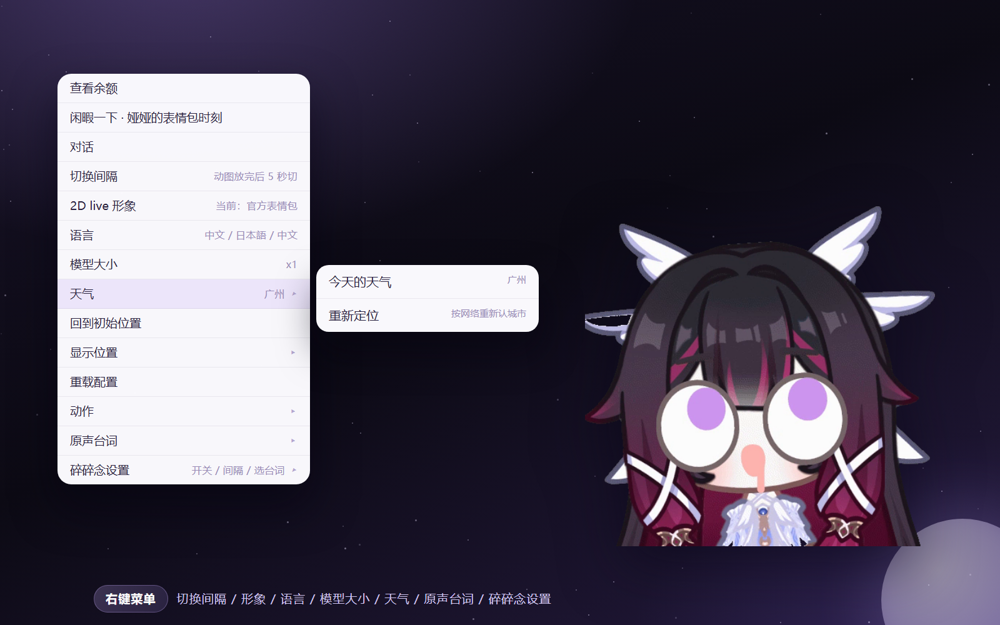
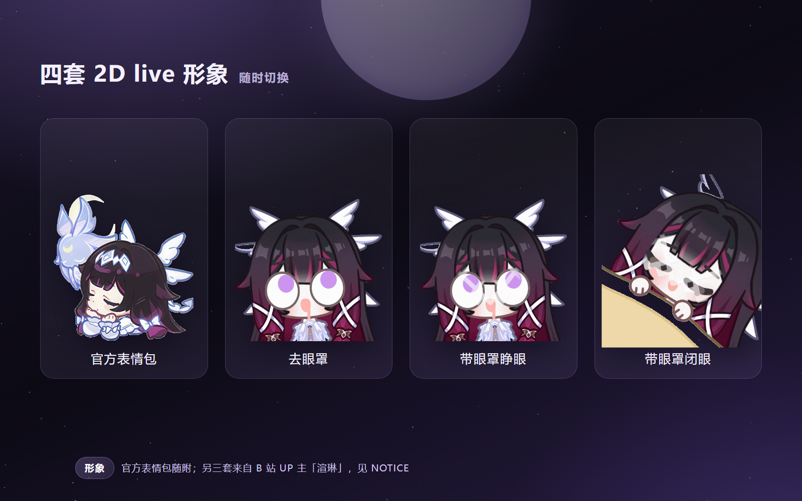
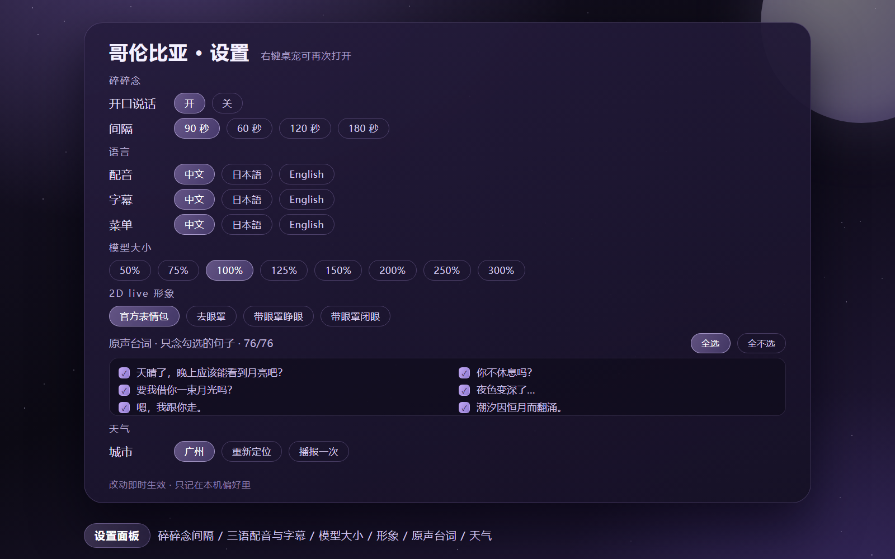

<div align="center">


# dsh-columbina-pet

**Columbina (Genshin Impact) 2D live desktop pet · DeepSeek Harness plugin**

Four sprite sets · 76 official voice lines in three languages · Weather reports · Real physics · Meme moments

<p><a href="README.md">中文</a> | <strong>English</strong> | <a href="README.ja.md">日本語</a></p>

[](LICENSE)


<br />

**Author**: [六硬币的好活](https://space.bilibili.com/1947282109) · Bilibili uid **1947282109** ｜ [GitHub @Yuanawaqwq](https://github.com/Yuanawaqwq)

</div>

---

## What this is

Columbina — "Damselette", Third Seat of the Fatui Harbingers in Genshin Impact — living on your DeepSeek Harness desktop: she floats above every other window, swings with real physics when you drag her, speaks softly according to the time of day and the scene, recites her official voice lines in her own voice, and reports today's weather.

This repository is the **2D-only fork** of [dsh-pet](https://github.com/PC2005-cloud/dsh-pet) (MIT): it keeps and deepens the 2D live sprites, voice lines, menus and physics, **removes the upstream 3D sprite switching, which was never finished**, and adds weather reports along with the docs, placeholders and copyright notes an open-source release needs.

> 中文简介：一款跑在 DeepSeek Harness 上的《原神》哥伦比娅 2D live 桌宠——四套形象、76 句中 / 日 / 英官方原声台词并配同步字幕、天气播报与真实物理。上游的 3D 模式已被特意移除。素材授权见 [NOTICE.md](NOTICE.md)。

## What comes next

Let me put the expectations up front:

- **The feature set is basically settled.** I won't keep piling on new features. From here the work is two things: keeping up with new DeepSeek Harness releases (fix whatever an API change breaks, and update the compatibility declaration with it), and continuing to smooth out what already exists — performance, stability, and the small rough edges in the interaction.
- **If you want a feature, come and ask.** DM [六硬币的好活](https://space.bilibili.com/1947282109) on Bilibili (uid 1947282109); or do it yourself — the project is MIT, and merging it back is welcome (a PR is fine, and if you're not familiar with the flow you can just show me the diff first).
- **If you hit a bug, do come and tell me to fix it.** This one has the highest priority — don't sit on it, and don't hack around it yourself. When reporting, include as much as you can: DSH version + plugin version (the `version` field under "Health check" below), the symptom and the steps to reproduce, and the lines containing `[dsh-pet]` from the F12 console or the logs.

## Preview

| Desktop mode | Context menu |
| :-: | :-: |
|  |  |

| Four 2D live sprite sets | Settings panel |
| :-: | :-: |
|  |  |

## Release notes

> Version-by-version details live in [CHANGELOG.md](./CHANGELOG.md); downloadable packages are on [Releases](https://github.com/Yuanawaqwq/dsh-columbina-pet/releases). Every release gets a section here explaining **what changed and whether you need to touch your settings**.

### 1.2.4 · 2026-11-16

> This release **does not touch sprites, voice lines or add features**; it does one thing — when she fails to start, the reason becomes visible. **No settings to change**; as always, **quit DSH completely and start it again** after upgrading.

- **Root cause: the logs were there, just written where nobody reads them.** In DSH 0.2.2-rc.3 `ctx.logger` is a pino-style collector — `info / warn / error` all exist, but messages only go into its own buffer and **never reach the terminal**. The desktop app then pipes the host's stdout straight into a GUI process that has no receiver. So "the desktop pet will not start" left **zero trace**: no error, no `launch-error.json`, no `electron.exe` in Task Manager. Diagnostics now go to `console` first and are forwarded to the host logger second, each side wrapped in its own `try/catch`.
- **A log file for hosts without a terminal (optional):** set `DSH_PET_DIAG_LOG=<path>` and diagnostics are also appended to that file (`ISO time [level] message`, rotated to `.1` past 2 MB). Without the variable the plugin writes no diagnostic log.
- **Fake or truncated Electron binaries are no longer accepted:** the old check only required "a file larger than 1 MB", so a renamed big file — or a half-updated exe — passed and then failed to spawn. It now also verifies the PE header (`MZ` → `PE\0\0`, and not a DLL; **Windows only** — macOS/Linux builds use other formats and keep the old permissive check).
- **`launch-error.json` on startup failure:** a failed helper `spawn` now writes `{stage: "helper-spawn", command, message}`, same directory and shape as the existing download-failure file.
- **`DSH_PET_NO_HELPER=1`** skips Electron detection and download entirely (web-side pet still works) and prints a single line — handy to check whether the helper is what is bothering the host.

### 1.2.3 · 2026-11-16

> This release **adds no new character and changes no lines**. It fixes one thing — "after she hides herself you can no longer find her" — and, while at it, lets volume and Do Not Disturb take arbitrary values. **No setting changes are needed**; after upgrading, please **quit DSH completely and start it again** (the host half changed too).

- **"Display location → None" is no longer a one-way door**: `display: none` used to stop the web pet from rendering, keep the desktop helper from starting, and even make the tray icon disappear — nothing left on screen could be clicked, so you had to remember to go back and change it under "Settings → Columbina". There are now two safety nets: ① the top of the settings page shows a warning bar, "All desktop pets are hidden", and one click restores "Desktop only"; ② the tray now lays out four flat items (Web only / Desktop only / Both / None) with the current one checked, instead of a single checkbox where "one click dropped you from desktop to none".
- **Display changes leave a trail**: every `display` write appends a line to `~/.dsh/columbina-pet/display-changes.ndjson` (timestamp, pet id, from what to what, and the source: web menu / desktop menu / tray / settings panel / API), and `displayChanges` on `/healthz` returns the last 10. Next time she really does go missing, a single command tells you who changed it and when.
- **Volume as any value from 0 to 100 %**: alongside the five presets under "Volume" (20/40/60/80/100 %), there is now "Custom volume…", which jumps to the Volume section of the settings panel where you drag a slider — **5 % per step, applied live while dragging** (it does not cut off the line currently being spoken). The mute switch stays in the same section.
- **Do Not Disturb for any time range**: alongside the four presets under "Do Not Disturb", there is now "Custom hours…", which jumps to the Do Not Disturb section of the settings panel, where two time fields take a start and an end (to the minute). Crossing midnight still works and is marked "(spans midnight)" in the bottom-right corner.
- **The web side gets the same entry points**: the web pet's context menu also has "Custom volume…" and "Custom hours…", and its settings panel has the same Volume and Do Not Disturb sections (a slider plus two time fields); clicking a menu item scrolls straight to that section. Both sides now have feature parity, and each keeps its own settings (one copy for the desktop helper, one for the page).
- **Fixed "she vanishes entirely after switching to the web side"**: the web bundle used to open with a "run once per page" guard. When the plugin was disabled and re-enabled, or the client code was hot-updated, DSH re-executed the same bundle in live mode, the guard simply `return`ed, and `window.__ModuleLoader__.load()` was never called again — the pet was gone, and the whole "Settings → Columbina" page vanished with it. The guard now de-duplicates only during the boot queue phase (`__ModuleLoader__.mode === "queue"`), and always re-registers in the live phase; if the same id is registered twice, only the `duplicate` warning is swallowed so the page does not crash. Measured: after disable → enable, `pet` in `shell.overlay` and `pet-config` in `settings.section` are back in their slots immediately, with no page refresh needed.
- **The settings panel now has its own language**: the Language section of the settings panel has one more row, "Panel", next to "Voice / Subtitles / Menu". Pick 中文 / 日本語 / English on its own, or "Follow menu" — the panel's wording (section titles, row labels, buttons, hints) follows it, decoupled from the menu language.
- **No Chinese left behind after switching menu language**: with `menuLang` set to Japanese or English, items that were missing from the dictionary (power saver, voice pack & assets, settings-panel section titles, line categories such as "About me / About companions / Ascension thoughts / Whispers in battle / Elemental skill & burst", 75 entries in total) now have translations. Both sides share the same source, and `test-i18n-coverage.cjs` scans every Chinese label / hint / placeholder in the source and fails if one is missing.
- **The web menu no longer falls back to the initial set when Display = both**: the web menu used to test `display === "web"` before adding the voice, line and whisper branches, so with `both` the test failed and the menu only had "View balance / Chatter / Chat / Back to start / Physics / Display position / Actions". It now uses "visible on the web side" (`isWebVisible`), so under `both` the menu matches "Web only" exactly.
- **The settings panel no longer jumps on its own**: dragging the idle-chatter interval slider used to re-render the panel the moment you let go, pulling the scroll position back to the top of the current section (it looked like the UI jumped). Re-renders now keep the scroll position, the panel scrolls to a section only when you click that item in the menu, and dragging the interval no longer rebuilds the whole block.
- **Voice-line items in Japanese/English now show a title plus a body preview**: switching the menu language to Japanese or English used to leave the line submenu showing only truncated body text (`They call this a…`), so you could not tell which line was which. It now matches Chinese: the item shows that language's title (`Chat: Singing` / `世間話・歌`) and the hint shows a body preview; the settings panel's line checklist behaves the same way. Both halves share one title dictionary (76 titles × 2 languages).
- **The line preview follows the menu language too**: the preview used to come from the subtitle language, so with subtitles in Chinese and the menu in Japanese/English the titles were translated but the hint on the right stayed Chinese. It now follows the menu language (the Chinese menu still uses the subtitle language); `test-menu-i18n.cjs` builds the tree with subtitles set to Chinese and fails if any preview is still Chinese.
- **Voice-line titles now use the official in-game text**: all 76 titles come from the game text instead of our own translation — English follows the official voice-over entries (`Chat: Singing`, `About Columbina: Eye Mask`, `About the "Tri-Lunar Convergence"`, `Feelings About Ascension: Climax`) and Japanese likewise (`世間話・歌`, `コロンビーナ自身について・アイマスク`, `「三相月臨」について`, `「雄鶏」について`). When the official text groups several lines under one name (`Elemental Skill` / `元素スキル`, `Low HP` / `HP低下`), the entries read "group name + index" (`Elemental Skill · 1` / `元素スキル・1`). Exception: animation slice names (`坐牢 1`, `通知_提示 星星_收藏`, `转向`) are asset file names with no counterpart in the official text, so they keep semantic translations.
- **Japanese translation got a full review pass**: fixed 17 duplicate keys whose English value was overwriting the Japanese one (action-slice aliases showed up as `Snack / Humming / Idle` in the Japanese UI) and 17 mistranslated character-name entries (`コロンビア` → the official `コロンビーナ`), plus a round of wording clean-ups (`表示先`, `元の位置に戻す`, `オリジナルボイス`, `元素スキルと元素爆発`, `おやすみモード` …) — 37 must-fix and 27 naturalness fixes in total.
- **Small menu items are clean too**: power saver, voice pack & assets, idle actions, the 2D live model variants, volume, quiet hours, the whisper toggle and interval units all follow the menu language now, and the web half matches; a new `test-menu-i18n.cjs` builds both menu trees, so any CJK left in the English tree or any untranslated Chinese key in the Japanese tree turns the suite red.
- **Action slice names have three languages too**: every entry under the right-click "Actions" submenu and in the settings panel's idle-action list is an asset file name (`喝(饮料杯)`, `打字(恼怒)`, `通知_提示 Bits` …). They used to stay Chinese under Japanese/English; all 99 slice names (across all four skins) now have translations, and a test compares against `assets/webm` plus the pools in `voice-index.js`, so a new asset without a translation turns the suite red.
- **Idle chatter leans on official lines again**: chatter used to be "55 % a real wiki line, 45 % a fragment sliced from early short videos", which felt like the fragments were crowding out her official voice. It is now **78 % official lines / 22 % fragments**, and fragments shorter than 4 characters (things like "钱" or "问号") are skipped. To restore the old ratio, change `Math.random() < 0.78` in `voice.js`.
- **Every item in the issue report (P1 / P2 / P3) is fixed**: dragging the interval slider no longer flips the unit back to Chinese (desktop uses `panelTr('秒')`, web uses `webTr("秒")`); the three web toggle buttons ("开 / 关") and the asset button ("修复中… / 一键修复") go through `webTr`; the web interval slider and scheduler now agree on **60–180 s** (was 15–300 s, and the scheduler really did fire every 15 s); `panelJumpSection` defaults back to `false` (matching its comment and the README); the tray menu items and tooltip follow the menu language (main process re-reads `prefs.json` every 4 s); `display-changes.ndjson` rotates past 256 KB keeping the last 200 lines, and cold start reads only the last 64 KB. New `test/test-panel-i18n.cjs` (27 assertions, scans panel copy by region so ternaries and string concatenation can no longer slip through); 11 test files / 212 assertions in total. The re-review added three more checks: changing the menu language from the pet context menu now pushes `menuLang / panelLang / voiceLang / subLang` to the host through `PetShared.postAction` (the tray no longer waits for a web-side change), the host `POST /voice-prefs` clamps `intervalSec` to 60–180 (it was 15–3600), and both the push path and the host clamp are asserted.
- **The three READMEs are in sync again**: the English and Japanese versions had fallen behind in their "Development and testing" section — they still said "5 cases, 93 assertions", the requirements table lacked `0.2.2-rc.3`, and the directory tree listed `src/` and `.github/workflows/ci.yml` as package contents (they are repo-only) with Chinese comments. All three files now say the same thing in their own language: 11 files / 212 assertions itemised, rc.3 in the requirements table, and a tree that marks repo-only paths and is fully translated — same shape in every file (675 lines / 43 level-3 headings / 75 table rows).
- **Compatibility declaration extended to 0.2.2-rc.3**: `dsh.compatibility.dshReleases` gains `0.2.2-rc.3: compatible` (6 named imports, 6 service members, and the `shell.overlay` / `settings.section` slots all verified working under rc.3).

### 1.2.2 · 2026-11-09

> This release **changes none of the pet's animations, voice or temper**. It changes the parts that make "it breaks less often later": tests, CI, the compatibility declaration and the install instructions. **No setting changes are needed**, and again, after upgrading please **quit DSH completely and start it again**.

- **The tests moved into the repository**: the 93 assertions used to sit in a temp directory, and only whoever wrote them remembered how to run them. The 5 cases (idle-chatter subtitles 19 / subtitles following the audio 15 / request-body encoding 19 / Range 24 / cross-site writes 16) now live in `test/`, and `npm test` runs them all with one command — zero dependencies, no network, with its own fake DOM and fake clock.
- **Runs on every commit**: a new GitHub Actions workflow runs the syntax check and the full suite on both Node 22 and 24, so a break shows up red immediately instead of relying on someone remembering.
- **Compatibility declaration caught up with new DSH versions**: `dsh.compatibility` now lists `0.2.2-rc.1`, and the `@deepseek-ai/*` peer dependency was widened from `^0.2.0-rc.1` to `>=0.2.0-rc.1 <0.3.0` — a minor release inside 0.2.x will no longer be flagged as incompatible.
- **Harder to misread during install**: the install section of the README now says outright that "the tarball is about 148 MB; the first install takes a few minutes, don't cancel midway", so nobody mistakes it for a hang.
- **`src/` has its role spelled out**: a new `src/README.md` explains that the published artifact is `lib/` with no build step, and that `src/` is semi-synchronised reference source which drifts from `lib/` — to judge real behaviour, read `lib/`.
- **You can now diagnose problems yourself**: the README gains "Troubleshooting" — how to line up the four numbers (version / code / voice pack / helper), which line to look at first for each symptom, and how to fix it, plus what to include in a bug report. The config paths were corrected along the way (the real directory is `~/.dsh/columbina-pet/`; the old `dsh-pet` one is migrated automatically, once).
- **Docs check-up**: the whole README was re-read against the current implementation — the custom mirror variable name (`DSH_PET_ELECTRON_MIRROR`), the example voice-pack mirror version (v1.1.4), the full context-menu table (including volume / Do Not Disturb / power saving / asset self-check / settings panel / idle animations / real physics) and the directory layout (`test/`, `docs/screenshots/`, the clip audio) all line up now; the author credit and contact details were added at the top.
- The assets and the runtime behaviour were left untouched.

### 1.2.1 · 2026-10-31

> A patch centred on "fixing the idle-chatter subtitles". **No setting changes are needed**; after upgrading please **quit DSH completely and start it again**.

- **Long subtitles no longer vanish early**: the idle-chatter subtitle used to disappear before the voice finished. The root cause was not the wording but the duration: the host asset endpoint did not return `accept-ranges`, so for an Ogg file Chromium cannot seek, `audio.duration` is reported as `Infinity`, and the old logic fell back to a fixed 3600 ms. Subtitles now follow the audio's **actual playback progress** (`timeupdate` keeps them alive), so they stay up as long as the line is being spoken and are withdrawn the instant it ends.
- **Subtitles are no longer clipped away**: the idle-chatter subtitle moved into its own overlay attached to `body` (it used to live inside `.dsh-pet-root`, where any ancestor with `transform` / `overflow: hidden` would cut a long line off entirely).
- **Subtitles follow the pet while it is dragged**: during display, `requestAnimationFrame` syncs the overlay position every frame, so a fling, a landing and an edge dock all keep up.
- **The idle-chatter rhythm is back to normal**: after setting an interval you would find that it only spoke once every ten-odd minutes — the timer was being reset along with task state. Fixed.
- **Assets can be checked on the desktop side too**: the desktop "Voice pack & assets" panel was completed — one click counts voice-pack files / animations / memes, and a missing voice pack is re-downloaded on the spot, with no need to dig through logs.
- **The web context menu now matches the desktop one**: items, order and wording are unified; the web side gains "Real physics: on / off", and the section order in the settings panel matches as well.
- **Weather report wording unified**: temperatures always carry `℃`, and the Chinese / Japanese / English phrasings are localized individually.
- **A long line is no longer cut off by the next one**: before triggering, `webAutoVoice()` checks whether the previous line is still playing — automatic sources such as warm-up / interval / gesture re-play / weather follow-up all step aside (the console prints `[dsh-pet] 碎碎念让路 来源=…`), and only you, by clicking the pet or "Voice lines", force a switch. The warm-up line is also scheduled only once per page session now.
- **Bubbles no longer show mojibake / tofu blocks**: the idle-chatter bubble once displayed as a string of diamond question marks. The root cause was that the host decoded the request body's non-UTF-8 bytes as UTF-8 (Windows console curl / PowerShell sends Chinese as GBK), and the replacement character `�` was written all the way into the bubble. The request body is now decoded strictly as UTF-8 first and re-decoded as GB18030 on failure; text containing double-conversion traces like `�` or `锟斤拷` is **never written into a bubble**.
- **Voice files support Range**: the asset endpoint now returns `accept-ranges` and supports `206` / `416`, so audio bytes can be fetched on demand and `audio.duration` yields the real value (it used to omit `accept-ranges`, and Chromium reports `Infinity` for an Ogg file it cannot seek). The `timeupdate` fallback stays, so both client versions are safe.
- **Local endpoints are no longer open to every web page**: previously all 24 routes had no origin check, so any web page could cross-site POST to `/broadcast` to stuff text into the bubble, or to `/whisper` to burn tokens. A write request is now rejected with `403 cross-site-blocked` when it carries `sec-fetch-site: cross-site` and an `Origin` from another http(s) site; same-origin pages, the `file://` desktop helper and local scripts (curl / node / python) work as before.
- **The desktop helper exits again after switching back to web mode**: `desktopModeEverActive` used to stay true forever once set, leaving 3 idle processes (about 178 MB, no window) after switching back to `web`. The helper is no longer launched when there is no desktop pet, and is restarted automatically when you switch back to desktop.
- **The voice-pack marker follows the version**: the `version` in `~/.dsh/columbina-pet/voice-pack.json` used to stay at 1.1.5 (written only during the one-time migration); it is now refreshed to the current version on every start.
- The assets are untouched (still the original 1.1.11 webm, about 147 MB); this release changes code only.

### 1.2.0 · 2026-10-31

> The development number was `1.1.12`; because the feature set reached a minor version, the release was renamed **1.2.0** (content identical to 1.1.12).

- **Idle animations are selectable**: "Idle animations" in the context menu switches between curated / all animations of the current sprite / pick your own; "Pick your own…" opens a searchable checklist in the settings panel, identical on desktop and web. The curated pool grows from 2 clips to official 9 / no-eyepatch 12 / eyes-open 12 / eyes-closed 10.
- **Idle no longer stutters**: clips containing "idle" were previously stretched into a 20-second loop (a 2.4-second official clip at ≈0.12×, i.e. 3.6 fps); they now run at a uniform 0.6×.
- **Power saving actually stops something**: the old implementation only paused `loop` videos, while idle animations play one-shot, so nothing was paused at all. Now 30 seconds without mouse movement pauses every playing video and blocks new animations pushed by the host.
- **Do Not Disturb / volume and mute / asset self-check and one-click repair / web panel parity**: see "Features" below.
- **Balance queries**: when the default model is attached to an API-key provider while this machine uses an account login, it no longer reports "missing credential DEEPSEEK_API_KEY" and instead queries the account balance.
- **The assets are untouched**: still the original 1.1.11 webm (about 147 MB); this release does **not** apply lossy compression. `scripts/shrink-webm.mjs` remains available as an optional tool.
- **`/healthz` can tell "the disk changed but nothing restarted"**: it gains `activatedBuildSha256` (the sha256 computed at the moment of activation, kept in memory) and `needsRestart` (`true` when the in-memory sha ≠ the on-disk sha). When the same version number is repackaged, `buildSha256` alone always equals the new artifact; only this pair of fields reveals that the old code is still running in memory.
- **It identifies itself at startup**: every start writes "which version, which build is running" into `~/.dsh/columbina-pet/activation.json` (`activatedAt` / `activatedVersion` / `diskVersion` / `buildSha256` / `activatedBuildSha256` / `needsRestart`) and prints `[dsh-pet] activated <版本> build <sha8>` to the host log. When the disk already holds a new version while the old one is still in memory, `needsRestart` is `true` and an extra warning is logged — no more guessing how to reach `/healthz`.
- After upgrading you need to **quit DSH completely and start it again**; every setting has a default, so no manual migration is required.

### 1.1.11 · 2026-10-30

- `/healthz` gains `activatedVersion` / `buildSha256`: a swapped package that was never restarted is visible at a glance.
- `ensure-voice` gains a 120 s total budget plus 20 s stall detection (`DSH_COLUMBINA_VOICE_STALL_MS` is adjustable).
- The npm package drops `src/`: entries 607 → 465, tarball 148.56 → 148.11 MB.
- Route path decoding is tolerant: a GBK percent-encoded path no longer turns the whole route into a 500.

### 1.1.10 · 2026-10-30

- Fixed the web "select none" that once wrote `lines` as `[0]` (speaking only the first line): a one-time host migration plus `prefsRev: 2`.
- This only affected the web-mode panel; the desktop side was always fine.

## Features

- **Four 2D live sprite sets**: `official` (official emote pack), `nochoker` (no eyepatch), `open` (eyepatch · eyes open) and `closed` (eyepatch · eyes closed). Switch them instantly under "2D live sprite" in the context menu; each set carries its own idle / click / drag / event animation tree (246 webm files in total).
- **Official voice lines in three languages**: 76 official Columbina voice lines, arranged into 94 clips in Chinese / Japanese / English. The voice language and the subtitle language are configured separately; **wherever there is audio there is a subtitle**, and a long line swaps subtitles as it plays.
- **Scene-aware idle chatter**: ten scene pools — greeting, midnight, comfort, thanks, question, play, friend, bedtime, serious, playful — drawn by the current time and recent appearance rate, never repeating back to back; the first 12 seconds after launch stay quiet.
- **Work bubbles take priority**: while a report to the user is in progress, the pet will not snatch the bubble; once its line ends, the bubble is handed back to the work status.
- **Weather reports**: "Weather → Today's weather" in the menu first gives a summary in a bubble (city, conditions, current temperature, today's range), then a beat later follows it with a fitting line in her own voice; offline it falls back to a safe line and never hangs.
- **Real physics**: dragging flings her along an arc, releasing drops her, landing bounces, and the window docks at screen edges; every parameter is configurable.
- **The menu is the settings**: switch interval, 2D live sprite, languages (voice / subtitles / menu), model scale 0.5–3×, voice-line selection and the idle-chatter switch — and the menu itself follows the language setting.
- **Moment memes**: 12 mood images (yay / hug / expect / set off / tasty / thinking / sleep / sleepy / cuddle / sing / curtain call / good night), picked by line tags and scene.
- **Volume and mute** (1.2.0, extended to 0–100 % in 1.2.3): five presets from 20–100 % under "Volume" plus one-click mute; from 1.2.3 the menu also has "Custom volume…", which opens a slider in the settings panel for any percentage. Both desktop and web have the same entry points (each keeping its own copy); a change takes effect immediately and never cuts off the line being played.
- **Three languages, and a panel language of its own** (three languages since 1.2.0; the panel became independent in 1.2.3): voice, subtitles and menu each have their own language, and lines and menus share one zh/ja/en table; from 1.2.3 the settings panel's own language can be selected separately (defaults to "follow menu"). Under Japanese or English, line entries in the menu show that language's **official line title** plus a body preview (`Chat: Singing` / `世間話・歌`), and the same applies to the line checklist in the settings panel.
- **Do Not Disturb** (1.2.0, any time range from 1.2.3): set a window (default 23:00–08:00) during which idle chatter keeps quiet; clicking "Voice lines" by hand still plays. From 1.2.3, besides the four presets you can enter any start / end time in the settings panel (to the minute, crossing midnight supported).
- **Asset self-check and one-click repair** (1.2.0): "Voice pack & assets" in the settings panel counts voice clips / animations / memes in one click, and a missing voice pack is re-downloaded on the spot — no more digging through logs.
- **Power saving** (1.2.0, off by default): after 30 idle seconds the looping idle animation is frozen, and any mouse movement resumes it immediately — easier on the CPU when the pet sits on your desktop all day.
- **Idle animations are selectable** (1.2.0): "Idle animations" in the context menu switches between curated / all animations of the current sprite / pick your own; "Pick your own" opens a searchable checklist in the settings panel (no-eyepatch 82 clips, eyepatch eyes-open 82, eyepatch eyes-closed 65, official emote pack 17), and only the ticked clips are cycled.
- **Web mode caught up** (1.2.0): the web side gains Do Not Disturb, power saving and idle animations (searchable checklist included in its settings panel), while the chatter window, volume and mute have the same entry points as the desktop and each side keeps its own copy (the desktop helper runs on `file://`, the page on http, so `localStorage` never overlapped).
- **Weather city names localized** (1.2.0): the city returned by geolocation is translated according to the subtitle language, so a Chinese UI shows "广州" rather than "Guangzhou"; English and Japanese UIs keep the local spelling.

## Feature guide

Everything here is reachable from the **context menu** or the **settings panel**; each entry below spells out "entry point / how to use it / what to watch out for".

### Sprites and animations (four 2D live sets)

- Entry: "2D live sprite" in the context menu.
- `official` official emote pack, `nochoker` no eyepatch, `open` eyepatch · eyes open, `closed` eyepatch · eyes closed; 246 webm clips across the four sets, each with its own idle / click / drag / event animation tree.
- Switching takes effect immediately and is remembered; the official set is 640×360 VP9, the other three are 500×500 VP8 + alpha.

### Voice and subtitles (official audio in three languages)

- Entry: "Language" in the context menu → set the **voice language / subtitle language / menu language** separately.
- 76 official voice lines are arranged into 94 clips; a long line swaps subtitles as playback progresses, and **wherever there is audio there is a subtitle**.
- Under "Voice lines" you can tick which lines may play (select all / select none / one by one); the choice lands in `prefs.json`.
- **Entry shape (1.2.3)**: under Japanese or English each entry shows that language's official line title (`Chat: Singing` / `世間話・歌`) plus a body preview; titles follow the in-game text, and when the game gives a group one shared title, it is written as "title + index" (`Elemental Skill · 1` / `元素スキル・1`).

### Idle chatter

- Entry: "Idle chatter settings" in the context menu.
- Ten scene pools (greeting / midnight / comfort / thanks / question / play / friend / bedtime / serious / playful), drawn by the current time and recent appearance rate, never repeating back to back.
- The interval is adjustable from 60–180 seconds (default 90); the first 12 seconds after launch stay quiet (scheduled only once per page session).
- **Subtitles (1.2.1)**: idle-chatter subtitles live in their own overlay attached to `body`, so an ancestor's `transform` / `overflow` can no longer clip them; while the pet is dragged or flung, `requestAnimationFrame` keeps them in step; the display time follows the audio's **actual playback progress** (`timeupdate`), so the subtitle is withdrawn as soon as the line ends instead of after a fixed 3.6 seconds. While it plays, F12 logs `[dsh-pet] 字幕跟音频 duration=…` and `[dsh-pet] 字幕收起（计划 …ms）`, so you can tell which branch was taken.

### Do Not Disturb (1.2.0, custom hours from 1.2.3)

- Entry: "Do Not Disturb" in the context menu. Four presets (22:00–07:00 / 23:00–08:00 / 00:00–09:00 / 01:00–10:00), crossing midnight supported.
- **Custom hours (1.2.3)**: "Do Not Disturb → Custom hours…" opens the Do Not Disturb section of the settings panel, where two `<input type="time">` fields take a start and an end (to the minute); a window crossing midnight is marked "(spans midnight)" in the bottom-right corner, and the change is saved immediately.
- This blocks **automatic idle chatter** only; clicking "Voice lines" by hand still plays, and is never muted.

### Volume and one-click mute (1.2.0, 0–100 % since 1.2.3)

- Entry: "Volume" in the context menu → mute switch + five presets 20 / 40 / 60 / 80 / 100 %.
- **Custom volume (1.2.3)**: "Volume → Custom volume…" opens the Volume section of the settings panel, where a slider runs 0–100 % in 5 % steps and applies while you drag (the panel is not rebuilt, so it does not snap back when you let go); dragging to 0 is the same as mute.
- Desktop and web share one set of settings (the same localStorage key); a change takes effect immediately and never cuts off the line being played.

### Idle animations (1.2.0)

- Entry: "Idle animations" in the context menu → curated (recommended) / all animations of the current sprite / pick your own…
- "Pick your own…" opens the **searchable checklist** in the settings panel (no-eyepatch and eyepatch eyes-open 82 clips each, eyepatch eyes-closed 65, official emote pack 17); select all / select none / restore curated are supported, and ticking takes effect immediately.
- Curated pools: official 9 / no-eyepatch 12 / eyes-open 12 / eyes-closed 10 clips, one round every 90 seconds.

### Power saving (1.2.0, off by default)

- Entry: "Power saving" in the context menu.
- After 30 seconds without mouse movement, every playing video is paused (including animations pushed by the host); moving / clicking / switching back to the window resumes them instantly.

### Weather reports

- Entry: "Weather" in the context menu → "Today's weather" (there is also re-locate).
- A bubble gives the summary first (city / conditions / current temperature / today's range), and a beat later a line in her own voice follows; offline it falls back to a safe line.
- City names are localized to the **subtitle language** (1.2.0): a Chinese UI shows "广州" rather than "Guangzhou".

### Asset self-check and one-click repair (web 1.2.0 / desktop 1.2.1)

- Entry: settings panel "Voice pack & assets" → check assets / one-click repair (the desktop context menu has this item too).
- Host endpoints: `GET <prefix>/voice/health`, `POST <prefix>/voice/repair`; they return the directory, count and size of voice clips / animations / memes, and a missing voice pack is re-downloaded on the spot.
- The desktop panel page is a `file://` origin, so these two endpoints answer with `access-control-allow-origin: *` (1.2.1).

### Balance query

- Entry: "Check balance" in the context menu (it can be set to refresh on a schedule in the config).
- It prefers the provider behind the current default model; if that provider is API-key based while this machine has no `DEEPSEEK_API_KEY`, it falls back to querying the DSH account balance (from 1.2.0) instead of just throwing "missing credential" at you.

### Web mode

- The pet inside the DSH web UI shares the same sprites, lines and menu structure as the desktop side; Do Not Disturb / power saving / idle animations / volume are all configurable on the web too, with a searchable checklist in the settings panel.
- Changes on the web side also need a **full DSH restart** to take effect.

### Pet physics

- Dragging has inertia, releasing drops her, landing bounces, and she docks at screen edges; the parameters are adjustable under `physics` in `assets/config.jsonc`.
- "Real physics: on / off" (brought to the web side in 1.2.1): switched off, releasing no longer flings or bounces her and she drops straight to the floor; desktop and web each remember their own choice (web key `columbina-physics-web-v1`).

### Multilingual menu

- The menu and panels support 中文 / 日本語 / English and follow the "menu language" setting; newly added menu items ship in all three languages too.
- The settings panel can pick its own language ("follow menu / 中文 / 日本語 / English", 1.2.3), and line categories and action slice names are trilingual as well.

## Requirements

| Item | Requirement |
| --- | --- |
| DSH | 0.2.x (0.2.1-rc.2 / 0.2.2-rc.1 / 0.2.2-rc.3 desktop builds verified working) |
| Node.js | ≥ 22.12 |
| OS | Windows / macOS / Linux |
| Electron | 43.3.0 (downloaded automatically on first run, or manually `node scripts/ensure-electron.mjs`) |

## Development and testing

- **The published artifact is `lib/`, and there is no build step**: change behaviour by editing `lib/index.js` (host half) or `lib/client.js` (web half) directly.
- `src/` is semi-synchronised TypeScript reference that drifts from `lib/` (the chatter overlay, the web-side real physics and the `data-dsh-pet-subtitle` host additions live only in `lib/`). **For real behaviour, read `lib/`** — see `src/README.md` (repo-only, not shipped in the npm package).
- Self-check commands:

  ```bash
  npm run check   # node --check lib/index.js lib/client.js
  npm test        # every case under test/: zero dependencies, built-ins only, no network
  ```

- **12 case files, 239 assertions**, all with a self-built fake DOM / fake clock / fake audio: request-body encoding 19, client boot guard 9, cross-site writes 16, dictionary coverage 8, trilingual menu tree 7, panel copy 27, Range 24, panel interaction 32, web/desktop parity 36, subtitles following audio 15, chatter 19, diagnostics and binary validation 27. CI runs them on Node 22 and on 24 (`.github/workflows/ci.yml`, repo-only, not shipped in the npm package).
- Before a release, also run `node scripts/check-voice-asset.mjs`: the voice pack is an external asset, so confirm in advance that it is still online.

## Package size: why it is this big, and how to shrink it

In one sentence: **more than 90% of the size is the animation videos of the four 2D live sprite sets**, and the code adds up to about 1.4 MB. The voice pack (33 MB) has been external since 1.1.5 and is not in the package.

### Size breakdown (measured on 1.2.2)

| Component | Size | Notes |
| --- | --- | --- |
| `assets/webm` | **145.6 MB** | 246 clips of 500×500 video with an alpha channel: idle, click feedback, mishap scenes, balance notice, movement |
| `assets/fonts` | 3.9 MB | Shangshou Gummy font (used by subtitles and bubbles) |
| `assets/memes` | 1.4 MB | 12 "moment memes" (static images) |
| `assets/pic` + `logo.png` | 0.5 MB | Preview images and the plugin icon |
| `lib` + `runtime` | about 1.4 MB | Host and renderer code (`lib` 968 KB, `runtime` about 0.5 MB once the clip audio is excluded) |
| Voice pack | **0 (external)** | 76 lines × Chinese/Japanese/English audio, about 33 MB to download and about 25.9 MB on disk, fetched in the background on first launch into `~/.dsh/columbina-pet/voice/official` |

The webm files, split by sprite:

| Sprite | Clips | Size |
| --- | --- | --- |
| No eyepatch | 82 | 52.1 MB |
| Eyepatch · eyes open | 82 | 52.1 MB |
| Eyepatch · eyes closed | 65 | 39.1 MB |
| Official emote pack | 17 | 2.2 MB |

### Why it is this big

1. **They are video, not vector art**: each clip is a 500×500 WebM with alpha (VP8 plus an alpha side channel). In a browser, the formats that give you "alpha channel plus smooth looping" are basically the WebM family, and the price is frame-by-frame encoding — you cannot draw a person in a few hundred bytes the way SVG can.
2. **The assets ship at their original 1:1 bitrate**: these clips average **1.2–4.3 Mb/s**, while on the desktop the pet is displayed at only 160–400 px, so the bitrate is clearly excessive. Following user feedback, 1.2.0 deliberately did **not** apply lossy compression by default (edges get slightly soft), and left compression to an optional script.
3. **The four sprite sets are independent**: hair colour, outfit and expression all differ, so frames cannot be shared, which is why it is a straight 82 + 82 + 65 + 17 clips.

### How to optimize (ordered by payoff)

**① Re-encode with the bundled script (recommended, about −56%)**

```bash
FFMPEG=/path/to/ffmpeg node scripts/shrink-webm.mjs --crf 30 --backup D:/backup/webm-orig
```

- Measured locally: **143.4 MB → 62.4 MB**, VP9 + alpha preserved, mean RGB difference from the originals on the first frame **0.74/255** (invisible to the eye)
- `--crf 24` is safer: 87.3 MB; `--crf 38` is the most aggressive: about 30 MB (extrapolated at the same ratio — back up and try one clip first)
- **ffmpeg ≥ 4.4 is required** (2021 or later). Older builds drop the alpha channel outright and the pet turns into an opaque white slab; the script cannot detect this, so before replacing anything, decode one frame and check that the alpha of the four corners is 0
- Files are replaced in place by default, and files that fail are left untouched; the 17 official emote clips are VP9 without alpha, and the script skips them automatically

**② Keep only the sprites you use**

Delete the `assets/webm/<前缀>*` you do not use and save directly according to the table above: keeping only the official emote pack is about 2.2 MB, official + one set about 54 MB. After deleting, also remove the matching `skins[]` entries in `runtime/electron-helper/voice/voice-index.js`, otherwise the context menu still offers a sprite set with no assets.

**③ Externalize the assets and share them across installs**

The host supports an external asset root at `~/.dsh/columbina-pet/assets`: a file of the same name there **takes precedence** over the bundled one (check `assets.externalActive` / `assets.externalFileCount` on `/healthz`). Move `assets/webm` there and delete it from the package, and you get "code upgrades with the package, assets kept in a single copy".

**④ Choose how you install**

- Plugin marketplace / `npm i dsh-columbina-pet`: downloads only the tarball (148 MB), without the git history
- `git clone` from source: the repository carries the full history and is bigger than the tarball; you also have to pull upgrades yourself
- On upgrade npm fetches the whole package again (much faster on a local cache hit), so externalizing the assets pays off most if you upgrade often

## Installation

> ℹ️ **It can coexist with upstream `dsh-pet`** (since 1.0.4): this plugin's route prefix, bridge scheme, user directory and session identity have all moved into the `dsh-columbina-pet*` namespace, so it no longer competes with upstream for `/dsh-pet-7340`. For compatibility with old bookmarks it still tries to register the old prefix, and silently skips it when upstream has claimed it.

> 📦 **The first install takes a while**: the package contains the animation videos of four 2D live sprite sets, and the tarball is about 148 MB (about 161 MB unpacked). Taking a few minutes to pull from GitHub or npm is normal, so do not cancel midway; after installing you still have to **quit DSH completely and start it again** before the pet runs the new code.

### Install through the DSH plugin manager (recommended)

1. Open the DeepSeek Harness desktop app → Settings → Plugins → **Add plugin**
2. Paste the repository address into the input box:

   ```
   github:Yuanawaqwq/dsh-columbina-pet
   ```

   You can also paste the full address `https://github.com/Yuanawaqwq/dsh-columbina-pet`.
3. Once installed, **quit DSH completely and start it again** (closing the window or refreshing the page does not count as a restart).
4. If the pet does not appear the first time, this machine has no Electron runtime yet: restart once more as prompted, or run it by hand

   ```bash
   node node_modules/dsh-columbina-pet/scripts/ensure-electron.mjs
   ```

### Install into a profile by hand

```bash
cd ~/.dsh/profiles/<你的 profile>
npm install dsh-columbina-pet
```

Then add it to the profile's `package.json`:

```jsonc
{
  "dependencies": {
    "dsh-columbina-pet": "^1.2.2"
  },
  "dsh": {
    "profile": {
      "bundles": [
        "@deepseek-ai/dsh-base",
        "dsh-columbina-pet"
      ]
    }
  }
}
```

**Quit DSH completely and start it again** (closing the window or refreshing the page does not count as a restart).

### Install from npm (1.2.4)

```bash
cd ~/.dsh/profiles/<你的 profile>
npm install dsh-columbina-pet@1.2.4
```

Once it is installed, add `dsh-columbina-pet` to the profile's `dsh.profile.bundles` the same way, then **quit DSH completely and open it again**.

### Install from GitHub

```bash
cd ~/.dsh/profiles/<你的 profile>
npm install github:Yuanawaqwq/dsh-columbina-pet
```

### Install from local source

```bash
cd ~/.dsh/profiles/<你的 profile>
npm install file:C:\path\to\dsh-columbina-pet
# 或 Linux/macOS
npm install file:/path/to/dsh-columbina-pet
```

> Note: the repository ships about 147 MB of 2D sprite-set motion assets (the voice pack is external and is not in the repo; the sprites still use the original 1.1.11 assets with no lossy compression), the npm tarball is about 148 MB and about 161 MB unpacked. If you want to slim it down yourself, run `node scripts/shrink-webm.mjs`: it re-encodes to VP9+alpha, and at crf 24 we measured 143.4 MB → 87.3 MB, with a mean first-frame RGB difference of 0.5/255 and a maximum transparent-edge difference of 4/255 — you cannot see the difference. A direct connection to the registry can be slow from mainland China; when the network is poor, prefer GitHub or the Release attachments, or use the mirror recipe below to speed things up.

### Faster networking in mainland China (optional)

First check which route is faster for you (a smaller number is faster):

```bash
curl -o /dev/null -s -w 'github %{time_total}s
' https://github.com
curl -o /dev/null -s -w 'npmmirror %{time_total}s
' https://registry.npmmirror.com
```

If `github` is clearly slower than `npmmirror`, go through the mirror below:

| Step | Regular address | Mainland-China mirror form |
| --- | --- | --- |
| Plugin install | `github:Yuanawaqwq/dsh-columbina-pet` | `https://ghfast.top/https://github.com/Yuanawaqwq/dsh-columbina-pet` (or swap the prefix for `https://gh-proxy.com/`) |
| Dependency install | `npm install` | `npm install --registry=https://registry.npmmirror.com` |
| Electron runtime | `node scripts/ensure-electron.mjs` | set `DSH_PET_ELECTRON_MIRROR=https://npmmirror.com/mirrors/electron/` first, then run the same command |
| Voice pack (external assets) | `node scripts/ensure-voice.mjs` | `DSH_VOICE_PACK_URL=https://ghfast.top/https://github.com/Yuanawaqwq/dsh-columbina-pet/releases/download/v1.1.4/dsh-columbina-pet-voice-1.1.4.tar.gz node scripts/ensure-voice.mjs` |

To set the environment variables in Windows PowerShell:

```powershell
$env:DSH_PET_ELECTRON_MIRROR = "https://npmmirror.com/mirrors/electron/"
$env:DSH_VOICE_PACK_URL = "https://ghfast.top/https://github.com/Yuanawaqwq/dsh-columbina-pet/releases/download/v1.1.4/dsh-columbina-pet-voice-1.1.4.tar.gz"
```

> Mirrors are third-party services and their availability changes; if a download fails, switch to another prefix, or just use the `dsh-columbina-pet-*.tar.gz` that ships with the repo (the Release attachments carry another full copy).

### External assets (optional, 1.0.2+)

You can move the assets out of the plugin directory and into `~/.dsh/columbina-pet/assets/`: the host reads "external root first, bundled copy as fallback", and that applies to sprites, memes, fonts, images and `config.jsonc`.

```bash
# 复制到外置根（保留包内原文件）
node scripts/migrate-assets.mjs
# 校验后删除包内素材（插件目录立即瘦身）
node scripts/migrate-assets.mjs --move
```

### Health check

The host exposes one self-check at `GET /dsh-columbina-pet-7340/healthz`: version, Electron path, whether the helper is running, asset roots, voice pack status, and the most recent launch error (`launch-error.json`). Look there first when troubleshooting:

```bash
curl http://127.0.0.1:<DSH 端口>/dsh-columbina-pet-7340/healthz
```

The version section has four fields: `version` (the version in the `package.json` on disk, read fresh on every request), `activatedVersion` (the one running in memory), `buildSha256` (the current sha256 of the `lib/index.js` on disk), and `activatedBuildSha256` (the sha256 computed **at the moment the plugin activated**, kept in memory and not updated when the disk changes). If the first three agree, the version is consistent; if `version` is newer than `activatedVersion`, a package was swapped in without a restart; if `buildSha256` differs from `activatedBuildSha256`, **the same version number was built again while the old copy is still what runs in memory** (`needsRestart: true`).

When `assetRoots.externalActive` is `true` and `externalFileCount > 0`, external assets are in use (1.0.3+); when `voicePack.active` is `false`, look at `voicePack.lastError`.

There is also corroborating evidence that needs no URL: `~/.dsh/columbina-pet/activation.json` records the time, version, `buildSha256` and `activatedBuildSha256` of the most recent activation, plus whether the on-disk version differs from the running one (`needsRestart`).

### Diagnostic log (optional, 1.2.4+)

The desktop app is a GUI process, and the host's console output has no receiver — so when something breaks the screen often shows "nothing at all". One environment variable keeps those diagnostics around:

```powershell
$env:DSH_PET_DIAG_LOG = "$env:USERPROFILE\.dsh\columbina-pet\diag.log"
```

After restarting DSH, `~/.dsh/columbina-pet/diag.log` holds lines with an ISO timestamp and level:

```
2026-11-16T11:09:30.716Z [info] [dsh-pet] activated 1.2.4 build d7390e0b
2026-11-16T11:09:30.759Z [info] dsh-pet desktop helper started (config: http://127.0.0.1:<port>/dsh-columbina-pet-7340/config)
```

- Rotates to `diag.log.1` past 2 MB, so it never grows without bound.
- Without the variable the plugin **writes no diagnostic log** (existing files such as `activation.json` are unaffected).
- Set it in the shell / shortcut that **launches DSH**, then quit and reopen: the host child inherits the environment it was started with.
- To rule the helper out: add `DSH_PET_NO_HELPER=1` and the host skips Electron detection and download, runs the web side only, and prints a single line.

### First launch

The first use needs the Electron runtime (about 100 MB, downloaded from npmmirror; environment variables can switch the source):

```bash
node node_modules/dsh-columbina-pet/scripts/ensure-electron.mjs
# 可选环境变量：DSH_PET_ELECTRON_VERSION / DSH_PET_ELECTRON_MIRROR
```

Once it has downloaded, Columbina appears on your desktop; right-click her to open every setting.

## Troubleshooting

> Nine out of ten problems can be located with two commands: `curl …/healthz` (the host self-check) and searching `[dsh-pet]` in the browser's F12 console (front-end logs). The sections below run "symptom → what to look at first → what to do", and none of them require a reinstall.

### Step 0: line up the four numbers

| What to check | Where | Expected |
| --- | --- | --- |
| Version matches | `version` and `activatedVersion` from `/healthz` | the two are the same; different = a package was swapped in without a restart |
| Code matches | `buildSha256` and `activatedBuildSha256` | the same; different with `needsRestart: true` → quit DSH fully and reopen |
| Voice pack | `voice.ready` / `voice.zh` from `/voice/health` | `true` / `76` |
| Desktop helper | `helperRunning` from `/healthz` | `true` in desktop mode; may be `false` in web mode |

The port changes every time DSH starts; how to write it is covered in "Health check" above.

### Installed but nothing changed / still the old behaviour

- `needsRestart: true` → **quit DSH completely** (closing the window does not count; exit the process from the tray/menu) and open it again. Refreshing the page only swaps the front-end, not the host.
- Is `dsh-columbina-pet` still enabled in plugin management? (When it is disabled the host still starts, just without the pet.)
- Installed from the marketplace? That entry points at `releases/latest`, so you get the latest version; to confirm which version you actually have, look at `version` from `/healthz`.

### The first install is very slow / seems stuck

- The tarball is about 148 MB (about 161 MB unpacked); a few minutes is normal, **do not cancel midway** — cancelling leaves you with half a `node_modules`.
- Leave at least 400 MB of disk space; a proxy or corporate network may block the npm registry.
- Truly stuck: delete `node_modules/dsh-columbina-pet` and install it once more (the other dependencies stay as they are).

### The pet does not appear / you cannot see her

- **First rule out "display position set to nowhere" (easier to check since 1.2.3)**: `displayChanges` from `curl http://127.0.0.1:<端口>/dsh-columbina-pet-7340/healthz` lists the last 10 display changes (time / pet / from → to / source), and the full record lives in `~/.dsh/columbina-pet/display-changes.ndjson`. If the last entry is `→ none`, open "Settings → Columbina": there is a warning strip at the top, and clicking "Restore to desktop only" brings her back.
- **Web mode**: refresh the page first (Ctrl+R), then check the console for a `[dsh-pet]` mount log.
- **Desktop mode**: she is **a separate transparent window**, so she may have been dragged past the edge of the screen, may be on a second monitor, or may be covered by a fullscreen app. Check `helperRunning`, then check Task Manager for `electron.exe`. If neither exists: look at `~/.dsh/columbina-pet/launch-error.json` (1.2.4+ records the failing stage), and for more detail set `DSH_PET_DIAG_LOG` and quit/reopen DSH once (see "Diagnostic log" above).
- In a fullscreen game or presentation mode the system suppresses always-on-top windows; leave fullscreen and try again.
- If you changed monitors or resolution, the position may be out of bounds: delete `position` from `pets[]` in `main-config.jsonc` and she returns to the default position.

### No sound / no subtitles / subtitles stop before the sound does

- Check the menu first: whether volume, mute, Do Not Disturb or idle chatter has been turned off.
- `[dsh-pet] 字幕丢弃 seq=…` in the console means that line was superseded by a later one (normal behaviour, not a bug).
- `[dsh-pet] 字幕跟音频 duration=未知` is a **normal fallback**: when the audio does not support reading bytes in ranges, subtitles follow the playback progress instead (since 1.2.1).
- Browser policy: autoplay is blocked until the page has been clicked. **Click anywhere on the page once** and the pet plays one extra line (the console logs the "replay").
- Voice pack missing: `voice.zh` is 0 in `/voice/health` → right-click menu "Voice pack & assets → Repair", or `curl -X POST …/voice/repair`.
- Subtitles sitting at the **top of the frame** is by design (so they do not cover the motion near her feet), not a misplaced element.

### Square blocks / mojibake in bubbles

- A whole line rendered as `□` / `?`: **the text itself is bad bytes** (it contains `\ufffd`). Since 1.2.1 the host refuses to write text like that (it responds `bad-encoding`); old bubbles that are already broken get overwritten by the next one. To check by hand: `curl …/state` and look for `\ufffd` inside `pets.main.say.data.text`.
- When you hit `/broadcast` from your own script, the Windows console converts Chinese to GBK first → use `curl --data-binary @body.json` (save the file as UTF-8), or run `chcp 65001` first.
- A rare character showing as a square: the font does not cover that glyph. That is normal fallback and does not affect the other characters.
- If a security tool blocks the self-hosted font route `…/font/上首软糖体.ttf`, she falls back to the system font and the text stays readable.

### The context menu will not open / the settings panel is blank

- Web mode: check F12 for `Uncaught` errors; first confirm the version is ≥ 1.2.1 (menu alignment and overlay fixes on the web side landed in 1.2.1).
- Desktop mode: the right-click must land on the pet herself; transparent areas are click-through.
- A blank panel is usually the asset route returning 404 (blocked by security software) → check the response code of `/dsh-columbina-pet-7340/…` in the Network tab.

### She will not drag / flies off when dragged

- The menu has "Real physics: on / off": turn it off and she stops flying off, stops bouncing off the ceiling, and stops as soon as she lands.
- Dragging requires holding the body itself; transparent areas do not respond.

### The voice pack download / verification fails

- Look at `lastError` in `/voice/health` first, then at the marker in `~/.dsh/columbina-pet/voice-pack.json` (`version` should be the current version).
- To repair it by hand: `node node_modules/dsh-columbina-pet/scripts/ensure-voice.mjs`; `DSH_VOICE_PACK_URL` can point it at a mirror.
- A sha256 mismatch usually means a proxy rewrote the content or the download stopped halfway → delete `~/.dsh/columbina-pet/voice/` and download it again.
- The voice pack is external, so **upgrading the plugin does not download it again**.

### The asset self-check is red

- "Voice pack & assets → Count" only reads local files and does not go online; only "Repair" downloads anything (about 31 MB, verifying each sha256).
- When the missing items are `webm` motions or memes, they ship with the package: delete the same-named override files from the user directory to fall back to the bundled versions, or reinstall the package once.

### Start completely over

1. Back up `~/.dsh/columbina-pet/` (config, voice and activation records all live there).
2. Delete it → it is rebuilt automatically on the next start, and the sprites and voice pack are downloaded again.
3. To reset only the settings: delete `main-config.jsonc` and the `pet/` directory, and keep `voice/` so the voice pack does not have to be downloaded again.

### What to include when reporting a bug

| Item | How to get it |
| --- | --- |
| Plugin version | `version` from `/healthz` |
| DSH version | DSH's "About" page, or the version in the window title bar |
| Full healthz output | `curl …/healthz` |
| Front-end logs | every line starting with `[dsh-pet]` in the F12 Console |
| Steps to reproduce | what you did → what you expected → what actually happened |
| Environment | Windows version, number of monitors and scaling, web mode or desktop mode |

If that feels like too much trouble, just message [六硬币的好活](https://space.bilibili.com/1947282109) on Bilibili (uid 1947282109) with those items pasted in; you can also open an issue in the repo.

## Context menu

| Menu | What it does |
| --- | --- |
| Switch interval | how long a motion **stays** after it finishes before the next one starts (Immediately / 1–60 s, default is switch immediately) |
| 2D live sprite set | switch instantly between the four sprite sets |
| Language | switch voice language, subtitle language and menu language between Chinese / Japanese / English independently |
| Model size | 0.5× – 3×, with the window kept inside the screen's work area |
| Weather | today's weather / re-locate |
| Volume | mute toggle + five levels 20 / 40 / 60 / 80 / 100 % + "Custom volume…" (1.2.3, a 0–100 % slider) |
| Do Not Disturb | on / off + four time windows (22–07 / 23–08 / 00–09 / 01–10) + "Custom window…" (1.2.3, any hour and minute) |
| Power-saving mode | on / off: pause the playing video after 30 seconds without interaction |
| Voice pack & assets | check assets / one-click repair |
| Settings panel | open the full settings (laid out in the page on the web, inside the pet window on the desktop) |
| Idle motion | curated / every motion of the current sprite set / pick your own… |
| Real physics: on / off | when off she is not thrown, does not bounce, and stops on landing |
| Original voice lines | tick the lines she is allowed to say, grouped by scene |
| Idle chatter settings | on / off, interval (60–180 s), choose the lines |

> The desktop menu also has window-related items such as "Display position"; the web menu's entries, order and wording are aligned with the desktop one (since 1.2.1).

## Configuration

Configuration has three layers, and later layers override earlier ones:

1. **Bundled defaults**: `assets/config.jsonc`
2. **User override**: `~/.dsh/columbina-pet/main-config.jsonc` (write only the keys you want to change; `pets` is merged by `id`)
3. **Per-pet override**: `~/.dsh/columbina-pet/pet/<id>.jsonc`

> Older versions used `~/.dsh/dsh-pet/`; on startup it is **migrated automatically** to `~/.dsh/columbina-pet/`, once, and the old directory is not deleted. Seeing both directories side by side is normal.

Assets support user overrides too (they take priority over the bundled ones):

| Asset | User directory | Bundled directory |
| --- | --- | --- |
| live sprite set | `~/.dsh/columbina-pet/main-animation/webm/` | `assets/webm/` |
| memes | `~/.dsh/columbina-pet/memes/` | `assets/memes/` |
| external asset root (1.0.2+, highest priority) | `~/.dsh/columbina-pet/assets/` | — |

Common fields (the full comments and defaults are in `assets/config.jsonc`):

| Key | Description |
| --- | --- |
| `pets[].name` / `size` / `position` | name, initial size and where she appears |
| `physics` | gravity, bounce, damping, edge snapping and other physics parameters |
| `animations` | the motion tree: idle, click, drag, events, motion groups |
| `memes` | meme filenames and trigger tags |
| `workStatusTexts` | bubble copy for the session work status |
| `whisperPrompt` | the pet's persona (used for conversation / unprompted speech) |

## Voice system

Voice is a **classic script sidecar**: `runtime/electron-helper/voice/voice.js`, running directly inside the Electron page with no build step.

- Voice index: `runtime/electron-helper/voice/voice-index.js` (`window.__COLUMBINA_VOICE`, holding the line table, semantic phrases, the four skins and the meme tags).
- Audio: external, at `~/.dsh/columbina-pet/voice/official/<lang>/<file>.ogg` (76 lines × three languages, downloaded on first launch; the bundled `runtime/electron-helper/voice/official` is excluded from the npm package). The 94 clip segments live in `runtime/electron-helper/voice/clips/`.
- Settings mirror: `runtime/electron-helper/voice/voice-settings.js` is a static copy of the defaults; adjustments made in the menu are also written to the browser's `localStorage` (key `columbina-voice-local-v1`).
- To add a line: add an entry under `lines` / `menu` in `voice-index.js`, drop the audio into the matching language directory, and restart the pet. Menu labels map to line indices, so if you change a label, change `menu` with it.
- To swap the character: replace the four sets of `webm` motions, `assets/memes`, `voice/official/*` and `voice-index.js`, then change the name and persona in `assets/config.jsonc` to your own character.

**The voice pack is external and is not part of the npm package.** New users download it on first launch through `scripts/ensure-voice.mjs` (about 33 MB, sha256-verified, falling back through the `gh-proxy.com` / `ghfast.top` mirrors on failure). Its address lives in `voicePack.url` in `package.json` and is pinned to **that v1.1.4 Release asset** — that asset is the **only voice source** for new users around the world, so treat it as an immutable archive:

- **Do not delete it or replace it.** Delete it and new users silently degrade to "no original voice", and `/voice/repair` cannot bring it back.
- Before a release, run `node scripts/check-voice-asset.mjs` once (it takes a second and sends a single HEAD): a 404 or a size mismatch fails outright; when github.com is unreachable from your machine it falls back to judging via the mirror and only warns, instead of mistaking it for a lost asset.
- If the voice content really must change later, go with "a new Release asset + update `voicePack.url` and `sha256` together", never overwrite the old file in place.

> The settings panel is **implemented by this plugin itself**: laid out in the page on the web, inside the pet window on the desktop. The sibling plugin [dsh-columbina-theme](https://github.com/Columbina-sn/dsh-columbina-theme) provides theme skins (recolours, backgrounds, BGM and so on) and is **optional**; the menu and the settings panel work without it.

## Weather reports

- Geolocation: the IP location from `ipwho.is` (city, latitude/longitude), requested once only when needed and cached for 24 hours.
- Forecast: the free `open-meteo.com` API, taking the current temperature, humidity, wind speed, today's high / low and the WMO weather code, cached for 20 minutes.
- City-name localisation: when the subtitle language is Chinese and the location is in China, open-meteo geocoding is used to look up the Chinese city name.
- Weather code → weather word → line scene (rain / thunder / snow / wind / other), then a Chinese / Japanese / English summary according to the subtitle language.
- No network or a timeout (9 seconds) plays one fallback line and ends there, without blocking later interaction.
- Debug hooks: `window.__columbinaVoice.weatherInfo(true)` in the page returns the current weather object, and `.weather()` triggers one report.

## Directory layout

```
dsh-columbina-pet/
├─ lib/                    # Prebuilt host and browser plugin (DSH loads this)
├─ src/                    # TypeScript source (reference only; repo-only, not in the npm package)
├─ test/                   # 11 zero-dependency cases (npm test runs this directory)
├─ runtime/electron-helper # Desktop pet runtime: main process, sprite, renderer, voice sidecar
│  └─ voice/               #   voice.js, voice-index.js, 94 clip segments (official voice is external)
├─ docs/screenshots/       #   README previews (repo-only, not in the npm package)
├─ assets/
│  ├─ webm/                #   Motion assets for the four looks
│  ├─ memes/               #   12 moment memes
│  ├─ fonts/               #   Bubble font
│  ├─ pic/                 #   Cursors and notification icons
│  ├─ preview/             #   Other preview assets (not shipped)
│  ├─ config.jsonc         #   Default config
│  └─ logo.png             #   Plugin icon (≤256 KiB)
├─ scripts/                #   ensure-electron / ensure-voice / check-voice-asset / shrink-webm / migrate-assets
├─ .github/workflows/ci.yml  # repo-only, not in the npm package
├─ cordis.patch.yml        # Mount declaration
├─ NOTICE.md               # Asset copyright notices
└─ package.json
```

## Building on it

- `lib/` is the build output and is what the DSH runtime loads; `src/` is only a source reference. After editing `src/` you have to rebuild `lib/` yourself as a TypeScript project (the upstream build config is not published with the package).
- Everything under `runtime/` is a classic script you can edit directly; after editing, self-check with `node --check <file>.js` and restart the pet for the change to take effect.
- Debugging in the page: `window.__columbinaVoice` exposes `state()`, `speak(text)`, `whisper(scene, force)`, `weatherInfo(force)`, `weather(force)`, `setLang`, `setScale`, `setSkin` and other hooks.

## Known limitations

- This branch only contains the 2D sprite sets; the upstream 3D look switching has been removed.
- `assets/fonts/上首软糖体.ttf` is a non-open-source font; confirm the licensing before redistributing it or using it commercially, or replace it with a font of your own.
- The official voice, sprites and memes are fan-made derivative assets, recommended for personal non-commercial use only; see [NOTICE.md](NOTICE.md) for details.
- `lib/` and `src/` may differ in version (whatever `lib/` actually does is authoritative).

## Credits and copyright

- Project author: [六硬币的好活](https://space.bilibili.com/1947282109) (Bilibili uid 1947282109) | [GitHub @Yuanawaqwq](https://github.com/Yuanawaqwq).
- Upstream: [dsh-pet](https://github.com/PC2005-cloud/dsh-pet) (MIT, Copyright © 2026 PC2005-cloud); this repo's skeleton, runtime and most of the engineering come from it.
- Characters and assets: see [NOTICE.md](NOTICE.md) for details.
- 2D sprites: the "official meme pack" set was put together by this project; the "no eyepatch / eyes open / eyes closed" trio was made with EmoteLab by the Bilibili creator [@渲琳](https://space.bilibili.com/39497551), originally in [【EmoteLab】捏了哥伦比娅和桑多涅！](https://www.bilibili.com/video/BV1gSczzjEub). Thanks to the author for sharing; if the author would like it taken down, contact us and we will remove it.
- Theme skins (optional, unrelated to the settings panel): [dsh-columbina-theme](https://github.com/Columbina-sn/dsh-columbina-theme).

## License

[MIT](LICENSE) — for the code. For the assets, see [NOTICE.md](NOTICE.md).
