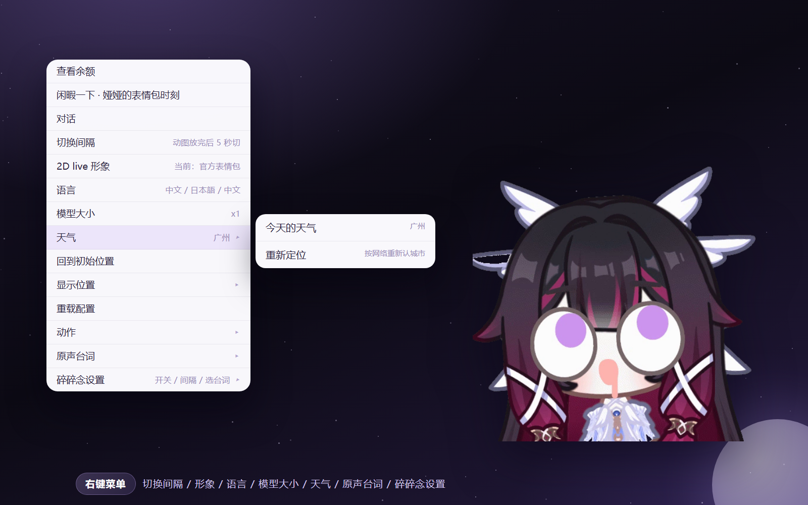
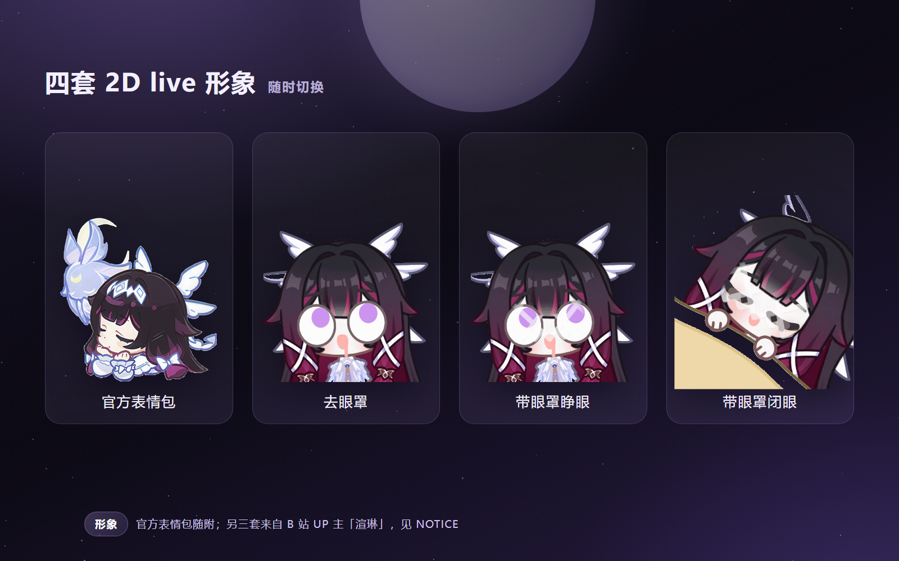
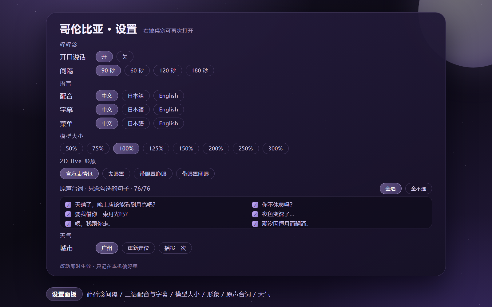

<div align="center">


# dsh-columbina-pet

**『原神』（Genshin Impact）コロンビア 2D live デスクトップマスコット · DeepSeek Harness プラグイン**

四つの姿 · 76 句の三言語オリジナルボイス · 天気予報 · 本物の物理演算 · スタンプの時間

<p><a href="README.md">中文</a> | <a href="README.en.md">English</a> | <strong>日本語</strong></p>

[](LICENSE)


<br />

**作者**：[六硬币的好活](https://space.bilibili.com/1947282109) · bilibili uid **1947282109** ｜ [GitHub @Yuanawaqwq](https://github.com/Yuanawaqwq)

</div>

---

## これは何か

『原神』に登場するファデュイ執行官第三位「少女」コロンビアを、DeepSeek Harness のデスクトップに住まわせます。彼女はウィンドウの最前面に浮かび、ドラッグすれば本物のような物理の揺れを見せ、時刻と場面に応じて小声で話し、公式の音声でセリフを読み上げ、今日の天気もお知らせします。

本リポジトリは [dsh-pet](https://github.com/PC2005-cloud/dsh-pet)（MIT）の**2D 専用ブランチ**です。2D live の姿、ボイスセリフ、メニュー、物理演算を残してさらに深め、**まだ完成していなかった上流の 3D 姿切り替えは削除**しました。そのうえで天気予報と、オープンソースに必要なドキュメント・プレースホルダー・著作権表記を補っています。

> 中文簡介：面向 DeepSeek Harness 的《原神》哥伦比娅 2D live 桌宠 —— 四套形象，76 句中／日／英官方语音并配同步字幕，天气播报，真实物理。上游的 3D 模式已刻意移除。素材授权见 [NOTICE.md](NOTICE.md)。

## 今後の方針

期待は先に明言しておきます。

- **機能面はほぼここまでです。** これ以上新しい機能を積み上げる予定はなく、やることは二つだけ。DeepSeek Harness の新バージョンに追従すること（インターフェースが変われば直し、互換性の宣言も合わせて更新します）と、既存のものを磨き続けること——性能、安定性、操作感の小さな引っかかりです。
- **欲しい機能があれば、ぜひ声をかけてください。** bilibili のダイレクトメッセージで [六硬币的好活](https://space.bilibili.com/1947282109)（uid 1947282109）まで。自分で手を動かしていただくのも歓迎です。プロジェクトは MIT なので、直したものを戻していただくのも大歓迎（PR を出していただければ十分です。手順に不慣れなら、まず変更内容を見せていただくだけでも構いません）。
- **バグに遭遇したら、必ず私を呼んでください。** これが最優先です。我慢したり、自分で hack したりしないでください。報告の際はできるだけ次を添えてください：DSH のバージョン + プラグインのバージョン（下の「ヘルスチェック」の `version` 欄を参照）、症状と再現手順、F12 のコンソールやログにある `[dsh-pet]` を含む行。

## プレビュー

| デスクトップモード | 右クリックメニュー |
| :-: | :-: |
|  |  |

| 四つの 2D live の姿 | 設定パネル |
| :-: | :-: |
|  |  |

## 更新のお知らせ

> バージョンごとの詳細は [CHANGELOG.md](./CHANGELOG.md)、ダウンロードできるパッケージは [Releases](https://github.com/Yuanawaqwq/dsh-columbina-pet/releases) をご覧ください。各バージョンごとにここへ一段落を残し、**何を変えたか、設定を触る必要があるか**を説明します。

### 1.2.3 · 2026-11-16

> このバージョンは**新しいキャラクターを追加せず、セリフも変えません**。直したのは「彼女が自分を隠してしまうと、もう見つけられなくなる」という一点と、ついでに音量と夜間おやすみモードを任意の値にできるようにしたことです。**設定を触る必要はありません**。アップグレード後は**DSH を完全に終了してから開き直して**ください（ホスト側も変わっています）。

- **「表示位置 → どちらも非表示」は一方通行ではなくなりました**：以前は `display: none` で Web 側のペットが描画されず、デスクトップのヘルパーも起動せず、トレイアイコンまで消えていました——画面上にクリックできる場所が一つも残らず、「設定 → コロンビア」を思い出して開き直すしかありませんでした。今は二重の保険があります。①設定ページの上部に「すべてのデスクトップマスコットが非表示です」という警告バーが出て、ワンクリックで「デスクトップのみ」に戻せます。②トレイは四項目の並列表示（Web のみ／デスクトップのみ／両方／どちらも非表示）に変わり、現在の項目にチェックが付きます。「チェックを外すとデスクトップからどちらも非表示へ飛ぶ」ようなことはもうありません。
- **表示位置の変更が記録されます**：`display` への書き込みのたびに、`~/.dsh/columbina-pet/display-changes.ndjson` へ一行記録します（時刻、ペット id、何から何へ変わったか、発生元：Web メニュー／デスクトップメニュー／トレイ／設定パネル／API）。`/healthz` の `displayChanges` は直近 10 件をそのまま返します。次に彼女が本当にいなくなったとき、コマンド一つで「誰がいつ変えたか」が分かります。
- **音量は 0–100 % の任意値**：右クリック「音量」の五段階（20/40/60/80/100 %）に加えて「カスタム音量…」を追加しました。設定パネルの「音量」セクションへ飛び、スライダーでドラッグします。**5 % 刻みで、ドラッグ中も即時反映**（読み上げ中のセリフを途切れさせません）。ミュートスイッチも同じセクションにあります。
- **三言語、そしてパネル専用の言語**（三言語は 1.2.0 から、パネルは 1.2.3 で独立）：吹き替え・字幕・メニューはそれぞれ別の言語を選べ、セリフもメニューも同じ zh・ja・en の対照表を使います。1.2.3 からは設定パネル自体の言語も単独で選べます（既定は「メニューに合わせる」）。日本語・英語のときは、メニュー内のセリフ項目にその言語の**公式セリフ見出し**と本文プレビューが出ます（`Chat: Singing` / `世間話・歌`）。設定パネルのセリフ一覧も同様です。
- **夜間おやすみモードが任意の時間帯に**：右クリック「夜間おやすみモード」の四つのプリセットに加えて「カスタム時間帯…」を追加しました。設定パネルの「夜間おやすみモード」セクションへ飛び、二つの時刻入力欄に開始／終了を入れます（分単位）。日付をまたぐ指定は従来どおり可能で、右下に「（日付またぎ）」と表示されます。
- **Web 側にも同じ入口を揃えました**：Web のペットの右クリックメニューにも「カスタム音量…」「カスタム時間帯…」が増え、設定パネルにも「音量」「夜間おやすみモード」の二つのセクションがあります（スライダー + 二つの時刻欄）。メニュー項目をクリックすると、そのセクションまで直接スクロールします。両端で機能面を揃え、設定はそれぞれ別に保存します（デスクトップのヘルパーが一つ、ページが一つ）。
- **「Web 側に切り替えると彼女が丸ごと消える」問題を修正**：以前は Web 側バンドルの冒頭に「同じページでは一度だけ実行する」というガードがありました。プラグインを無効化してから再度有効化したとき、またはクライアントコードのホットリロード時に、DSH は live モードで同じバンドルを再実行します。ガードはその場で `return` してしまい、`window.__ModuleLoader__.load()` が呼ばれなくなって——ペットが消え、「設定 → コロンビア」のページごと消えていました。現在はガードによる重複排除を起動時のキュー段階（`__ModuleLoader__.mode === "queue"`）だけに限り、live 段階では必ず再登録します。万一同じ id が二重に登録されても、`duplicate` の警告を飲み込むだけで、ページ全体を壊しません。実測：無効化 → 有効化のあと、`shell.overlay` の `pet` と `settings.section` の `pet-config` がすぐにスロットへ戻り、ページを再読み込みする必要はありませんでした。
- **設定パネルにも専用の言語を追加**：設定パネルの「言語」セクションに、これまでの「吹き替え／字幕／メニュー」に加えて「パネル」の行が増えました。中文／日本語／English から単独で選ぶことも、「メニューに合わせる」こともできます。パネルの文言（セクション名、行ラベル、ボタン、ヒント）はこの設定に従い、メニュー言語とは切り離されています。
- **メニュー言語を切り替えたのに中国語が残る問題**：`menuLang` を日本語や英語にしても、辞書に未登録だった項目（省電力モード、ボイスパックと素材、設定パネルのセクション名、セリフ分類「わたしについて／仲間について／突破の想い／戦いの中のささやき／元素スキルと爆発」など計 75 件）が中国語のままでした。両側に同じ内容の辞書を追加し、`test-i18n-coverage.cjs` がソース中の中国語ラベル／ヒント／プレースホルダーを走査して、漏れがあれば失敗するようにしました。
- **「表示位置＝両方」のとき Web メニューが初期の七項目に戻る問題**：「Web で見えるか」を `display === "web"` で判定していたため、`both` では判定に落ち、ボイス／セリフ／つぶやきの分岐が入らず「残高を見る／つぶやき／会話／初期位置へ／本物の物理演算／表示位置／モーション」の七項目だけになっていました。`isWebVisible` での判定に変え、`both` でも「Web のみ」と同じメニューになります。
- **設定パネルが勝手に下へ飛ばなくなりました**：以前はつぶやき間隔のスライダーをドラッグし、指を離した瞬間にパネルが再レンダリングされ、スクロール位置が現在のセクションの先頭へ戻っていました（「画面が下へ飛ぶ」ように見える現象です）。現在は再レンダリングでもスクロール位置を保ち、メニューから項目を選んだときだけそのセクションへスクロールします。間隔のドラッグ中もブロック全体を再構築しなくなりました。
- **日本語・英語メニューのセリフ項目は「タイトル + 本文プレビュー」に**：以前はメニュー言語を日本語や英語にすると、セリフの子項目には切り詰めた本文（`They call this a…`）しか出ず、どのセリフか分かりませんでした。いまは中国語と同じく、その言語のタイトル（`Chat: Singing` / `世間話・歌`）を出し、ヒント行に本文のプレビューを出します。設定パネルのセリフ一覧も同じです。デスクトップと Web は同じタイトル辞書を共有します（76 件 × 2 言語）。
- **セリフのプレビューもメニュー言語に合わせました**：これまではプレビューが字幕言語の本文を固定で使っていたため、「字幕＝中国語、メニュー＝日本語／英語」だとタイトルだけ訳されて右側の説明が中国語のままでした。いまはメニュー言語に従います（中国語メニューは字幕言語のまま）。`test-menu-i18n.cjs` は「字幕＝中国語」の実際の設定でメニューを組み、プレビューが中国語なら失敗します。
- **セリフのタイトルは公式テキストに合わせました**：76 件のタイトルは独自訳ではなくゲーム内テキスト準拠です。英語は公式ボイス一覧の表記（`Chat: Singing`、`About Columbina: Eye Mask`、`About the "Tri-Lunar Convergence"`、`Feelings About Ascension: Climax`）、日本語も同様（`世間話・歌`、`コロンビーナ自身について・アイマスク`、`「三相月臨」について`、`「雄鶏」について`）。公式が複数セリフを一つの名前でまとめている場合（`Elemental Skill` / `元素スキル`、`Low HP` / `HP低下`）は「グループ名 + 番号」（`Elemental Skill · 1` / `元素スキル・1`）にしています。例外として、モーションのスライス名（`坐牢 1`、`通知_提示 星星_收藏`、`转向`）は素材のファイル名で公式テキストに対応する項目がないため、意味訳のままです。
- **日本語訳を全体に見直しました**：英語の値が日本語の値を上書きしていた同キー重複 17 件（日本語 UI でモーション名が `Snack / Humming / Idle` になっていた）と、キャラクター名の誤訳 17 件（`コロンビア` → 公式表記の `コロンビーナ`）を修正し、`表示先`、`元の位置に戻す`、`オリジナルボイス`、`元素スキルと元素爆発`、`おやすみモード` などの言い回しも揃えました（必修正 37 件 + 自然さの改善 27 件）。
- **細かなメニュー項目も整理しました**：省電力モード、ボイスパックと素材、待機モーション、2D Live モデル、音量、夜間おやすみモード、つぶやきのオン・オフと間隔の単位まで、ラベルとヒントがメニュー言語に追従します。Web 側も同じです。新しい `test-menu-i18n.cjs` が両方のメニューツリーを実際に組み立て、英語ツリーに漢字が残るか、日本語ツリーに未翻訳の中国語キーがあればテストが赤くなります。
- **モーションのスライス名も三言語に**：右クリックの「アクション」サブメニューと設定パネルの待機モーション一覧に出る項目は、すべて素材のファイル名です（`喝(饮料杯)`、`打字(恼怒)`、`通知_提示 Bits` など）。以前は日本語／英語にしても中国語のままでしたが、いまは 99 個のスライス名（四つの姿それぞれのプールを含む）に訳が入っています。テストが `assets/webm` と `voice-index.js` のプールを照合するので、訳のない素材を足すとテストが赤くなります。
- **つぶやきは公式ボイス寄りに**：以前のつぶやきは「55 % は wiki の正式セリフ、45 % は初期に短い動画から切り出した断片」で、断片が公式ボイスを押しのけているように感じられました。現在は **78 % 正式セリフ／22 % 断片** に変更し、4 文字未満の断片（「钱」「问号」など）は単独では出さなくしました。元の比率に戻すには `voice.js` の `Math.random() < 0.78` を一行変えるだけです。
- **issue レポートの P1 / P2 / P3 をすべて修正**：設定パネルの間隔スライダーを動かした後、単位が中国語に戻らなくなりました（デスクトップは `panelTr('秒')`、Web は `webTr("秒")`）。Web の3つのトグルボタン（「開 / 関」）と素材ボタン（「修復中… / 一括修復」）も `webTr` 経由に。Web の間隔スライダーとスケジューラーを **60–180 秒** に統一（従来は 15–300 秒で、実際に 15 秒間隔で発火していました）。`panelJumpSection` の初期値を `false` に戻し、コメントと README に一致させました。トレイの4項目メニューとツールチップがメニュー言語に追従します（メインプロセスが 4 秒ごとに `prefs.json` を読み直し）。`display-changes.ndjson` は 256 KB を超えるとローテーションして最後の 200 行だけ残し、コールドスタートでは末尾 64 KB だけ読みます。`test/test-panel-i18n.cjs` を新規追加（27 アサーション、パネル文言を領域ごとに走査するので三項演算子や文字列連結の漏れも検出）。テストは合計 11 ファイル / 212 アサーション。再レビュー後に三点を追加：ペットの右クリックメニューで言語を変えると `PetShared.postAction` 経由で `menuLang / panelLang / voiceLang / subLang` をホストへ送るため、トレイは Web 側の変更を待たずに同期します。ホスト `POST /voice-prefs` の `intervalSec` は 60–180 に統一（従来 15–3600）。送信経路とホスト側の丸めもアサーションに含めました。
- **三言語の README も揃えました**：英語版と日本語版の「開発とテスト」節が中国語版より遅れていました——「5 ケース・93 アサーション」のまま、動作環境表に `0.2.2-rc.3` がなく、ディレクトリ構成ではリポジトリ内にしかない `src/` と `.github/workflows/ci.yml` をパッケージ内のパスとして扱い、ツリーのコメントも中国語のままでした。いまは三つとも同じ内容をそれぞれの言語で書いています：11 ファイル / 212 アサーションを項目別に列挙、環境表に rc.3、ツリーは「リポジトリ内のみ・npm パッケージには含まれません」と注記して翻訳済み。構成も一致しています（675 行 / レベル 3 見出し 43 個 / 表 75 行）。
- **互換性の宣言に 0.2.2-rc.3 を追加**：`dsh.compatibility.dshReleases` に `0.2.2-rc.3: compatible` を追加しました（6 個の名前付きインポート、6 個のサービスメンバー、`shell.overlay` / `settings.section` スロットが rc.3 でも正常に動作することを実測済み）。

### 1.2.2 · 2026-11-09

> このバージョンは**ペットの動作、声、気性を変えません**。変えたのは「これから壊れにくくする」部分です：テスト、CI、互換性の宣言、インストール手順。**設定を触る必要はありません**。アップグレード後は同じく**DSH を完全に終了してから開き直して**ください。

- **テストをリポジトリに入れました**：以前は 93 個のアサーションが一時ディレクトリに置かれ、書いた本人が実行方法を覚えているだけでした。現在は 5 個のテスト（つぶやき字幕 19／字幕と音声の同期 15／リクエストボディのエンコード 19／Range 24／クロスサイト書き込み 16）を `test/` へ移し、`npm test` 一発で完走します。依存ゼロ、ネットワーク不要、偽の DOM と偽の時計を同梱しています。
- **コミットごとに自動で実行**：GitHub Actions を追加し、Node 22 と 24 で構文チェックと全テストをそれぞれ実行します。壊れたらその場で赤くなり、人が覚えておく必要はありません。
- **互換性の宣言を新しい DSH に追従**：`dsh.compatibility` に `0.2.2-rc.1` を追加。`@deepseek-ai/*` の peer 依存を `^0.2.0-rc.1` から `>=0.2.0-rc.1 <0.3.0` へ緩めました——0.2.x 内のマイナーアップデートがもう非互換扱いになりません。
- **インストール時の誤解を減らす**：README のインストール節に「tarball は約 148 MB、初回は数分待つ必要があるので途中でキャンセルしないこと」を直接明記しました。固まったと勘違いしないためです。
- **`src/` の位置づけを明記**：`src/README.md` を追加——配布物は `lib/` でビルド手順はありません。`src/` は半同期の参考ソースで `lib/` からずれていくため、実際の挙動は `lib/` を見て判断してください。
- **困ったときに自分で調べられるように**：README に「困ったときは」を追加——バージョン／コード／ボイスパック／ヘルパーの四つの数値の突き合わせ方、症状ごとにまず見る行、直し方、バグ報告に添える情報をまとめました。ついでに設定パスも訂正（実際のディレクトリは `~/.dsh/columbina-pet/`、旧 `dsh-pet` からは一度だけ自動移行されます）。
- **ドキュメントの健康診断**：README 全体を現在の実装に合わせて見直しました——カスタムミラー変数名（`DSH_PET_ELECTRON_MIRROR`）、ボイスパックのミラー例のバージョン（v1.1.4）、右クリックメニューの完全な表（音量／夜間おやすみモード／省電力／素材セルフチェック／設定パネル／待機モーション／本物の物理演算を含む）、ディレクトリ構成（`test/`、`docs/screenshots/`、分割音声）をすべて揃え、冒頭に作者名と連絡先を補いました。
- 素材と実行時の挙動はどちらも変えていません。

### 1.2.1 · 2026-10-31

> 「つぶやき字幕の修正」が中心のパッチです。**設定を触る必要はありません**。アップグレード後は**DSH を完全に終了してから開き直して**ください。

- **長いセリフの字幕が先に消えなくなりました**：つぶやきの字幕が音声より先に消えていました。原因は文言ではなく、再生時間が取得できないこと——ホストの素材インターフェースが `accept-ranges` を返さず、シークできない Ogg に対して Chromium は `audio.duration` を `Infinity` と報告します。旧ロジックはこれを受けて固定の 3600 ms に落としていました。現在は字幕が音声の**実際の再生進行**に追従し（`timeupdate` で延命）、読み終わるまで表示して、終わったらすぐ引っ込みます。
- **字幕が切られなくなりました**：つぶやきの字幕を `body` に付けた独立のオーバーレイへ移しました（以前は `.dsh-pet-root` の中に寄生していて、祖先に `transform` / `overflow: hidden` があると長いセリフが丸ごと切れていました）。
- **ペットをドラッグすると字幕も付いてくる**：表示中は `requestAnimationFrame` でフレームごとにオーバーレイの位置を同期します。振り飛ばされても、着地しても、端に寄っても追従します。
- **つぶやきのテンポが正常に戻りました**：間隔を設定したのに十数分に一句しか話さない——タイマーがタスク状態に巻き込まれてリセットされていたのを修正しました。
- **デスクトップ側でも素材を確認できるように**：デスクトップの「ボイスパックと素材」パネルを補完し、ワンクリックでボイスパック／モーション／表情を数え、ボイスパックが欠けていればその場で再ダウンロードします。ログを漁る必要はありません。
- **Web の右クリックメニューをデスクトップに揃えました**：項目、順序、文言を統一。Web 側には「本物の物理演算：オン／オフ」を追加し、設定パネル内のセクション順も揃えました。
- **天気予報の文言を統一**：気温には必ず `℃` を付け、中／日／英の文型はそれぞれローカライズしました。
- **長いセリフが次の一句に途中で切られなくなりました**：`webAutoVoice()` は発火前に前の一句がまだ再生中かを確認します——ウォームアップ／間隔／ジェスチャー補完再生／天気の相づちといった自動由来はすべて道を譲ります（コンソールに `[dsh-pet] 碎碎念让路 来源=…` と出力）。強制的に切り替わるのは、手動でペットをクリックするか「オリジナルボイス」を押したときだけです。ウォームアップの一句も、ページセッションごとに一度だけ並べるように変更しました。
- **吹き出しに文字化け／豆腐が現れなくなりました**：つぶやきの吹き出しが丸ごと菱形の疑問符で表示されることがありました。原因は、ホストがリクエストボディを受け取るときに非 UTF-8 のバイト列をそのまま UTF-8 としてデコードしていたことです（Windows のコンソールの curl / PowerShell は中国語を GBK で送ります）。置換文字 `�` がそのまま吹き出しに書き込まれていました。現在はまず厳密に UTF-8 として読み、失敗したら GB18030 で読み直します。`�`、`锟斤拷` のような二重変換の痕跡を含むテキストは**一切吹き出しに書き込みません**。
- **音声ファイルが Range に対応**：素材インターフェースが `accept-ranges` を返し、`206` / `416` をサポートするようになりました。音声は必要なバイトだけ取得でき、`audio.duration` も実際の値を取れます（以前は `accept-ranges` を返さず、シークできない Ogg に対して Chromium が `Infinity` を報告していました）。字幕は `timeupdate` のフォールバックも残しており、クライアントのどちらのバージョンでも安定します。
- **ローカルインターフェースはもうどの Web ページにも開かれていません**：以前は 24 本のルートにオリジン検証がなく、任意の Web ページがクロスサイトで `/broadcast` に POST して吹き出しに文字を差し込んだり、`/whisper` でトークンを消費したりできました。現在は、書き込みリクエストに `sec-fetch-site: cross-site` が付き、かつ `Origin` が別の http(s) サイトなら `403 cross-site-blocked` を返します。同一オリジンのページ、`file://` のデスクトップヘルパー、ローカルスクリプト（curl / node / python）は従来どおりです。
- **Web モードに戻すとデスクトップヘルパーが終了します**：以前は `desktopModeEverActive` が一度真になると二度と戻らず、`web` に切り替えても空回りするプロセスが 3 つ（約 178 MB、ウィンドウなし）残っていました。現在はデスクトップのペットがいなければヘルパーを起動せず、デスクトップへ戻すと自動で再起動します。
- **ボイスパックの目印がバージョンに追従**：`~/.dsh/columbina-pet/voice-pack.json` の `version` は以前 1.1.5 で止まっていました（移行時に一度書かれるだけ）。現在は起動のたびに現在のバージョンで更新されます。
- 素材は変えていません（1.1.11 の元の webm をそのまま使用、約 147 MB）。本バージョンはコードのみの変更です。

### 1.2.0 · 2026-10-31

> 開発中の番号は `1.1.12` でしたが、機能面が次のマイナーバージョンに達したため、正式リリースで **1.2.0** に改名しました（内容は 1.1.12 と完全に同一です）。

- **待機モーションを選べるように**：右クリック「待機モーション」で 厳選／現在の姿の全モーション／自分で選ぶ を切り替えます。「自分で選ぶ…」は設定パネルの検索ボックス付きチェックリストを開きます。デスクトップと Web で同じ仕組みです。厳選プールは 2 段から、公式 9／アイマスクなし 12／開眼 12／閉眼 10 段へ広がりました。
- **待機がカクカクしなくなりました**：「待機」を含むクリップは以前 20 秒のループに引き伸ばされていました（2.4 秒の公式クリップ ≈0.12×、実に 3.6 fps）。現在は一律 0.6× です。
- **省電力モードが本当に止まるように**：旧実装は `loop` の動画だけを一時停止していましたが、待機は one-shot 再生なので何も止まっていませんでした。現在はマウスが 30 秒動かなければ再生中の動画をすべて一時停止し、ホストから押し出される新しいモーションも受け付けません。
- **夜間おやすみモード／音量とミュート／素材セルフチェックとワンタッチ修復／Web パネルの同期**：下の「機能紹介」を参照してください。
- **残高照会**：デフォルトモデルが API Key 版のプロバイダーにあり、本機がアカウントログインのときは、「資格情報 DEEPSEEK_API_KEY がありません」とエラーを出さず、自動的にアカウント残高の照会へ切り替えます。
- **素材は変えていません**：1.1.11 の元の webm（約 147 MB）をそのまま使い、本バージョンでは**不可逆圧縮を行っていません**。`scripts/shrink-webm.mjs` は任意のツールとして残してあります。
- **`/healthz` が「ディスクは入れ替わったが再起動していない」を見分けられるように**：`activatedBuildSha256`（アクティベートした瞬間に計算した sha256、メモリ上に保持）と `needsRestart`（メモリ上の sha ≠ ディスク上の sha のとき `true`）を追加しました。同じバージョン番号で再パッケージした場合、`buildSha256` だけ見ても常に新しいディスク側と一致してしまうため、この組のフィールドでしかメモリ内が旧コードだと分かりません。
- **起動時に身分を自己申告**：起動のたびに「今回動いているのはどのバージョン、どのコードか」を `~/.dsh/columbina-pet/activation.json` へ書き込み（`activatedAt` / `activatedVersion` / `diskVersion` / `buildSha256` / `activatedBuildSha256` / `needsRestart`）、同時にホストのログへ `[dsh-pet] activated <版本> build <sha8>` の一行を出します。ディスク上はすでに新バージョンで、メモリ上は旧版が動いているときは `needsRestart` が `true` になり、warn を一行添えます——もう `/healthz` にどうアクセスするかを先に推測しなくて済みます。
- アップグレード後は**DSH を完全に終了してから開き直して**ください。設定項目にはすべてデフォルト値があり、手動での移行は不要です。

### 1.1.11 · 2026-10-30

- `/healthz` に `activatedVersion` / `buildSha256` を追加：パッケージを入れ替えて再起動していないことが一目で分かります。
- `ensure-voice` に 120 秒の総予算 + 20 秒の停滞検知を追加（`DSH_COLUMBINA_VOICE_STALL_MS` で調整可能）。
- npm パッケージから `src/` を削除：エントリ 607 → 465、tarball 148.56 → 148.11 MB。
- ルートパスのデコードを寛容に：GBK のパーセントエンコーディングでルート全体が 500 にならなくなりました。

### 1.1.10 · 2026-10-30

- Web 側の「すべて選択解除」が `lines` を `[0]` と書いてしまう（最初の一句しか読まない）不具合を修正：ホストで一度だけ移行し、`prefsRev: 2` を書き込みます。
- 影響するのは Web モードのパネルだけです。デスクトップ側は以前から正常でした。

## 特徴

- **四つの 2D live の姿**：`official`（公式スタンプ）、`nochoker`（アイマスクなし）、`open`（アイマスクあり・開眼）、`closed`（アイマスクあり・閉眼）。右クリックメニューの「2D live の姿」で即座に切り替わり、各セットが待機／クリック／ドラッグ／イベントのモーションツリーを備えています（計 246 本の webm）。
- **三言語のオリジナルボイス**：コロンビアの公式ボイス 76 句を、中／日／英で 94 のクリップに整理しました。吹き替え言語と字幕言語は別々に設定できます。**音声があれば必ず字幕があり**、長いセリフは再生の進行に合わせて字幕を分割して切り替えます。
- **場面に応じたつぶやき**：挨拶、真夜中、慰め、感謝、質問、遊び、友人、寝る前、真面目、おちゃめの十組のシーンプールから、時刻と最近の出番率で抽選し、連続では重複しません。起動から最初の 12 秒は静かにしています。
- **作業中の吹き出しが優先**：ユーザーへ報告している最中は、ペットが吹き出しを奪いません。彼女の言葉が終わると自動で作業状態の吹き出しへ戻します。
- **天気予報**：メニュー「天気 → 今日の天気」。まず吹き出しで概要（都市、天気、現在の気温、今日の気温の範囲）を出し、一拍おいてからオリジナルボイスで一言添えます。オフライン時はフォールバックのセリフを返し、固まることはありません。
- **本物の物理演算**：ドラッグで弧を描いて飛び、離すと落下し、着地で跳ね、ウィンドウの端に寄りかかります。パラメータはすべて設定可能です。
- **メニューがそのまま設定**：切り替え間隔、2D live の姿、言語（吹き替え／字幕／メニュー）、モデルサイズ 0.5–3×、オリジナルボイスのチェック、つぶやきのオン／オフ。メニュー自体も言語に追従して切り替わります。
- **ときどきスタンプ**：12 枚の気分画像（やったー／ハグ／期待／出発／おいしい／考え中／就寝／眠い／くっつき／歌う／カーテンコール／おやすみなさい）を、セリフのタグと場面から選びます。
- **音量とミュート**（1.2.0、1.2.3 で 0–100 % に拡張）：右クリック「音量」の五段階 20–100 % とワンタッチミュート。1.2.3 からメニューに「カスタム音量…」が加わり、設定パネルのスライダーで任意のパーセントにできます。デスクトップと Web で入口は同じ（保存はそれぞれ別）、変更はすぐ反映され、再生中のセリフを途切れさせません。
- **夜間おやすみモード**（1.2.0、1.2.3 から任意の時間帯）：時間帯を一つ設定すると（デフォルト 23:00–08:00）、その間はつぶやきが自動的に黙ります。手動で「オリジナルボイス」を押せば従来どおり再生されます。1.2.3 から四つのプリセットに加え、設定パネルで任意の開始／終了時刻（分単位、日付またぎ対応）を入力できます。
- **素材セルフチェックとワンタッチ修復**（1.2.0）：設定パネルの「ボイスパックと素材」を押すと、ボイスクリップ／モーション／表情を数えます。ボイスパックが欠けていればその場で再ダウンロードします。ログを漁る必要はありません。
- **省電力モード**（1.2.0、デフォルトはオフ）：30 秒間なにもしないとループ待機のアニメを止め、マウスが動けばすぐ再開します。長時間デスクトップに置いても CPU を節約できます。
- **待機モーションを選べる**（1.2.0）：右クリック「待機モーション」で 厳選／現在の姿の全モーション／自分で選ぶ を切り替え。「自分で選ぶ」は設定パネルの検索可能なチェックリストを開きます（アイマスクなし、アイマスクあり・開眼は各 82 段、アイマスクあり・閉眼は 65 段、公式スタンプは 17 段）。チェックした段だけを順番に再生します。
- **Web モードの補完**（1.2.0）：Web 側にも夜間おやすみモード、省電力モード、待機モーションを追加（設定パネルでも検索してチェックできます）。つぶやきの時間帯、音量とミュートはデスクトップと入口を揃え、保存はそれぞれ別です（デスクトップのヘルパーは `file://`、ページは http なので `localStorage` はもともと共有されません）。
- **天気の都市名のローカライズ**（1.2.0）：位置情報で得た都市名を字幕言語に合わせて翻訳します。中国語 UI では「Guangzhou」ではなく「广州」と表示し、英語／日本語 UI では現地のつづりを残します。

## 機能紹介

どの項目も**右クリックメニュー**または**設定パネル**から開けます。以下では「入口／使い方／注意点」を整理します。

### 姿とモーション（四つの 2D live）

- 入口：右クリック「2D live の姿」。
- `official` 公式スタンプ、`nochoker` アイマスクなし、`open` アイマスクあり・開眼、`closed` アイマスクあり・閉眼。四セットで計 246 本の webm があり、それぞれ待機／クリック／ドラッグ／イベントのモーションツリーを持ちます。
- 切り替えは即時反映され、設定も記憶されます。公式セットは 640×360 の VP9、残り三セットは 500×500 の VP8 + alpha です。

### ボイスと字幕（三言語オリジナル）

- 入口：右クリック「言語」→ **吹き替え言語／字幕言語／メニュー言語**をそれぞれ設定。
- 76 句の公式ボイスを 94 のクリップに整理しました。長いセリフは再生の進行に合わせて字幕を分割し、**音声があれば必ず字幕があります**。
- 「オリジナルボイス」では、どの句を再生するかをチェックできます（全選択／全解除／一句ずつ）。設定は `prefs.json` に保存されます。
- **項目の表示（1.2.3）**：日本語・英語のメニューでは、各項目にその言語の公式セリフ見出し（`Chat: Singing` / `世間話・歌`）と本文プレビューが出ます。見出しはゲーム内テキストに従い、同じグループに一つしか見出しがない場合は「見出し + 番号」（`Elemental Skill · 1` / `元素スキル・1`）で書きます。

### つぶやき

- 入口：右クリック「つぶやき設定」。
- 十組のシーンプール（挨拶／真夜中／慰め／感謝／質問／遊び／友人／寝る前／真面目／おちゃめ）から、現在時刻と最近の出番率で抽選し、連続では重複しません。
- 間隔は 60–180 秒で調整できます（デフォルト 90 秒）。起動から最初の 12 秒は静かにしています（ページセッションごとに一度だけ）。
- **字幕（1.2.1）**：つぶやきの字幕は `body` に付けた独立のオーバーレイの中にあり、祖先の `transform` / `overflow` に切られることがありません。ペットをドラッグしたり振り飛ばしたりしたときは `requestAnimationFrame` で追従します。表示時間は音声の**実際の再生進行**（`timeupdate`）に従い、読み終わればすぐ引っ込み、固定の 3.6 秒ではなくなりました。表示中は F12 に `[dsh-pet] 字幕跟音频 duration=…` と `[dsh-pet] 字幕收起（计划 …ms）` の二行が出て、どちらの分岐を通ったか分かります。

### 夜間おやすみモード（1.2.0、1.2.3 から任意の時間帯）

- 入口：右クリック「夜間おやすみモード」。四つのプリセット（22:00–07:00 / 23:00–08:00 / 00:00–09:00 / 01:00–10:00）で、日付をまたぐ指定にも対応します。
- **カスタム時間帯（1.2.3）**：右クリック「夜間おやすみモード → カスタム時間帯…」で設定パネルの「夜間おやすみモード」セクションを開きます。二つの `<input type="time">` に開始と終了を入れ（分単位）、日付をまたぐ場合は右下に「（日付またぎ）」と表示されます。変更はすぐ保存されます。
- 止まるのは**自動のつぶやきだけ**です。手動で「オリジナルボイス」を押せば従来どおり再生され、ミュートされません。

### 音量とワンタッチミュート（1.2.0、1.2.3 から 0–100 %）

- 入口：右クリック「音量」→ ミュートスイッチ + 20 / 40 / 60 / 80 / 100 % の五段階。
- **カスタム音量（1.2.3）**：右クリック「音量 → カスタム音量…」で設定パネルの「音量」セクションを開きます。スライダーは 0–100 %、5 % 刻みで、ドラッグ中にも反映されます（パネルを再構築しないので、指を離しても元に戻りません）。0 まで下げるとミュートと同じです。
- デスクトップと Web は同じ設定を共有します（同じ localStorage キー）。変更はすぐ反映され、再生中の一句を途切れさせません。

### 待機モーション（1.2.0）

- 入口：右クリック「待機モーション」→ 厳選（推奨）／現在の姿の全モーション／自分で選ぶ…
- 「自分で選ぶ…」で設定パネルの**検索できるチェックリスト**を開きます（アイマスクなし／アイマスクあり・開眼が各 82、アイマスクあり・閉眼 65、公式スタンプ 17）。全選択／全解除／厳選に戻すに対応し、チェックするとすぐ反映されます。
- 厳選プール：公式 9／アイマスクなし 12／開眼 12／閉眼 10 で、90 秒で一周します。

### 省電力モード（1.2.0、デフォルトはオフ）

- 入口：右クリック「省電力モード」。
- マウスが 30 秒動かないと、再生中の動画をすべて一時停止します（ホストから押し出されるモーションも含む）。動かす／クリックする／ウィンドウに戻るとすぐ再開します。

### 天気予報

- 入口：右クリック「天気」→「今日の天気」（ほかに再取得も）。
- まず吹き出しで概要（都市／天気／現在の気温／今日の気温帯）を出し、一拍おいてオリジナルボイスで一句添えます。オフライン時はフォールバックのセリフを返します。
- 都市名は**字幕言語**に合わせてローカライズされます（1.2.0）：中国語 UI では「Guangzhou」ではなく「广州」と表示します。

### 素材セルフチェックとワンタッチ修復（1.2.0 Web 側／1.2.1 デスクトップ側）

- 入口：設定パネル「ボイスパックと素材」→ 素材を確認／ワンタッチ修復（デスクトップの右クリックメニューにもあります）。
- ホスト側のインターフェース：`GET <prefix>/voice/health`、`POST <prefix>/voice/repair`。ボイスクリップ／モーション／表情のディレクトリ、本数、サイズを返し、ボイスパックが欠けていればその場で再ダウンロードします。
- デスクトップ側のパネルページはオリジンが `file://` なので、この二つのインターフェースのレスポンスには `access-control-allow-origin: *` が付きます（1.2.1）。

### 残高照会

- 入口：右クリック「残高を見る」（設定で定期更新にもできます）。
- 現在のデフォルトモデルに対応するプロバイダーを優先します。API Key 版のプロバイダーで、本機に `DEEPSEEK_API_KEY` がない場合は、自動的に DSH アカウントの残高照会へ切り替えます（1.2.0 から）。「資格情報がありません」の一言で終わることはありません。

### Web モード

- DSH の Web 画面内のペットはデスクトップ側と同じ姿・セリフ・メニュー構成を共有します。夜間おやすみモード／省電力／待機モーション／音量は Web 側でも設定でき、設定パネルでも検索してチェックできます。
- Web 側の変更も**DSH を完全に再起動**しないと反映されません。

### デスクトップマスコットの物理演算

- ドラッグには慣性があり、離すと落下し、着地で跳ね、端に寄りかかります。パラメータは `assets/config.jsonc` の `physics` で調整できます。
- 「本物の物理演算：オン／オフ」（1.2.1 で Web 側も補完）：オフにすると離した後に飛ばず、跳ねず、そのまま地面へ落ちます。デスクトップと Web はそれぞれ選択を記憶します（Web 側のキーは `columbina-physics-web-v1`）。

### 多言語メニュー

- メニューとパネルは中国語／日本語／英語に対応し、「メニュー言語」で切り替わります。後から追加した項目にも三言語があります。
- 設定パネル自体の言語も単独で選べます（「メニューに合わせる / 中文 / 日本語 / English」、1.2.3）。セリフ分類名とモーションのスライス名も三言語です。

## 動作環境

| 項目 | 要件 |
| --- | --- |
| DSH | 0.2.x（0.2.1-rc.2 / 0.2.2-rc.1 / 0.2.2-rc.3 のデスクトップ版で動作確認済み） |
| Node.js | ≥ 22.12 |
| OS | Windows / macOS / Linux |
| Electron | 43.3.0（初回実行時に自動ダウンロード、または手動で `node scripts/ensure-electron.mjs`） |

## 開発とテスト

- **リリース物は `lib/` で、ビルド手順はありません**：挙動を変えるには `lib/index.js`（ホスト側）や `lib/client.js`（Web 側）を直接編集します。
- `src/` は半同期の TypeScript 参考で、`lib/` からずれていきます（つぶやきのオーバーレイ、Web 側の本物の物理演算、`data-dsh-pet-subtitle` をホストへ渡す処理など、後から追加したものは `lib/` にしかありません）。**実際の挙動は `lib/` で判断してください。** 詳しくは `src/README.md`（リポジトリ内のみ、npm パッケージには含まれません）。
- セルフチェックのコマンド：

  ```bash
  npm run check   # node --check lib/index.js lib/client.js
  npm test        # test/ 配下の全ケース：ゼロ依存・組み込みモジュールのみ・ネットワーク不使用
  ```

- **テストは 11 ファイル／212 アサーション**で、すべて自作の偽 DOM／偽の時計／偽のオーディオで動きます：リクエストボディのエンコード 19、クライアント起動ガード 9、クロスサイト書き込み 16、辞書カバレッジ 8、メニューツリー三言語 7、パネル文言 27、Range 24、パネル操作 32、Web／デスクトップの一致 36、字幕と音声 15、つぶやき 19。CI は Node 22 と 24 で実行します（`.github/workflows/ci.yml`、リポジトリ内のみ、npm パッケージには含まれません）。
- リリース前に `node scripts/check-voice-asset.mjs` も実行します。ボイスパックは外置資産なので、オンラインにまだあるかを先に確かめます。

## パッケージサイズ：なぜこんなに大きいのか、どう小さくするか

一言でいうと、**容量の 90 % 以上は四セットの 2D live 姿のモーションビデオ**で、コードは合わせて約 1.4 MB です。ボイスパック（33 MB）は 1.1.5 から外置され、パッケージには含まれていません。

### 容量の内訳（1.2.2 実測）

| 構成 | サイズ | 説明 |
| --- | --- | --- |
| `assets/webm` | **145.6 MB** | 246 本の 500×500・アルファ付き動画：待機、クリック反応、不運な小芝居、残高通知、移動 |
| `assets/fonts` | 3.9 MB | 上首软糖体（字幕・吹き出し用） |
| `assets/memes` | 1.4 MB | 12 枚の「時刻スタンプ」（静止画） |
| `assets/pic` + `logo.png` | 0.5 MB | プレビュー画像とプラグインアイコン |
| `lib` + `runtime` | 約 1.4 MB | ホストとレンダラー側のコード（`lib` 968 KB、`runtime` はクリップ音声を除いて約 0.5 MB） |
| ボイスパック | **0（外置済み）** | 76 句 × 中／日／英のオリジナル。ダウンロード約 33 MB、展開後約 25.9 MB。初回起動時にバックグラウンドで `~/.dsh/columbina-pet/voice/official` へダウンロードします |

webm を姿ごとに分けると：

| 姿 | 本数 | サイズ |
| --- | --- | --- |
| アイマスクなし | 82 | 52.1 MB |
| アイマスクあり・開眼 | 82 | 52.1 MB |
| アイマスクあり・閉眼 | 65 | 39.1 MB |
| 公式スタンプ | 17 | 2.2 MB |

### なぜこんなに大きいのか

1. **動画であって、ベクターではない**：各クリップは 500×500、アルファ付きの WebM（VP8 + 透明チャンネルの側路）です。ブラウザで「透明 + 滑らかなループ」を両立できる形式はほぼ WebM 系しかなく、その代償として全フレームを符号化する必要があり、SVG のように数百バイトで一人を描くわけにはいきません。
2. **素材は 1:1 の元ビットレートのまま同梱**：このクリップ群は平均 **1.2–4.3 Mb/s** ですが、デスクトップでは実際には 160–400 px でしか表示されず、ビットレートは明らかに過剰です。1.2.0 では利用者の声を受けて**デフォルトでは**非可逆圧縮を行っていません（圧縮すると輪郭がやや甘くなります）。圧縮は任意のスクリプトとして残してあります。
3. **四セットの姿は互いに独立**：髪色も衣装も表情も異なり、フレームを共有できないため、82 + 82 + 65 + 17 本をそのまま足した数になります。

### どう小さくするか（効果の大きい順）

**① 公式スクリプトで再エンコード（推奨、約 −56 %）**

```bash
FFMPEG=/path/to/ffmpeg node scripts/shrink-webm.mjs --crf 30 --backup D:/backup/webm-orig
```

- 本機での実測：**143.4 MB → 62.4 MB**。VP9 + alpha は保持され、先頭フレームの元ファイルとの RGB 平均差は **0.74/255**（肉眼では分かりません）
- `--crf 24` ならより安全：87.3 MB。`--crf 38` が最も攻めた設定：約 30 MB（同じ比率からの概算なので、まず自分でバックアップを取って一部で試すことを勧めます）
- **ffmpeg ≥ 4.4（2021 年以降）が必須**です。古いビルドは透明チャンネルをそのまま落としてしまい、デスクトップマスコットが不透明な白い板になります。スクリプトでは自動判別できないので、置き換える前に一フレームをデコードして四隅の alpha が 0 か確認してください
- デフォルトはその場で置き換え、失敗したファイルは元のまま残します。公式スタンプ 17 本は alpha なしの VP9 なので、スクリプトが自動で飛ばします

**② 使う姿だけを残す**

使わない `assets/webm/<前缀>*` を削除し、上の表のとおりに減らします：公式スタンプだけなら約 2.2 MB、公式 + 一セットなら約 54 MB。削除したら `runtime/electron-helper/voice/voice-index.js` の対応する `skins[]` 項目も外してください。そうしないと右クリックメニューに素材のない姿が残ります。

**③ 素材を外置して複数のインストールで共有**

ホストは外部素材ルート `~/.dsh/columbina-pet/assets` に対応しています（同名ファイルは**パッケージ内より優先**されます。`/healthz` の `assets.externalActive` / `assets.externalFileCount` で確認できます）。`assets/webm` をそこへ移してパッケージ内から削除すれば、「コードはパッケージで更新し、素材は一つだけ持つ」形になります。

**④ インストール方法を選ぶ**

- プラグインマーケット／`npm i dsh-columbina-pet`：tarball（148 MB）だけをダウンロードし、git 履歴は含みません
- `git clone` でソースからインストール：リポジトリは履歴を含むため tarball より大きく、更新も自分で pull する必要があります
- 更新時に npm はパッケージ全体を取り直します（ローカルキャッシュが効けばかなり速くなります）。そのため「素材の外置」は繰り返しの更新に最も効きます

## インストール

> ℹ️ **上流の `dsh-pet` と共存できます**（1.0.4 から）：このプラグインのルートパスプレフィックス、bridge scheme、ユーザーディレクトリ、セッション ID は `dsh-columbina-pet*` 名前空間へ移り、上流と `/dsh-pet-7340` を取り合うことはなくなりました。古いブックマークとの互換のため旧プレフィックスの登録も試みますが、上流が使っていれば静かに飛ばします。

> 📦 **初回インストールには少し時間がかかります**：パッケージには四セットの 2D live 姿のモーションビデオが入っており、tarball は約 148 MB（展開すると約 212 MB）です。GitHub や npm からの取得に数分かかるのは正常なので、途中でキャンセルしないでください。インストール後は**DSH を完全に終了してから開き直す**必要があります。そうして初めて新しいコードに切り替わります。

### DSH のプラグイン管理からインストール（推奨）

1. DeepSeek Harness のデスクトップ版を開く → 設定 → プラグイン → **プラグインを追加**
2. 入力欄にリポジトリのアドレスを貼り付け：

   ```
   github:Yuanawaqwq/dsh-columbina-pet
   ```

   完全なアドレス `https://github.com/Yuanawaqwq/dsh-columbina-pet` を貼っても構いません。
3. インストールが終わったら**DSH を完全に終了してから開き直します**（ウィンドウを閉じる、ページを再読み込みするだけでは再起動になりません）。
4. 初回にデスクトップマスコットが出てこない場合、本機にまだ Electron ランタイムがありません。案内に従ってもう一度再起動するか、手動で実行してください：

   ```bash
   node node_modules/dsh-columbina-pet/scripts/ensure-electron.mjs
   ```

### profile へ手動で入れる

```bash
cd ~/.dsh/profiles/<你的 profile>
npm install dsh-columbina-pet
```

その後、profile の `package.json` に追加します：

```jsonc
{
  "dependencies": {
    "dsh-columbina-pet": "^1.2.2"
  },
  "dsh": {
    "profile": {
      "bundles": [
        "@deepseek-ai/dsh-base",
        "dsh-columbina-pet"
      ]
    }
  }
}
```

**DSH を完全に終了してから開き直します**（ウィンドウを閉じる、ページを再読み込みするだけでは再起動になりません）。

### npm からインストール（1.2.2）

```bash
cd ~/.dsh/profiles/<你的 profile>
npm install dsh-columbina-pet@1.2.2
```

インストール後、同じく `dsh-columbina-pet` を profile の `dsh.profile.bundles` に追加し、**DSH を完全に終了してから開き直します**。

### GitHub からインストール

```bash
cd ~/.dsh/profiles/<你的 profile>
npm install github:Yuanawaqwq/dsh-columbina-pet
```

### ローカルソースからインストール

```bash
cd ~/.dsh/profiles/<你的 profile>
npm install file:C:\path\to\dsh-columbina-pet
# 或 Linux/macOS
npm install file:/path/to/dsh-columbina-pet
```

> 説明：リポジトリには約 147 MB の 2D 姿モーション素材が含まれています（ボイスパックは外置でリポジトリには入っていません。姿は 1.1.11 の元素材のままで、非可逆圧縮はしていません）。npm パッケージの tarball は約 148 MB、展開すると 161 MB です。自分で小さくしたい場合は `node scripts/shrink-webm.mjs` を実行してください：VP9+alpha で再エンコードし、crf 24 の実測で 143.4 MB → 87.3 MB、先頭フレームの RGB 平均差 0.5/255、透明部の最大差 4/255 で、肉眼では差が分かりません。国内から registry へ直結すると遅いことがあります。回線が良くないときは GitHub や Release の添付を優先するか、下のミラー設定で速くしてください。

### 国内からのネットワーク高速化（任意）

先にどちらの経路が速いか見ておきます（数字が小さいほど速い）：

```bash
curl -o /dev/null -s -w 'github %{time_total}s
' https://github.com
curl -o /dev/null -s -w 'npmmirror %{time_total}s
' https://registry.npmmirror.com
```

`github` が `npmmirror` より明らかに遅い場合は、以下のミラーで進めます：

| 段階 | 通常のアドレス | 国内ミラーの書き方 |
| --- | --- | --- |
| プラグインのインストール | `github:Yuanawaqwq/dsh-columbina-pet` | `https://ghfast.top/https://github.com/Yuanawaqwq/dsh-columbina-pet`（プレフィックスを `https://gh-proxy.com/` にしても可） |
| 依存のインストール | `npm install` | `npm install --registry=https://registry.npmmirror.com` |
| Electron ランタイム | `node scripts/ensure-electron.mjs` | 先に `DSH_PET_ELECTRON_MIRROR=https://npmmirror.com/mirrors/electron/` を設定し、同じコマンドを実行 |
| ボイスパック（外置素材） | `node scripts/ensure-voice.mjs` | `DSH_VOICE_PACK_URL=https://ghfast.top/https://github.com/Yuanawaqwq/dsh-columbina-pet/releases/download/v1.1.4/dsh-columbina-pet-voice-1.1.4.tar.gz node scripts/ensure-voice.mjs` |

Windows PowerShell で環境変数を設定する場合：

```powershell
$env:DSH_PET_ELECTRON_MIRROR = "https://npmmirror.com/mirrors/electron/"
$env:DSH_VOICE_PACK_URL = "https://ghfast.top/https://github.com/Yuanawaqwq/dsh-columbina-pet/releases/download/v1.1.4/dsh-columbina-pet-voice-1.1.4.tar.gz"
```

> ミラーはいずれも第三者のサービスで、可用性は変わります。ダウンロードに失敗したら別のプレフィックスに替えるか、リポジトリ同梱の `dsh-columbina-pet-*.tar.gz` をそのまま使ってください（Release の添付にも完全版があります）。

### 素材の外置（任意、1.0.2+）

素材はプラグインディレクトリの外、`~/.dsh/columbina-pet/assets/` へ移せます。ホストは「外置ルート優先、パッケージ内はフォールバック」で読み、姿、スタンプ、フォント、画像、`config.jsonc` のいずれにも適用されます。

```bash
# 复制到外置根（保留包内原文件）
node scripts/migrate-assets.mjs
# 校验后删除包内素材（插件目录立即瘦身）
node scripts/migrate-assets.mjs --move
```

### ヘルスチェック

ホストは `GET /dsh-columbina-pet-7340/healthz` で一度のセルフチェックを公開します：バージョン、Electron のパス、Helper が動いているか、素材ルート、ボイスパックの状態、そして直近の起動エラー（`launch-error.json`）。トラブル時はまずこれを見ます：

```bash
curl http://127.0.0.1:<DSH 端口>/dsh-columbina-pet-7340/healthz
```

バージョンの欄には四つのフィールドがあります：`version`（ディスク上の `package.json` のバージョン。リクエスト時に読み直します）、`activatedVersion`（メモリ上で動いているもの）、`buildSha256`（ディスク上の `lib/index.js` の現在の sha256）、`activatedBuildSha256`（**プラグインをアクティベートした瞬間**に計算した sha256 で、メモリ上に残り、ディスクの変化に追随しません）。最初の三つが一致していればバージョンは揃っています。`version` が `activatedVersion` より新しければ、パッケージを替えて再起動していません。`buildSha256` と `activatedBuildSha256` が違えば、**同じバージョン番号でパッケージを作り直したのに、メモリ上では古いほうが動いている**ということです（`needsRestart: true`）。

`assetRoots.externalActive` が `true` で `externalFileCount > 0` なら、外置素材が効いています（1.0.3+）。`voicePack.active` が `false` のときは `voicePack.lastError` を見てください。

もう一つ、URL にアクセスせずに確かめられる傍証があります：`~/.dsh/columbina-pet/activation.json` に、直近のアクティベート時刻、バージョン、`buildSha256`、`activatedBuildSha256`、そしてディスクのバージョンと実行中のバージョンが食い違っているか（`needsRestart`）が記録されます。

### 初回起動

初回は Electron ランタイムが必要です（約 100 MB、npmmirror からダウンロード。環境変数で取得元を変えられます）：

```bash
node node_modules/dsh-columbina-pet/scripts/ensure-electron.mjs
# 可选环境变量：DSH_PET_ELECTRON_VERSION / DSH_PET_ELECTRON_MIRROR
```

ダウンロードが終わるとデスクトップにコロンビアが現れます。彼女を右クリックすれば、すべての設定を開けます。

## 困ったときは

> 問題の九割は二つのコマンドで切り分けられます：`curl …/healthz`（ホストのセルフチェック）と、ブラウザの F12 で `[dsh-pet]` を検索（フロントエンドのログ）。以下は「症状 → まず見るもの → 対処」の順に並べてあり、どれも再インストールは不要です。

### ステップ 0：四つの数値を突き合わせる

| 見るもの | どこで | 正常値 |
| --- | --- | --- |
| バージョン一致 | `/healthz` の `version` と `activatedVersion` | 二つが同じ。違えば = パッケージを替えて再起動していない |
| コード一致 | `buildSha256` と `activatedBuildSha256` | 同じ。違って `needsRestart: true` → DSH を完全に終了して開き直す |
| ボイスパック | `/voice/health` の `voice.ready` / `voice.zh` | `true` / `76` |
| デスクトップ Helper | `/healthz` の `helperRunning` | デスクトップモードなら `true` が正常。Web モードでは `false` でも可 |

ポートは DSH を起動するたびに変わるので、書き方は前の「ヘルスチェック」の節を参照してください。

### インストールしたのに効かない／古い挙動のまま

- `needsRestart: true` → **完全に終了**（ウィンドウを閉じるのでは足りません。トレイやメニューからプロセスを終了します）してから開き直してください。ページを再読み込みしてもフロントエンドが替わるだけで、ホストは替わりません。
- プラグイン管理で `dsh-columbina-pet` がまだ有効になっているか（無効にするとホストは普通に起動し、ペットだけがいなくなります）。
- マーケットから入れた場合は？ マーケットの項目は `releases/latest` を指すので、入るのは最新版です。どれが入ったかを確かめるには `/healthz` の `version` を見てください。

### 初回インストールが遅く、固まったように見える

- tarball は約 148 MB（展開すると約 212 MB）なので、数分かかるのは正常です。**途中でキャンセルしないでください**——キャンセルすると `node_modules` が半端に残ります。
- ディスクに少なくとも 400 MB 空けてください。プロキシや社内ネットワークが npm registry を遮断していることもあります。
- 本当に固まったら：`node_modules/dsh-columbina-pet` を削除して入れ直せば済みます（ほかの依存は触らなくて構いません）。

### デスクトップマスコットが出ない／彼女が見えない

- **まず「表示位置がどちらも非表示になっていないか」を除外します（1.2.3 から調べやすくなりました）**：`curl http://127.0.0.1:<端口>/dsh-columbina-pet-7340/healthz` の `displayChanges` に直近 10 回の display 変更（時刻／ペット／変更前 → 変更後／発生元）が並び、完全な記録は `~/.dsh/columbina-pet/display-changes.ndjson` にあります。最後の一件が `→ none` なら、「設定 → コロンビア」を開くと上部に警告バーが出ています。「デスクトップのみに戻す」を押せば戻ります。
- **Web モード**：まずページを再読み込み（Ctrl+R）し、コンソールに `[dsh-pet]` のマウントログがあるか見ます。
- **デスクトップモード**：彼女は**独立した透明ウィンドウ**なので、画面の端の外へドラッグされていたり、サブディスプレイにいたり、全画面アプリに隠れていたりします。`helperRunning` を見て、タスクマネージャーに `electron.exe` があるかも確認してください。
- 全画面のゲーム／プレゼン中は OS が最前面ウィンドウを抑え込みます。全画面を抜けてから試してください。
- マルチディスプレイや解像度を変えた後は位置が範囲外になることがあります。`main-config.jsonc` の `pets[]` にある `position` を削除して、既定の位置に戻してください。

### 音が出ない／字幕が出ない／字幕が音より先に消える

- まずメニューを見ます：音量、ミュート、夜間おやすみモード、つぶやきがオフになっていないか。
- コンソールの `[dsh-pet] 字幕丢弃 seq=…` は、その一句がより後ろの一句に押し出されたという意味です（正常な動作で、バグではありません）。
- `[dsh-pet] 字幕跟音频 duration=未知` は**正常なフォールバック**です。音声が範囲取得に対応していない場合、字幕は再生の進行に合わせて延命されます（1.2.1 から）。
- ブラウザのポリシー：ページが一度もクリックされるまで自動再生は止められます。**ページをどこでもいいので一度クリック**すると、ペットが一句補って再生します（コンソールに「補播」の記録が出ます）。
- ボイスパックの欠落：`/voice/health` の `voice.zh` が 0 → 右クリックメニュー「ボイスパックと素材 → 修復」、または `curl -X POST …/voice/repair`。
- 字幕が**画面の上部**に出るのは仕様です（足元のモーションを隠さないため）であり、位置の誤りではありません。

### 吹き出しに豆腐や文字化けが出る

- 一句まるごと `□` / `?` になる：**テキスト自体が壊れたバイト列**です（`\ufffd` を含む）。1.2.1 からホストはこうしたテキストの書き込みを拒否します（レスポンスは `bad-encoding`）。壊れた古い吹き出しは次の一句で上書きされます。自己チェック：`curl …/state` で `pets.main.say.data.text` に `\ufffd` がないか見てください。
- 自分でスクリプトから `/broadcast` を叩くとき、Windows のコンソールは中国語を先に GBK へ変換してしまいます → `curl --data-binary @body.json`（ファイルは UTF-8 で保存）を使うか、先に `chcp 65001` を実行してください。
- 一部の珍しい漢字だけ豆腐になる：フォントがその字形を持っていないだけで、正常なフォールバックです。ほかの文字には影響しません。
- 自前のフォントルート `…/font/上首软糖体.ttf` がセキュリティソフトに遮断されるとシステムフォントへフォールバックし、文字は読めるままです。

### 右クリックメニューが開かない／設定パネルが真っ白

- Web モード：F12 で `Uncaught` のエラーがないか見ます。まずバージョン ≥ 1.2.1 を確認してください（Web 側のメニュー統一とオーバーレイの修正は 1.2.1 です）。
- デスクトップモード：右クリックはペット本体の上で行う必要があります。透明な部分はクリックが通り抜けます。
- パネルが真っ白になるのは、たいてい素材ルートの 404（セキュリティソフトに遮断）です → Network で `/dsh-columbina-pet-7340/…` のレスポンスコードを見てください。

### ドラッグできない／ドラッグすると飛んでいく

- メニューに「本物の物理演算：オン／オフ」があります。オフにすると吹き飛ばず、天井で跳ねず、着地で止まります。
- ドラッグは本体を押さえる必要があります。透明な部分は反応しません。

### ボイスパックのダウンロード／検証に失敗する

- まず `/voice/health` の `lastError`、次に `~/.dsh/columbina-pet/voice-pack.json` の marker（`version` は現在のバージョンであるべき）を見ます。
- 手動で補う：`node node_modules/dsh-columbina-pet/scripts/ensure-voice.mjs`。`DSH_VOICE_PACK_URL` でミラーを指定できます。
- sha256 の不一致は、たいていプロキシが内容を書き換えたか、途中までしか落ちていないのが原因です → `~/.dsh/columbina-pet/voice/` を削除して再ダウンロードしてください。
- ボイスパックは外置なので、**プラグインを更新しても再ダウンロードされません**。

### 素材セルフチェックが赤くなる

- 「ボイスパックと素材 → ワンタッチ計測」は本機のファイルを読むだけで、ネットワークは使いません。「修復」を押したときだけダウンロードします（約 31 MB、sha256 を一本ずつ検証）。
- 欠けているのが `webm` のモーションやスタンプなら、それらはパッケージ同梱です。ユーザーディレクトリの同名上書きファイルを削除すればパッケージ内の版へ戻ります。あるいはパッケージを入れ直してください。

### 完全にやり直したい

1. `~/.dsh/columbina-pet/` をバックアップします（設定、ボイス、アクティベート記録はすべてここにあります）。
2. それを削除 → 次回起動時に自動で作り直され、姿とボイスは再ダウンロードされます。
3. 既定の設定だけに戻したい：`main-config.jsonc` と `pet/` ディレクトリを削除し、`voice/` を残せばボイスの再ダウンロードは不要です。

### バグ報告に添えてほしいもの

| 項目 | 入手方法 |
| --- | --- |
| プラグインのバージョン | `/healthz` の `version` |
| DSH のバージョン | DSH の「バージョン情報」ページ、またはウィンドウのタイトルバーのバージョン番号 |
| healthz の全文 | `curl …/healthz` |
| フロントエンドのログ | F12 の Console にある `[dsh-pet]` で始まる行すべて |
| 再現手順 | 何をした → 何を期待した → 実際はどうなった |
| 環境 | Windows のバージョン、ディスプレイの数と拡大率、Web モードかデスクトップモードか |

面倒なら bilibili で [六硬币的好活](https://space.bilibili.com/1947282109)（uid 1947282109）へ直接メッセージして、上の項目を貼ってください。リポジトリで issue を開いてもらっても構いません。

## 右クリックメニュー

| メニュー | 役割 |
| --- | --- |
| 切り替え間隔 | 一段のモーションが終わったあと**留まる**時間（即時／1–60 秒、デフォルトは即時切り替え） |
| 2D live の姿 | 四セットの姿を即座に切り替え |
| 言語 | 吹き替え言語、字幕言語、メニュー言語を中／日／英で個別に切り替え |
| モデルの大きさ | 0.5× – 3×。ウィンドウは画面の作業領域内に制限 |
| 天気 | 今日の天気／再取得 |
| 音量 | ミュートスイッチ + 20 / 40 / 60 / 80 / 100 % の五段階 + 「カスタム音量…」（1.2.3、0–100 % のスライダー） |
| 夜間おやすみモード | オン／オフ + 四つの時間帯（22–07 / 23–08 / 00–09 / 01–10）+ 「カスタム時間帯…」（1.2.3、任意の時分） |
| 省電力モード | オン／オフ：30 秒操作がないと再生中の動画を一時停止 |
| ボイスパックと素材 | 素材を確認／ワンタッチ修復 |
| 設定パネル | 完全な設定を開く（Web 側はページ内に、デスクトップ側はペットのウィンドウ内に展開） |
| 待機モーション | 厳選／現在の姿の全モーション／自分で選ぶ… |
| 本物の物理演算：オン／オフ | オフにすると吹き飛ばず、跳ねず、着地で止まる |
| オリジナルボイス | 場面ごとに、話してよい句をチェック |
| つぶやき設定 | オン／オフ、間隔（60–180 秒）、セリフの選択 |

> デスクトップ側には別に「表示位置」などウィンドウ関連の項目があります。Web 側のメニューは項目・順序・文言をデスクトップ側に揃えました（1.2.1 から）。

## 設定

設定は三層で、後ろが前を上書きします：

1. **パッケージ内の既定値**：`assets/config.jsonc`
2. **ユーザーの上書き**：`~/.dsh/columbina-pet/main-config.jsonc`（変えたいキーだけ書けば十分で、`pets` は `id` でマージされます）
3. **ペット個別の上書き**：`~/.dsh/columbina-pet/pet/<id>.jsonc`

> 旧バージョンのディレクトリ名は `~/.dsh/dsh-pet/` で、起動時に `~/.dsh/columbina-pet/` へ**自動で移行**されます。一度だけで、元のディレクトリは削除しません。二つのディレクトリが並んでいても正常です。

素材も同じくユーザーの上書きに対応しています（パッケージ内より優先）：

| 素材 | ユーザーディレクトリ | パッケージ内のディレクトリ |
| --- | --- | --- |
| live の姿 | `~/.dsh/columbina-pet/main-animation/webm/` | `assets/webm/` |
| スタンプ | `~/.dsh/columbina-pet/memes/` | `assets/memes/` |
| 外置素材ルート（1.0.2+、最優先） | `~/.dsh/columbina-pet/assets/` | — |

よく使うフィールド（`assets/config.jsonc` に完全なコメントと既定値があります）：

| キー | 説明 |
| --- | --- |
| `pets[].name` / `size` / `position` | 名前、初期サイズ、表示位置 |
| `physics` | 重力、反発、減衰、端への寄りかかりなど物理パラメータ |
| `animations` | モーションツリー：待機、クリック、ドラッグ、イベント、モーショングループ |
| `memes` | スタンプのファイル名と発火タグ |
| `workStatusTexts` | セッション作業状態の吹き出し文言 |
| `whisperPrompt` | デスクトップマスコットの人格設定（会話／自分から話すときに使用） |

## ボイスシステム

ボイスは **classic script のサイドカー**です：`runtime/electron-helper/voice/voice.js`。Electron のページで直接動き、ビルドは不要です。

- ボイス索引：`runtime/electron-helper/voice/voice-index.js`（`window.__COLUMBINA_VOICE`。セリフ表、意味グループ、四セットの skins、スタンプのタグを含む）。
- 音声：`~/.dsh/columbina-pet/voice/official/<lang>/<file>.ogg` に外置（76 句 × 三言語、初回起動時にダウンロード。パッケージ内の `runtime/electron-helper/voice/official` は npm パッケージから除外済み）。94 本のクリップ音声は `runtime/electron-helper/voice/clips/` にあります。
- 設定のミラー：`runtime/electron-helper/voice/voice-settings.js` は既定値の静的コピーです。メニューでの調整はブラウザの `localStorage` にも書き込まれます（キー `columbina-voice-local-v1`）。
- セリフを追加したい：`voice-index.js` の `lines` / `menu` に項目を足し、音声を対応する言語ディレクトリへ置いて、デスクトップマスコットを再起動すれば完了です。メニューのラベルはセリフのインデックスにマップされるので、ラベルを変えたら `menu` も忘れずに合わせてください。
- キャラクターを替えたい：四セットの `webm` モーション、`assets/memes`、`voice/official/*`、`voice-index.js` を差し替え、`assets/config.jsonc` の名前と人格設定を自分のキャラクターに変えてください。

**ボイスパックは外置で、npm パッケージ本体には入っていません。** 新規ユーザーは初回起動時に `scripts/ensure-voice.mjs` がダウンロードします（約 33 MB、sha256 検証付き。失敗すると `gh-proxy.com` / `ghfast.top` のミラーへ順に切り替えます）。そのアドレスは `package.json` の `voicePack.url` に書かれ、**v1.1.4 の Release 資産**に固定されています——この資産は世界中の新規ユーザーにとって**唯一の音声ソース**であり、不変のアーカイブです：

- **削除も置き換えもしないでください。** 消すと新規ユーザーは黙って「オリジナルなし」へ降格し、`/voice/repair` でも直せません。
- リリース前に `node scripts/check-voice-asset.mjs` を一度実行します（秒単位、HEAD を一つ投げるだけ）。資産が 404 かサイズ不一致ならそのまま失敗します。本機から github.com に届かないときは自動でミラーで判定し、警告を出すだけで、資産の消失と誤判定しません。
- 将来ほんとうに音声内容を更新するときは「新しい Release 資産を立てる + `voicePack.url` と `sha256` を同時に変える」で行い、旧ファイルをその場で上書きしないでください。

> 設定パネルは**このプラグイン自身の実装**です：Web 側はページ内に、デスクトップ側はペットのウィンドウ内に展開されます。姉妹プラグイン [dsh-columbina-theme](https://github.com/Columbina-sn/dsh-columbina-theme) が提供するのはテーマスキン（配色、背景、BGM など）で、**任意**です。入れなくてもメニューと設定パネルには影響しません。

## 天気予報

- 位置情報：`ipwho.is` の IP 归属（都市、緯度経度）。必要なときだけ一度リクエストし、24 時間キャッシュします。
- 予報：`open-meteo.com` の無料 API から、現在の気温、湿度、風速、その日の最高／最低気温、WMO 天気コードを取得し、20 分キャッシュします。
- 都市名のローカライズ：字幕言語が中国語で、位置が中国国内のときは、open-meteo geocoding で中国語の都市名を逆引きします。
- 天気コード → 天気の語 → セリフの場面（雨／雷／雪／風／その他）と変換し、字幕言語に合わせて中／日／英の概要を出します。
- オフラインまたはタイムアウト（9 秒）のときはフォールバックのセリフを一句出して終わり、その後の操作を止めません。
- デバッグ用インターフェース：ページ内で `window.__columbinaVoice.weatherInfo(true)` が現在の天気オブジェクトを返し、`.weather()` で一度だけ播報を起こします。

## ディレクトリ構成

```
dsh-columbina-pet/
├─ lib/                    # ビルド済みのホスト／ブラウザプラグイン（DSH はここを読み込みます）
├─ src/                    # TypeScript ソース（参考用・リポジトリ内のみ、npm パッケージには含まれません）
├─ test/                   # 11 個のゼロ依存ケース（npm test はこのディレクトリを実行）
├─ runtime/electron-helper # デスクトップペットの実行環境：メインプロセス、スプライト、描画、音声 sidecar
│  └─ voice/               #   voice.js、voice-index.js、94 個の切り抜き音声（公式ボイスは外置）
├─ docs/screenshots/       #   README 用プレビュー画像（リポジトリ内のみ、npm パッケージには含まれません）
├─ assets/
│  ├─ webm/                #   4 種類の見た目のモーション素材
│  ├─ memes/               #   12 枚のスタンプ
│  ├─ fonts/               #   吹き出しのフォント
│  ├─ pic/                 #   カーソルと通知アイコン
│  ├─ preview/             #   その他のプレビュー素材（パッケージには含まれません）
│  ├─ config.jsonc         #   既定の設定
│  └─ logo.png             #   プラグインアイコン（≤256 KiB）
├─ scripts/                #   ensure-electron / ensure-voice / check-voice-asset / shrink-webm / migrate-assets
├─ .github/workflows/ci.yml  # リポジトリ内のみ、パッケージには含まれません
├─ cordis.patch.yml        # マウント宣言
├─ NOTICE.md               # 素材の権利表示
└─ package.json
```

## 二次開発

- `lib/` はパッケージ済みの成果物で、DSH の実行時に読み込まれるのはこれです。`src/` はソースの参考にすぎません。`src/` を変更したら、自分で TS プロジェクトとして `lib/` を再ビルドする必要があります（上流のビルド設定はパッケージに含まれていません）。
- `runtime/` の下は直接編集できる classic script です。変更したら `node --check <file>.js` で自己チェックし、デスクトップマスコットを再起動すれば反映されます。
- ページ内でのデバッグ：`window.__columbinaVoice` が `state()`、`speak(text)`、`whisper(scene, force)`、`weatherInfo(force)`、`weather(force)`、`setLang`、`setScale`、`setSkin` などのインターフェースを公開します。

## 既知の制限

- このブランチには 2D の姿だけが入っており、上流の 3D 姿切り替えは削除されています。
- `assets/fonts/上首软糖体.ttf` は非オープンソースのフォントです。外部へ配布したり商用利用する前にライセンスを確認するか、自分のフォントに差し替えてください。
- 公式の音声、姿、スタンプはファンメイドの二次創作素材です。個人の非商業利用のみを推奨します。詳しくは [NOTICE.md](NOTICE.md)。
- `lib/` と `src/` にはバージョン差があり得ます（`lib/` の実際の挙動を正とします）。

## 謝辞と著作権

- 本プロジェクトの作者：[六硬币的好活](https://space.bilibili.com/1947282109)（bilibili uid 1947282109）｜ [GitHub @Yuanawaqwq](https://github.com/Yuanawaqwq)。
- 上流：[dsh-pet](https://github.com/PC2005-cloud/dsh-pet)（MIT、Copyright © 2026 PC2005-cloud）。本リポジトリの骨格、runtime、そして大部分の実装はここに由来します。
- キャラクターと素材：詳しくは [NOTICE.md](NOTICE.md)。
- 2D の姿：「公式スタンプ」版は本プロジェクトが整理したものです。「アイマスクなし／開眼／閉眼」の三セットは bilibili の UP 主 [@渲琳](https://space.bilibili.com/39497551) が EmoteLab で制作したもので、原作は [【EmoteLab】捏了哥伦比娅和桑多涅！](https://www.bilibili.com/video/BV1gSczzjEub) です。公開してくださった作者に感謝します。作者が公開の取り下げを望む場合は、ご連絡いただければ削除します。
- テーマスキン（任意、設定パネルとは無関係）：[dsh-columbina-theme](https://github.com/Columbina-sn/dsh-columbina-theme)。

## License

[MIT](LICENSE) —— コード部分。素材部分は [NOTICE.md](NOTICE.md) を参照してください。
