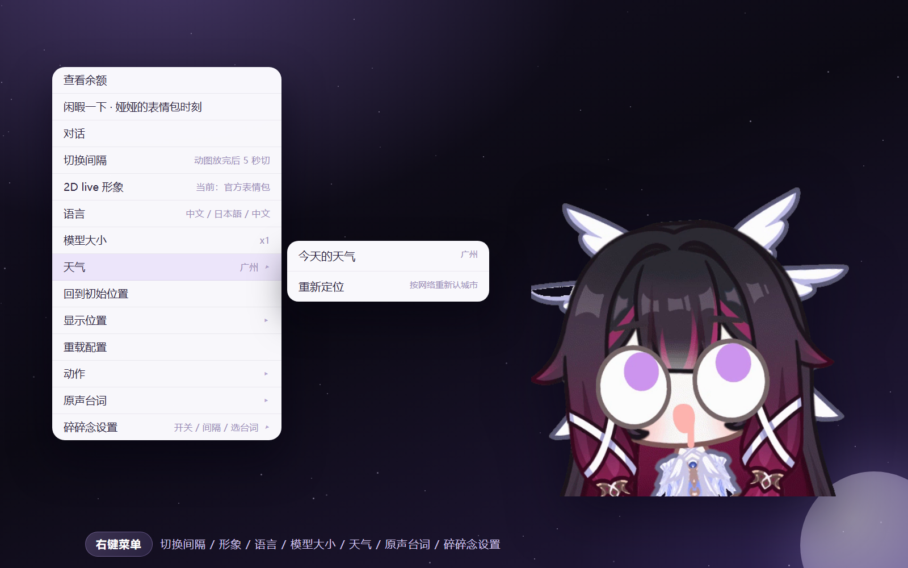
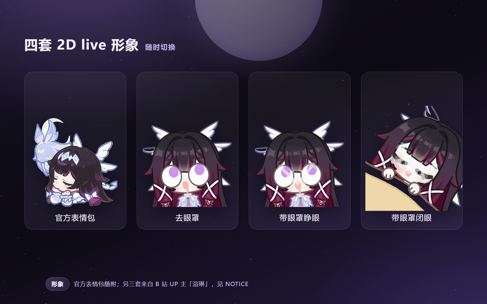
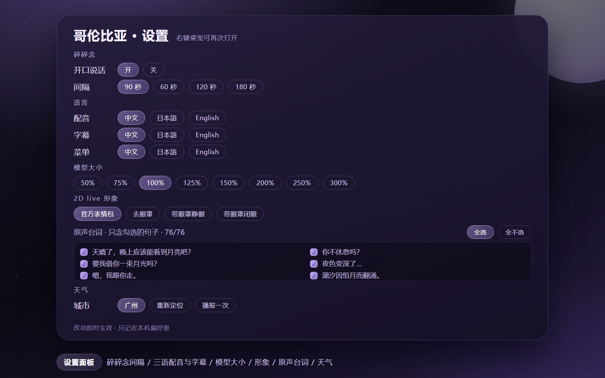

<div align="center">


# dsh-columbina-pet

**哥伦比娅 2D live 桌宠 · DeepSeek Harness 插件**

四套形象 · 76 句三语原声台词 · 天气播报 · 真实物理 · 表情包时刻

[](LICENSE)


</div>

---

## 这是什么

把愚人众第三席「少女」哥伦比娅放进 DeepSeek Harness 的桌面：她会浮在窗口最上层，被拖动时有真实的物理摆动，会按时间与场景轻声说话，会用官方原声念出台词，也会播报今天的天气。

本仓库是 [dsh-pet](https://github.com/PC2005-cloud/dsh-pet)（MIT）的**2D 专用分支**：保留并深化了 2D live 形象、语音台词、菜单与物理，**移除了尚未完善的上游 3D 形象切换**，补上了天气播报与开源所需的文档、占位与版权说明。

> 英文简介：A 2D live desktop pet of Columbina for DeepSeek Harness — four sprite sets, 76 official voice lines in zh/ja/en with synced subtitles, weather reports, and real physics. 3D mode from upstream has been removed on purpose. See [NOTICE.md](NOTICE.md) for asset licensing.

## 预览

| 桌面模式 | 右键菜单 |
| :-: | :-: |
|  |  |

| 四套 2D live 形象 | 设置面板 |
| :-: | :-: |
|  |  |

## 更新公告

> 逐版本明细见 [CHANGELOG.md](./CHANGELOG.md)；可下载的包见 [Releases](https://github.com/Yuanawaqwq/dsh-columbina-pet/releases)。每个版本都会在这里留一段，说明**改了什么、要不要动设置**。

### 1.2.1 · 2026-10-31

> 一版以「修碎碎念字幕」为主的补丁。**不需要动任何设置**，升级后请**完整退出 DSH 再打开**。

- **长句字幕不再提前消失**：碎碎念字幕比声音先没了。根因不在文案，而在时长拿不到——宿主素材接口不返回 `accept-ranges`，Chromium 对不能 seek 的 Ogg 会把 `audio.duration` 报成 `Infinity`，旧逻辑据此退回固定的 3600 ms。现在字幕跟着音频的**实际播放进度**走（`timeupdate` 续命），读多久就显示多久，念完立刻收。
- **字幕不再被裁掉**：碎碎念字幕挪进挂在 `body` 的独立浮层（原先寄生在 `.dsh-pet-root` 里，祖先一旦有 `transform` / `overflow: hidden` 就会把长句整块切走）。
- **拖动宠物时字幕跟着走**：显示期间用 `requestAnimationFrame` 逐帧同步浮层位置，甩飞、落地、贴边都跟得上。
- **碎碎念节奏恢复正常**：设过间隔却发现十几分钟才念一句——计时器被任务状态连带重置，已修。
- **桌面端也能检查素材了**：桌面「语音包与素材」面板补齐，一键数语音包 / 动作 / 表情，缺语音包原地重下，不用翻日志。
- **网页右键菜单向桌面看齐**：菜单项、顺序、文案统一；网页端新增「真实物理：开 / 关」，设置面板里的分区顺序也一致了。
- **天气播报文案统一**：温度一律带 `℃`，中 / 日 / 英句式各自本地化。
- **长句不再被下一句掐断**：`webAutoVoice()` 在触发前先看上一句还在不在播——热身 / 间隔 / 手势补播 / 天气接话这些自动来源都会让路（控制台打 `[dsh-pet] 碎碎念让路 来源=…`），只有你手动点桌宠或点「原声台词」才是强制换句。热身那句也改成每个页面会话只排一次。
- **气泡不再出现乱码 / 豆腐块**：碎碎念气泡曾整串显示成菱形问号。根因是宿主接收请求体时把非 UTF-8 字节直接按 UTF-8 解码（Windows 控制台的 curl / PowerShell 会把中文按 GBK 发出来），替换字符 `�` 就一路写进了气泡。现在请求体先严格 UTF-8、失败再按 GB18030 重解；含 `�`、`锟斤拷` 这类双重转换痕迹的文本**一律不写进气泡**。
- **语音文件支持 Range**：素材接口现在回 `accept-ranges` 并支持 `206` / `416`，音频可以按需取字节，`audio.duration` 能拿到真值（以前不返回 `accept-ranges`，Chromium 对不能 seek 的 Ogg 报 `Infinity`）。字幕仍保留 `timeupdate` 兜底，客户端两个版本都稳。
- **本地接口不再对任何网页敞开**：此前 24 条路由全无来源校验，任意网页都能跨站 POST `/broadcast` 往气泡里塞字、`/whisper` 烧 token。现在写请求若带 `sec-fetch-site: cross-site` 且 `Origin` 是别的 http(s) 站，直接 `403 cross-site-blocked`；同源页面、`file://` 的桌面 Helper、本机脚本（curl / node / python）照常。
- **切回网页模式后桌面 Helper 会退出**：以前 `desktopModeEverActive` 一旦为真就永不复位，切回 `web` 后还留着 3 个空转进程（约 178 MB、无窗口）。现在没有桌面宠物就不再拉起 Helper，切回桌面时自动重启。
- **语音包标记跟着版本走**：`~/.dsh/columbina-pet/voice-pack.json` 的 `version` 之前停在 1.1.5（只在迁移那一次写），每次启动会按当前版本刷新。
- 素材没动（沿用 1.1.11 的原始 webm，约 147 MB），本版只改代码。

### 1.2.0 · 2026-10-31

> 开发期编号是 `1.1.12`，因为功能面到了次版本，正式发布更名 **1.2.0**（内容与 1.1.12 完全一致）。

- **待机动作可选**：右键「待机动作」切 精选 / 当前形象全部动作 / 自己选；「自己选…」打开设置面板里带搜索框的勾选列表，桌面与网页同一套。精选池从 2 段扩到官方 9 / 去眼罩 12 / 睁眼 12 / 闭眼 10 段。
- **待机不再一顿一顿**：带「待机」的片段此前被拉成 20 秒循环（2.4 秒的官方片段 ≈0.12×，折合 3.6 fps），现在统一 0.6×。
- **省电模式真的会停**：旧实现只暂停 `loop` 的视频，而待机是 one-shot 播放，所以什么都没停；现在鼠标 30 秒不动就暂停所有在播视频，并拦住宿主推来的新动作。
- **夜间勿扰 / 音量与静音 / 素材自检与一键修复 / 网页面板同步**：见下面「功能介绍」。
- **余额查询**：默认模型挂在 API Key 版服务商、而本机是账号登录时，不再报「缺少凭证 DEEPSEEK_API_KEY」，自动改查账号余额。
- **素材没动**：沿用 1.1.11 的原始 webm（约 147 MB），本版**没有**做有损压缩；`scripts/shrink-webm.mjs` 留作可选工具。
- **`/healthz` 能分辨「磁盘换了没重启」**：新增 `activatedBuildSha256`（激活那一刻算的 sha256，留在内存）与 `needsRestart`（内存 sha ≠ 磁盘 sha 时为 `true`）。同一版本号重打包时，光看 `buildSha256` 永远等于新盘，只有这组字段能看出内存里跑的是旧代码。
- **启动时自报身份**：每次启动把「这次跑的是哪个版本、哪份代码」写进 `~/.dsh/columbina-pet/activation.json`（`activatedAt` / `activatedVersion` / `diskVersion` / `buildSha256` / `activatedBuildSha256` / `needsRestart`），同时往宿主日志打一行 `[dsh-pet] activated <版本> build <sha8>`。磁盘上已经是新版本、内存里跑的还是旧的时，`needsRestart` 为 `true` 并补一条 warn——以后不用先猜 `/healthz` 怎么访问。
- 升级后需**完整退出 DSH 再打开**；设置项都带默认值，不需要手动迁移。

### 1.1.11 · 2026-10-30

- `/healthz` 增加 `activatedVersion` / `buildSha256`：换包没重启一眼可见。
- `ensure-voice` 增加 120 s 总预算 + 20 s 停滞检测（`DSH_COLUMBINA_VOICE_STALL_MS` 可调）。
- npm 包去掉 `src/`：条目 607 → 465，tarball 148.56 → 148.11 MB。
- 路由路径解码容错：GBK 百分号编码不再整条路由 500。

### 1.1.10 · 2026-10-30

- 修复网页端「全不选」曾把 `lines` 写成 `[0]`（只念第一句）：宿主一次性迁移 + 写入 `prefsRev: 2`。
- 只影响网页模式面板；桌面端一直正常。

## 特性

- **四套 2D live 形象**：`official`（官方表情包）、`nochoker`（去眼罩）、`open`（带眼罩·睁眼）、`closed`（带眼罩·闭眼）。右键菜单「2D live 形象」即时切换，每套自带待机 / 点击 / 拖拽 / 事件动作树（共 246 个 webm）。
- **三语原声台词**：76 句哥伦比娅官方语音，按中 / 日 / 英整理为 94 段切片。配音语言与字幕语言分开设置；**有声音必有字幕**，一句长台词会按播放进度分段换字幕。
- **按场景碎碎念**：问候、午夜、安慰、感谢、提问、玩耍、友人、睡前、认真、俏皮十组场景池，按时间与近期出镜率抽签，不连续重复；开局前 12–22 秒保持安静。
- **工作气泡优先**：正在向用户汇报时，桌宠不会抢走气泡；它的话结束后自动把气泡还给工作状态。
- **天气播报**（v10.4）：菜单「天气 → 今天的天气」，先用气泡给出摘要（城市、天气、当前温度、今日温度区间），隔一拍再用原声台词接一句应景的话；断网时给一句兜底台词，不会卡死。
- **真实物理**：拖拽甩出弧度、松手下落、落地回弹、窗口贴边停靠，参数全部可配。
- **菜单即设置**：切换间隔、2D live 形象、语言（配音 / 字幕 / 菜单）、模型大小 0.5–3×、原声台词勾选、碎碎念开关，菜单本身也随语言切换。
- **时刻表情包**：12 张心情图（好耶 / 抱抱 / 期待 / 出发 / 好吃 / 思考 / 睡觉 / 困了 / 贴贴 / 唱歌 / 谢幕 / 晚安），由台词标签与场景挑选。
- **音量与静音**（1.2.0）：右键「音量」五档 20–100 % 加一键静音，桌面与网页共用一套设置；改完立刻生效，不会掐断正在播的那一句。
- **夜间勿扰**（1.2.0）：设一个时段（默认 23:00–08:00），这段时间碎碎念自动闭嘴；手动点「原声台词」照常播。
- **素材自检与一键修复**（1.2.0）：设置面板「语音包与素材」点一下就数一遍语音切片 / 动作 / 表情，语音包缺了直接原地重下，不用再翻日志。
- **省电模式**（1.2.0，默认关）：闲着 30 秒把循环待机动图定格，鼠标一动立刻继续，长时间挂桌面更省 CPU。
- **待机动作可选**（1.2.0）：右键「待机动作」切精选 / 当前形象全部动作 / 自己选；「自己选」会打开设置面板里可搜索的勾选列表（去眼罩、带眼罩睁眼各 82 段，带眼罩闭眼 65 段，官方表情包 17 段），勾了哪几段就只轮播哪几段。
- **网页模式补平**（1.2.0）：网页端补齐夜间勿扰、省电模式与待机动作（设置面板里同样可搜索勾选），碎碎念时段、音量与静音和桌面共用一套设置。
- **天气城市名本地化**（1.2.0）：定位拿到的城市按字幕语言翻译，中文界面显示「广州」而不是「Guangzhou」；英文/日文界面保留本地拼写。

## 功能介绍

每一项都能从**右键菜单**或**设置面板**进去；下面写清「入口 / 怎么用 / 要注意什么」。

### 形象与动作（四套 2D live）

- 入口：右键「2D live 形象」。
- `official` 官方表情包、`nochoker` 去眼罩、`open` 带眼罩·睁眼、`closed` 带眼罩·闭眼；四套共 246 段 webm，各自带待机 / 点击 / 拖拽 / 事件动作树。
- 切换立即生效，设置会记住；官方那套是 640×360 的 VP9，另外三套是 500×500 的 VP8 + alpha。

### 语音与字幕（三语原声）

- 入口：右键「语言」→ 分别设置**配音语言 / 字幕语言 / 菜单语言**。
- 76 句官方语音整理成 94 段切片；一句长台词会按播放进度分段换字幕，**有声音必有字幕**。
- 「原声台词」里可以勾选只播哪几句（全选 / 全不选 / 逐句勾），设置落 `prefs.json`。

### 碎碎念

- 入口：右键「碎碎念设置」。
- 十组场景池（问候 / 午夜 / 安慰 / 感谢 / 提问 / 玩耍 / 友人 / 睡前 / 认真 / 俏皮），按当前时间与近期出镜率抽签，不连续重复。
- 间隔 60–180 秒可调（默认 90 秒）；启动后前 12–22 秒保持安静。
- **字幕（1.2.1）**：碎碎念的字幕挂在 `body` 上的独立浮层里，不会被子元素祖先的 `transform` / `overflow` 裁掉；宠物被拖动、甩飞时用 `requestAnimationFrame` 跟随；显示时长跟着音频的**实际播放进度**（`timeupdate`）走，念完立刻收，不再固定 3.6 秒。念的时候 F12 里会打 `[dsh-pet] 字幕跟音频 duration=…` 与 `[dsh-pet] 字幕收起（计划 …ms）` 两条日志，方便判断走的是哪条分支。

### 夜间勿扰（1.2.0）

- 入口：右键「夜间勿扰」。四档预设（22:00–07:00 / 23:00–08:00 / 00:00–09:00 / 01:00–10:00），支持跨零点。
- 只挡**自动碎碎念**；手动点「原声台词」照常播，不会被静音。

### 音量与一键静音（1.2.0）

- 入口：右键「音量」→ 静音开关 + 20 / 40 / 60 / 80 / 100 % 五档。
- 桌面与网页共用一套设置（同一个 localStorage 键），改完立刻生效，不会掐断正在播的那一句。

### 待机动作（1.2.0）

- 入口：右键「待机动作」→ 精选（推荐）/ 当前形象全部动作 / 自己选…
- 「自己选…」打开设置面板的**可搜索勾选列表**（去眼罩、带眼罩睁眼各 82 段，带眼罩闭眼 65 段，官方表情包 17 段）；支持全选 / 全不选 / 还原精选，勾了立即生效。
- 精选池：官方 9 / 去眼罩 12 / 睁眼 12 / 闭眼 10 段，90 秒一轮。

### 省电模式（1.2.0，默认关）

- 入口：右键「省电模式」。
- 鼠标 30 秒不动暂停所有正在播的视频（含宿主推来的动作），移动/点击/窗口切回来立刻恢复。

### 天气播报

- 入口：右键「天气」→「今天的天气」（另有重新定位）。
- 先用气泡给摘要（城市 / 天气 / 当前温度 / 今日温度区间），隔一拍再用原声台词接一句；断网给兜底台词。
- 城市名按**字幕语言**本地化（1.2.0）：中文界面显示「广州」而不是「Guangzhou」。

### 素材自检与一键修复（1.2.0 网页端 / 1.2.1 桌面端）

- 入口：设置面板「语音包与素材」→ 检查素材 / 一键修复（桌面右键菜单里也有这一项）。
- 宿主接口：`GET <prefix>/voice/health`、`POST <prefix>/voice/repair`；返回语音切片 / 动作 / 表情的目录、数量与体积，语音包缺了直接原地重下。
- 桌面端的面板页面是 `file://` 源，所以这两个接口响应带 `access-control-allow-origin: *`（1.2.1）。

### 余额查询

- 入口：右键「查看余额」（可在配置里设成定时刷新）。
- 优先用当前默认模型对应的服务商；若是 API Key 版服务商但本机没有 `DEEPSEEK_API_KEY`，自动改查 DSH 账号余额（1.2.0 起），不会只甩一句「缺少凭证」。

### 网页模式

- DSH Web 界面里的宠物与桌面端共用同一份形象、台词、菜单结构；夜间勿扰 / 省电 / 待机动作 / 音量在网页端同样可设，设置面板里也能搜索勾选。
- 网页端改动同样需要**完整重启 DSH** 才生效。

### 桌宠物理

- 拖拽有惯性、松手下落、落地回弹、贴边停靠；参数在 `assets/config.jsonc` 的 `physics` 里可调。
- 「真实物理：开 / 关」（1.2.1 网页端补齐）：关掉后松手不再甩飞、不弹跳，直接落回地面；桌面与网页各自记住选择（网页键 `columbina-physics-web-v1`）。

### 多语言菜单

- 菜单与面板支持中文 / 日本語 / English，随「菜单语言」切换；新加的菜单项也带三语。

## 环境要求

| 项 | 要求 |
| --- | --- |
| DSH | 0.2.x（已在 0.2.1-rc.2 桌面版长期使用） |
| Node.js | ≥ 22.12 |
| 系统 | Windows / macOS / Linux |
| Electron | 43.3.0（首次运行自动下载，或手动 `node scripts/ensure-electron.mjs`） |

## 包体积：为什么这么大、怎么变小

一句话：**超过 90% 的体积是四套 2D live 形象的动作视频**，代码加起来不到 0.6 MB。语音包（33 MB）从 1.1.5 起就外置了，不在包里。

### 体积构成（1.2.0 实测）

| 组成 | 大小 | 说明 |
| --- | --- | --- |
| `assets/webm` | **145.6 MB** | 246 段 500×500 带透明通道的视频：待机、点击反馈、倒霉剧情、余额通知、移动 |
| `assets/fonts` | 3.9 MB | 上首软糖体（字幕、气泡用） |
| `assets/memes` | 1.4 MB | 12 张「时刻表情包」（静态图） |
| `assets/pic` + `logo.png` | 0.5 MB | 预览图与插件图标 |
| `lib` + `runtime` | 0.5 MB | 宿主与渲染端代码 |
| 语音包 | **0（已外置）** | 76 句 × 中文/日文/英文原声约 33 MB，首次启动后台下载到 `~/.dsh/columbina-pet/voice/official` |

webm 按形象拆开：

| 形象 | 段数 | 体积 |
| --- | --- | --- |
| 去眼罩 | 82 | 52.1 MB |
| 带眼罩·睁眼 | 82 | 52.1 MB |
| 带眼罩·闭眼 | 65 | 39.1 MB |
| 官方表情包 | 17 | 2.2 MB |

### 为什么这么大

1. **它们是视频，不是矢量**：每段是 500×500、带 alpha 的 WebM（VP8 + 透明通道侧信道）。浏览器里能「带透明通道 + 流畅循环」的格式基本只有 WebM 系，代价就是必须逐帧编码，没法像 SVG 那样几百字节画一个人。
2. **素材按 1:1 原始码率随包发布**：这批片段平均 **1.2–4.3 Mb/s**，而桌面上实际只显示 160–400 px，码率明显过剩。1.2.0 按使用反馈**没有**默认做有损压缩（压完边缘会略糊），压缩留成可选脚本。
3. **四套形象互相独立**：发色、服装、表情都不同，帧不能共用，所以是 82 + 82 + 65 + 17 段直接相加。

### 怎么优化（按收益排序）

**① 用官方脚本重编码（推荐，约 −56%）**

```bash
FFMPEG=/path/to/ffmpeg node scripts/shrink-webm.mjs --crf 30 --backup D:/backup/webm-orig
```

- 本机实测：**143.4 MB → 62.4 MB**，VP9 + alpha 保留，首帧与原件 RGB 平均差 **0.74/255**（肉眼无差）
- `--crf 24` 更保险：87.3 MB；`--crf 38` 最激进：约 30 MB（按同等比例估算，建议自己先备份试一段）
- **必须用 ffmpeg ≥ 4.4**（2021 年以后）。更老的构建会直接丢掉透明通道，桌宠会变成一块不透明白板；脚本无法自动识别，替换前先解码一帧看四角 alpha 是否为 0
- 默认原地替换、失败的文件保持原样；17 段官方表情包是 VP9 无 alpha，脚本会自动跳过

**② 只保留要用的形象**

删掉不用的 `assets/webm/<前缀>*`，按上表直接省：只留官方表情包约 2.2 MB，官方 + 一套约 54 MB。删完把 `runtime/electron-helper/voice/voice-index.js` 里对应的 `skins[]` 项一并去掉，否则右键菜单里还能选到一套没素材的形象。

**③ 素材外置，多份安装共用**

宿主支持外部素材根 `~/.dsh/columbina-pet/assets`：同名的文件**优先**于包内（`/healthz` 的 `assets.externalActive` / `assets.externalFileCount` 可以查）。把 `assets/webm` 挪过去、包内删掉，就变成「代码随包升级、素材只留一份」。

**④ 选安装方式**

- 插件市场 / `npm i dsh-columbina-pet`：只下 tarball（148 MB），不带 git 历史
- `git clone` 源码安装：仓库带完整历史，比 tarball 更大；升级也要自己拉
- 升级时 npm 会重新取整包（本地缓存命中会快很多），所以「素材外置」对反复升级最划算

## 安装

> ℹ️ **可以与上游 `dsh-pet` 并存**（1.0.4 起）：本插件的路由前缀、bridge scheme、用户目录、会话身份都已迁到 `dsh-columbina-pet*` 命名空间，不再和上游抢 `/dsh-pet-7340`。为兼容旧书签仍会尝试注册旧前缀，旧前缀被上游占用时静默跳过。

### 通过 DSH 插件管理安装（推荐）

1. 打开 DeepSeek Harness 桌面端 → 设置 → 插件 → **添加插件**
2. 在输入框里粘贴仓库地址：

   ```
   github:Yuanawaqwq/dsh-columbina-pet
   ```

   也可以贴完整地址 `https://github.com/Yuanawaqwq/dsh-columbina-pet`。
3. 安装完成后**完整退出 DSH 再打开**（关窗口、刷新页面都不算重启）。
4. 第一次桌宠没出现，说明本机还没有 Electron 运行时：按提示再重启一次，或手动运行

   ```bash
   node node_modules/dsh-columbina-pet/scripts/ensure-electron.mjs
   ```

### 手动装进 profile

```bash
cd ~/.dsh/profiles/<你的 profile>
npm install dsh-columbina-pet
```

然后把它加进 profile 的 `package.json`：

```jsonc
{
  "dependencies": {
    "dsh-columbina-pet": "^1.0.0"
  },
  "dsh": {
    "profile": {
      "bundles": [
        "@deepseek-ai/dsh-base",
        "dsh-columbina-pet"
      ]
    }
  }
}
```

**完整退出 DSH 再打开**（关窗口、刷新页面都不算重启）。

### 从 npm 安装（1.2.0）

```bash
cd ~/.dsh/profiles/<你的 profile>
npm install dsh-columbina-pet@1.2.0
```

装完同样把 `dsh-columbina-pet` 加进 profile 的 `dsh.profile.bundles`，然后**完整退出 DSH 再打开**。

### 从 GitHub 安装

```bash
cd ~/.dsh/profiles/<你的 profile>
npm install github:Yuanawaqwq/dsh-columbina-pet
```

### 从本地源码安装

```bash
cd ~/.dsh/profiles/<你的 profile>
npm install file:C:\path\to\dsh-columbina-pet
# 或 Linux/macOS
npm install file:/path/to/dsh-columbina-pet
```

> 说明：仓库自带约 147 MB 的 2D 形象与语音素材（1.2.0 沿用 1.1.11 的原始素材，不做有损压缩），npm 包 tarball 约 148 MB、解包 161 MB。想自己瘦身可以跑 `node scripts/shrink-webm.mjs`：VP9+alpha 重编码，crf 24 实测 143.4 MB → 87.3 MB，首帧 RGB 平均差 0.5/255、透明边缘最大差 4/255，肉眼看不出差别。国内直连 registry 可能较慢；网络不好时优先走 GitHub 或 Release 附件，或按下面的镜像写法加速。

### 国内网络加速（可选）

先看一眼自己走哪条线更快（数字越小越快）：

```bash
curl -o /dev/null -s -w 'github %{time_total}s
' https://github.com
curl -o /dev/null -s -w 'npmmirror %{time_total}s
' https://registry.npmmirror.com
```

如果 `github` 明显慢于 `npmmirror`，按下面的镜像走：

| 环节 | 常规地址 | 国内镜像写法 |
| --- | --- | --- |
| 插件安装 | `github:Yuanawaqwq/dsh-columbina-pet` | `https://ghfast.top/https://github.com/Yuanawaqwq/dsh-columbina-pet`（或把前缀换成 `https://gh-proxy.com/`） |
| 依赖安装 | `npm install` | `npm install --registry=https://registry.npmmirror.com` |
| Electron 运行时 | `node scripts/ensure-electron.mjs` | 先设 `ELECTRON_MIRROR=https://npmmirror.com/mirrors/electron/`，再运行同一命令 |
| 语音包（外置素材） | `node scripts/ensure-voice.mjs` | `DSH_VOICE_PACK_URL=https://ghfast.top/https://github.com/Yuanawaqwq/dsh-columbina-pet/releases/download/v1.1.0/dsh-columbina-pet-voice-1.1.0.tar.gz node scripts/ensure-voice.mjs` |

Windows PowerShell 里设置环境变量：

```powershell
$env:ELECTRON_MIRROR = "https://npmmirror.com/mirrors/electron/"
$env:DSH_VOICE_PACK_URL = "https://ghfast.top/https://github.com/Yuanawaqwq/dsh-columbina-pet/releases/download/v1.1.0/dsh-columbina-pet-voice-1.1.0.tar.gz"
```

> 镜像都是第三方服务，可用性会变；下载失败就换一个前缀，或直接走仓库自带的 `dsh-columbina-pet-*.tar.gz`（Release 附件里另有一份完整包）。

### 素材外置（可选，1.0.2+）

素材可以从插件目录里搬出去，放在 `~/.dsh/columbina-pet/assets/`：宿主按「外置根优先、包内兜底」读取，形象、表情包、字体、图片与 `config.jsonc` 都适用。

```bash
# 复制到外置根（保留包内原文件）
node scripts/migrate-assets.mjs
# 校验后删除包内素材（插件目录立即瘦身）
node scripts/migrate-assets.mjs --move
```

### 健康检查

宿主在 `GET /dsh-columbina-pet-7340/healthz` 暴露一次自检：版本、Electron 路径、Helper 是否在跑、素材根、语音包状态，以及最近的启动错误（`launch-error.json`）。排障时先看它：

```bash
curl http://127.0.0.1:<DSH 端口>/dsh-columbina-pet-7340/healthz
```

版本一栏有四个字段：`version`（磁盘上 `package.json` 的版本，请求时现读）、`activatedVersion`（内存里正在跑的）、`buildSha256`（磁盘上 `lib/index.js` 现在的 sha256）、`activatedBuildSha256`（**插件激活那一刻**算的 sha256，留在内存里，不随磁盘变化）。前三个对得上说明版本一致；`version` 比 `activatedVersion` 新，就是换包没重启；`buildSha256` 与 `activatedBuildSha256` 不同，就是**同一个版本号又重新打过包、而内存里跑的还是旧那份**（`needsRestart: true`）。

`assetRoots.externalActive` 为 `true` 且 `externalFileCount > 0` 时，说明外置素材已经命中（1.0.3+）；`voicePack.active` 为 `false` 时看 `voicePack.lastError`。

另有一个不用访问 URL 的旁证：`~/.dsh/columbina-pet/activation.json` 记录最近一次激活的时间、版本、`buildSha256`、`activatedBuildSha256`，以及磁盘版本与运行版本是否不一致（`needsRestart`）。

### 第一次启动

首次使用需要 Electron 运行时（约 100 MB，从 npmmirror 下载，可用环境变量换源）：

```bash
node node_modules/dsh-columbina-pet/scripts/ensure-electron.mjs
# 可选环境变量：DSH_PET_ELECTRON_VERSION / DSH_PET_ELECTRON_MIRROR
```

下载好后桌面会出现哥伦比娅；右键她可以打开全部设置。

## 右键菜单

| 菜单 | 作用 |
| --- | --- |
| 切换间隔 | 碎碎念与动作的间隔（常说话 / 适中 / 安静 / 很安静 / 只动手） |
| 2D live 形象 | 四套形象即时切换 |
| 语言 | 配音语言、字幕语言、菜单语言分别切中 / 日 / 英 |
| 模型大小 | 0.5× – 3×，窗口限制在屏幕工作区内 |
| 天气 | 今天的天气 / 重新定位 |
| 原声台词 | 按场景分组勾选允许说的句子；「打开设置面板」看完整清单 |
| 碎碎念设置 | 开 / 关桌宠主动说话 |

## 配置

配置分三层，后面的覆盖前面的：

1. **包内默认**：`assets/config.jsonc`
2. **用户覆盖**：`~/.dsh/dsh-pet/main-config.jsonc`（只写要改的键即可，`pets` 按 `id` 合并）
3. **单只宠物覆盖**：`~/.dsh/dsh-pet/pet/<id>.jsonc`

素材同样支持用户覆盖（优先于包内）：

| 素材 | 用户目录 | 包内目录 |
| --- | --- | --- |
| live 形象 | `~/.dsh/dsh-pet/main-animation/webm/` | `assets/webm/` |
| 表情包 | `~/.dsh/dsh-pet/memes/` | `assets/memes/` |
| 外置素材根（1.0.2+，优先级最高） | `~/.dsh/columbina-pet/assets/` | — |

常用字段（`assets/config.jsonc` 内有完整注释与默认值）：

| 键 | 说明 |
| --- | --- |
| `pets[].name` / `size` / `position` | 名字、初始大小与出现位置 |
| `physics` | 重力、回弹、阻尼、贴边等物理参数 |
| `animations` | 动作树：待机、点击、拖拽、事件、动作分组 |
| `memes` | 表情包文件名与触发标签 |
| `workStatusTexts` | 会话工作状态气泡文案 |
| `whisperPrompt` | 桌宠人设（供对话 / 主动说话使用） |

## 语音系统

语音是一个 **classic script sidecar**：`runtime/electron-helper/voice/voice.js`，在 Electron 页面里直接跑，不需要构建。

- 语音索引：`runtime/electron-helper/voice/voice-index.js`（`window.__COLUMBINA_VOICE`，含台词表、语义词组、四套 skins、表情包标签）。
- 音频：`runtime/electron-helper/voice/official/<lang>/<n>.<ext>`（76 句 × 三语），切片音频在 `voice/clips/`。
- 设置镜像：`runtime/electron-helper/voice/voice-settings.js` 是默认值的静态副本；菜单里的调整也会写进浏览器 `localStorage`（键 `columbina-voice-local-v1`）。
- 想加台词：在 `voice-index.js` 的 `lines` / `menu` 里加条目，把音频放进对应语言目录，重启桌宠即可。菜单标签会映射到台词下标，改标签别忘了同步改 `menu`。
- 想换角色：替换四套 `webm` 动作、`assets/memes`、`voice/official/*` 与 `voice-index.js`，再把 `assets/config.jsonc` 里的名字与人设改成你的角色。

> 「打开设置面板 / 选择台词」的侧边栏面板由姊妹插件 [dsh-columbina-theme](https://github.com/Columbina-sn/dsh-columbina-theme) 提供，本仓库**不含**它。不装也能用右键菜单完成所有设置。

## 天气播报

- 定位：`ipwho.is` 的 IP 归属（城市、经纬度），只在需要时请求一次，缓存 24 小时。
- 预报：`open-meteo.com` 免费接口，取当前温度、湿度、风速、当日最高 / 最低温与 WMO 天气码，缓存 20 分钟。
- 城市名本地化：当字幕语言是中文且定位在中国时，用 open-meteo geocoding 反查中文城市名。
- 天气码 → 天气词 → 台词场景（雨 / 雷 / 雪 / 风 / 其他），再按字幕语言给出中文 / 日文 / 英文摘要。
- 断网或超时（9 秒）会弹一句兜底台词并结束，不阻塞后续交互。
- 调试接口：页面内 `window.__columbinaVoice.weatherInfo(true)` 返回当前天气对象，`.weather()` 触发一次播报。

## 目录结构

```
dsh-columbina-pet/
├─ lib/                    # 预构建的宿主与浏览器插件（DSH 实际加载这里）
├─ src/                    # TypeScript 源码（参考；构建配置未随包发布）
├─ runtime/electron-helper # 桌宠运行时：主进程、精灵、渲染、语音 sidecar
│  └─ voice/               #   voice.js、voice-index.js、官方原声与切片
├─ assets/
│  ├─ webm/                #   四套形象的动作素材
│  ├─ memes/               #   12 张时刻表情
│  ├─ fonts/               #   气泡字体
│  ├─ pic/                 #   光标与通知图标
│  ├─ preview/             #   README 预览图（不随 npm 包发布）
│  ├─ config.jsonc         #   默认配置
│  └─ logo.png             #   插件图标（≤256 KiB）
├─ scripts/ensure-electron.mjs
├─ cordis.patch.yml        # 挂载声明
├─ NOTICE.md               # 素材版权声明
└─ package.json
```

## 二次开发

- `lib/` 是打包产物，DSH 运行时加载的是它；`src/` 只是源码参考。修改 `src/` 后需要自己按 TS 工程重建 `lib/`（上游构建配置未随包发布）。
- `runtime/` 下是可直接改的 classic script，改完 `node --check <file>.js` 自检，重启桌宠即生效。
- 页面里调试：`window.__columbinaVoice` 暴露 `state()`、`speak(text)`、`whisper(scene, force)`、`weatherInfo(force)`、`weather(force)`、`setLang`、`setScale`、`setSkin` 等接口。

## 已知限制

- 本分支只含 2D 形象，上游的 3D 形象切换已移除。
- `assets/fonts/上首软糖体.ttf` 是非开源字体；对外分发或商用前请确认授权，或替换成自己的字体。
- 官方语音、形象与表情属于同人二创素材，仅建议个人非商业使用，详见 [NOTICE.md](NOTICE.md)。
- `lib/` 与 `src/` 可能存在版本差（以 `lib/` 实际行为为准）。

## 致谢与版权

- 上游：[dsh-pet](https://github.com/PC2005-cloud/dsh-pet)（MIT，Copyright © 2026 PC2005-cloud），本仓库的骨架、runtime 与大部分工程实现来自它。
- 角色与素材：详见 [NOTICE.md](NOTICE.md)。
- 2D 形象：「官方表情包」版由本项目整理；「去眼罩 / 睁眼 / 闭眼」三套由 B站 UP 主 [@渲琳](https://space.bilibili.com/39497551) 使用 EmoteLab 制作，原作见 [【EmoteLab】捏了哥伦比娅和桑多涅！](https://www.bilibili.com/video/BV1gSczzjEub)。感谢作者分享，如作者希望下架请联系移除。
- 主题与设置面板：[dsh-columbina-theme](https://github.com/Columbina-sn/dsh-columbina-theme)。

## License

[MIT](LICENSE) —— 代码部分。素材部分见 [NOTICE.md](NOTICE.md)。
