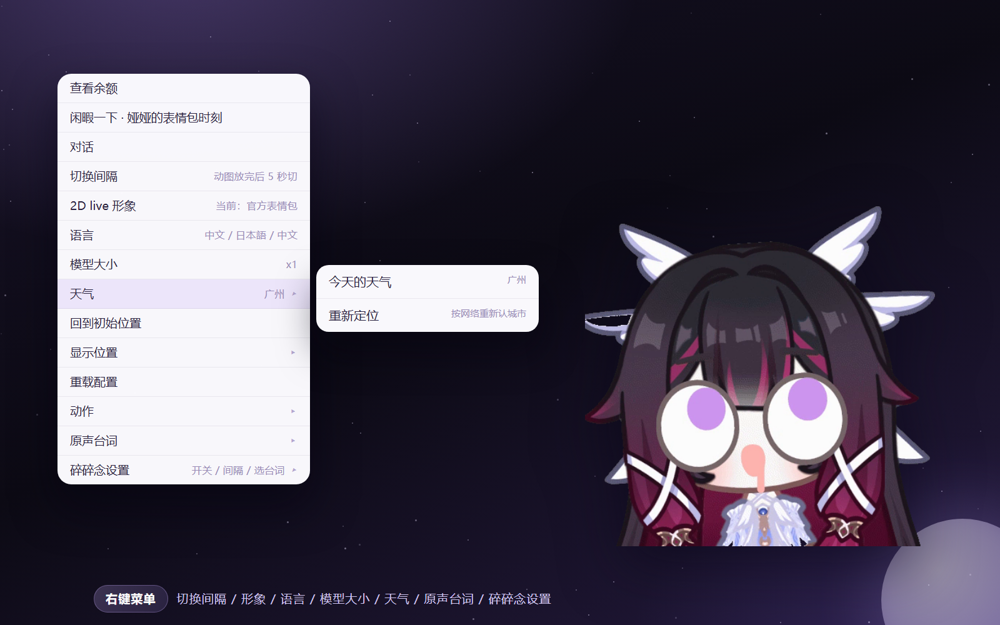
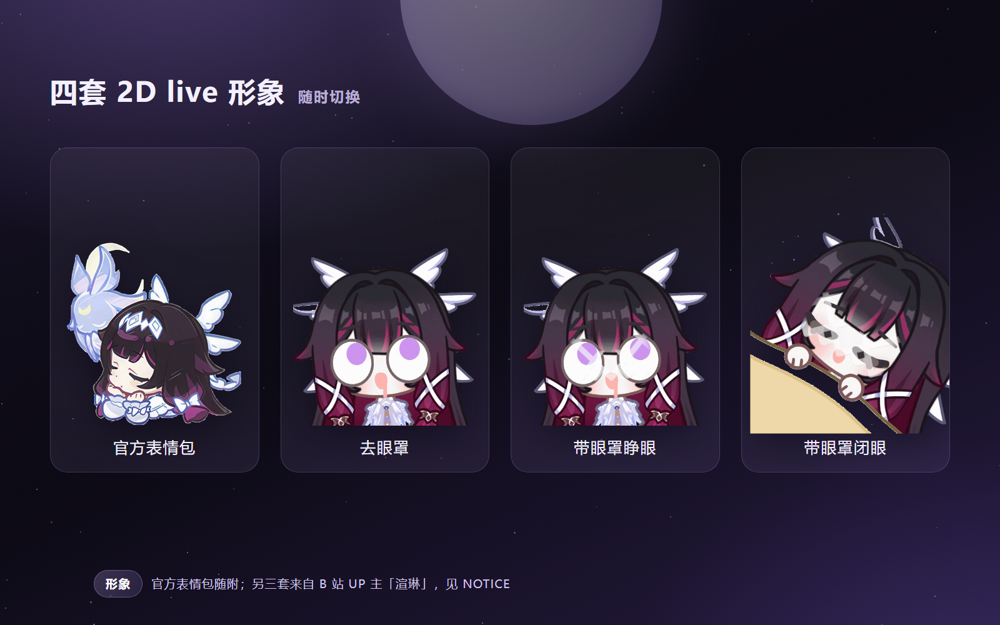
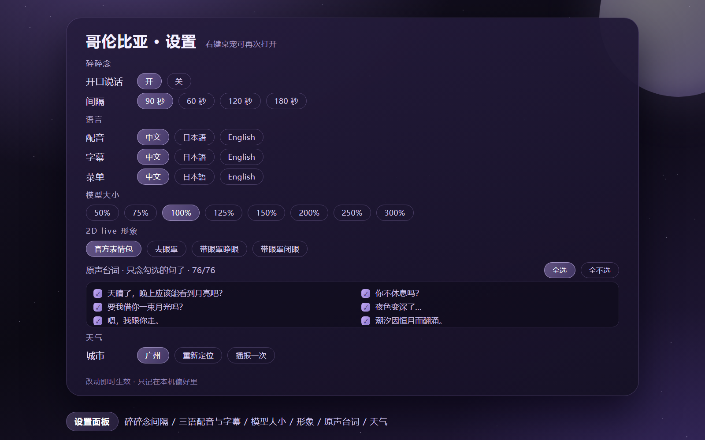

<div align="center">


# dsh-columbina-pet

**《原神》哥伦比娅 2D live 桌宠 · DeepSeek Harness 插件**

四套形象 · 76 句三语原声台词 · 天气播报 · 真实物理 · 表情包时刻

<p><strong>中文</strong> | <a href="README.en.md">English</a> | <a href="README.ja.md">日本語</a></p>

[](LICENSE)


<br />

**作者**：[六硬币的好活](https://space.bilibili.com/1947282109) · B 站 uid **1947282109** ｜ [GitHub @Yuanawaqwq](https://github.com/Yuanawaqwq)

</div>

---

## 这是什么

把《原神》里愚人众第三席「少女」哥伦比娅放进 DeepSeek Harness 的桌面：她会浮在窗口最上层，被拖动时有真实的物理摆动，会按时间与场景轻声说话，会用官方原声念出台词，也会播报今天的天气。

本仓库是 [dsh-pet](https://github.com/PC2005-cloud/dsh-pet)（MIT）的**2D 专用分支**：保留并深化了 2D live 形象、语音台词、菜单与物理，**移除了尚未完善的上游 3D 形象切换**，补上了天气播报与开源所需的文档、占位与版权说明。

> 英文简介：A 2D live desktop pet of Columbina (Genshin Impact) for DeepSeek Harness — four sprite sets, 76 official voice lines in zh/ja/en with synced subtitles, weather reports, and real physics. 3D mode from upstream has been removed on purpose. See [NOTICE.md](NOTICE.md) for asset licensing.

## 关于后续

先把期待放在明面上：

- **功能面基本到这儿了。** 后面不会再往里堆新功能，主要做两件事：跟住 DeepSeek Harness 的新版本（接口一变就修，兼容声明也会跟着更新），以及把现有的东西继续磨顺——性能、稳定性、交互上的小毛刺。
- **有想要的功能，欢迎来说。** B 站私信 [六硬币的好活](https://space.bilibili.com/1947282109)（uid 1947282109）；或者你自己动手，项目是 MIT 的，改完想合回来也欢迎（提 PR 就行，不熟流程也可以先把改动贴给我看）。
- **遇到 bug，一定要来喊我修。** 这条优先级最高，别自己忍着，也别自己 hack。报的时候尽量带上：DSH 版本 + 插件版本（见下面「健康检查」的 `version` 一栏）、现象与复现步骤、F12 控制台或日志里带 `[dsh-pet]` 的行。

## 预览

| 桌面模式 | 右键菜单 |
| :-: | :-: |
|  |  |

| 四套 2D live 形象 | 设置面板 |
| :-: | :-: |
|  |  |

## 更新公告

> 逐版本明细见 [CHANGELOG.md](./CHANGELOG.md)；可下载的包见 [Releases](https://github.com/Yuanawaqwq/dsh-columbina-pet/releases)。每个版本都会在这里留一段，说明**改了什么、要不要动设置**。

### 1.2.6 · 2026-11-18

> 这一版**不加新功能、不动形象与台词**，做的是「让她动得更顺」：动作循环到环点不再卡一下、网页端也跟上同一套、天气问不到时先给个回应、诊断日志不用再折腾环境变量。**不需要动任何设置**；升级后请**完整退出 DSH 再打开**（宿主、桌面 helper、网页端三处都改了）。

- **动作循环不再每圈卡一下**：以前「一段动作要放不止一遍」时，每放完一遍都要把播放位置拨回 0 再重新开播，实测就是环点黑一下、再接一圈。现在改成视频元素自己的 `loop` 无缝循环，到点再摘掉 `loop`，让最后一遍自然放完。桌面 helper 与网页端现在是**同一套**（此前网页端还停在旧的 seek 重播实现上）。
- **「切换间隔」按字面意思生效了**：以前设 2 秒，实际是「第一遍放完 + 再停 2 秒」，待机动作（0.6× 慢放）常常要 6–10 秒才换一次，这个设置项几乎不起作用。现在设 N 秒就是「播够 N 秒、这一遍放完就换」。想让待机恢复从前那种慢悠悠的节奏，把间隔调到 **3000–5000 毫秒**即可。
- **网页端碎碎念的配图补回来了**：1.2.5 修字幕时漏了一步——字幕改走独立浮层后只写了字，`image` 一路传到浏览器却没人画出来（桌面端不受影响）。现在浮层按原口径拼图：显式 `url` 优先，否则用表情包名走 `/pic/memes/<名>.png`，图在字上方、宽度跟着宠物尺寸走。
- **天气先给个回应**：点「今天的天气」后如果网络慢，4 秒时会先说一句「云有点厚，再等等…」（日 / 英同步），而不是干等十几秒。
- **问不到时也说得明白**：失败文案改成「今天的天气…这会儿问不到呢。过一会儿我再试一次。」，气泡从 4.2 秒延长到 5.6 秒，并在 20 秒后**后台静默重试一次**，成功了也不打扰你。
- **旧数据标清楚是哪一刻的**：网络抽风时用旧记录顶上，句子后面标「（旧数据 · 21:38）」；同时挂一次后台刷新，刷新成功后下次回答就是新的。
- **诊断日志不用再改环境变量**：`~/.dsh/columbina-pet/main-config.jsonc` 里加一个顶层 `diagLog` 即可——`true` 写到默认的 `diag.log`，或直接写路径（相对路径落在 `~/.dsh/columbina-pet/` 下）。环境变量 `DSH_PET_DIAG_LOG` 仍然优先，临时排障照旧可用。
- **测试**：新增 `test/test-126-polish.cjs`（65 条断言，把 `installAnimPacing` 与 `applyDiagLogSetting` 切出来用假对象跑：`loop` 挂上与摘掉的时机、换代自停、`loop` 挂不上时的兜底重播、`diagLog` 四种取值与环境变量优先级、网页端同一套口径）。网页端字幕配图另在 `test/test-whisper.cjs` 补了 10 条回归断言；总数 **15 文件 / 333 断言**。
- **README（三语同步）**：新增 1.2.6 公告；「诊断日志」一节补配置文件写法；「切换间隔」的说明改为按字面生效。

### 1.2.5 · 2026-11-18

> 这一版**不改形象、不加新功能**，修的是四处「用起来别扭」：贴边时菜单互相压、原声台词条目只剩正文、天气要等很久还说错话、点了「重新定位」没反应。**不需要动任何设置**；升级后请**完整退出 DSH 再打开**（宿主半边也改了 `/healthz`）。

- **贴屏幕右缘时菜单不再互相压**：右键菜单被夹在「宠物窗口 ∩ 屏幕工作区」里，窗口贴右边时可用宽度只剩一半左右，三级菜单原来会被硬夹回去、压在上一级上面。现在按菜单层级给每一列分配宽度（每列最多 300 px、最少 120 px），窄的时候自动进入紧凑模式：灰色摘要让位、只留标题，绝不把标题压成省略号。
- **原声台词条目恢复「短标题 + 灰句」**：1.2.3 引入三语标题时判断写反了，中文菜单里标题被换成整句正文，菜单一下变臃肿，子项还挡不住上一级。现在改回标题优先；日/英菜单里凡缺译名处同样修好。
- **天气更快，也少说错话**：20 分钟内的天气直接答缓存，同时在后台静默刷新（以前每次都要现拉一次网络）；网络抽风时先用旧记录顶上，并在句子里注明「（21:38 记下的）」，而不是干等或只说「问不到」。
- **晴天不再总念「我的歌」**：晴天 / 多云 / 阴 / 雾没有专用天气台词，原来会退回闲聊组随机取，而组里第一条正好是那句 8.5 秒的「我的歌并不为谁而唱」。现在退回闲聊时会避开刚念过的那一句。
- **「重新定位」先给个回应**：点了之后立刻出「让我看看你在哪…」，定位到城市马上报，天气在后台接着算。
- **`/healthz` 能分清两种「没在跑」**：新增 `helperDisabled`（是不是你用 `DSH_PET_NO_HELPER=1` 主动关掉的）与 `clientBuildSha`（客户端那份的哈希，用来看是不是「只换了入口文件」的半装）。

### 1.2.4 · 2026-11-16

> 这一版**不动形象、不动台词、不加新功能**，只做一件事：她起不来的时候，让原因看得见。**不需要动任何设置**；升级后同样请**完整退出 DSH 再打开**。

- **根因：日志一直在写，只是写进了没人看的地方**：DSH 0.2.2-rc.3 的 `ctx.logger` 是 pino 风格的采集器——`info / warn / error` 方法都在，消息却只进它自己的缓冲，**不进终端**。桌面 App 又把宿主的 stdout 直接 pipe 给 GUI 进程、没有接收方。于是「桌面宠物起不来」在宿主里是**零痕迹**：没有报错、没有 `launch-error.json`、任务管理器里也没有 `electron.exe`。现在所有诊断先直出 `console`，再转给宿主 logger，两边各自兜底。
- **给没有终端的宿主留一份日志（可选）**：设 `DSH_PET_DIAG_LOG=<路径>` 后，诊断同时追加进文件（`ISO 时间 [级别] 消息`，超过 2 MB 轮转成 `.1`）。不设就不写诊断日志。桌面 App 里要看日志，就靠它。
- **假的 / 残缺的 Electron 不再被当成可用**：以前只校验「是文件且大于 1 MB」，改名的大文件或更新到一半的 exe 都能骗过校验，然后 spawn 必然失败。现在再验 PE 头（`MZ` → `PE\0\0`、且不是 DLL；**仅 Windows**，macOS / Linux 的产物格式不同，保持原来的宽松判定），骗不过去了。
- **启动失败会留下 `launch-error.json`**：helper `spawn` 失败时写 `{stage: "helper-spawn", command, message}`，和「Electron 下载失败」那份同目录、同格式。
- **不想让她起桌面窗口时：`DSH_PET_NO_HELPER=1`**：跳过 Electron 探测与下载，只打一行提示，浏览器里的宠物照常。排查「是不是 helper 拖累了宿主」时很有用。

### 1.2.3 · 2026-11-16

> 这一版**不加新角色、不改台词**，修的是「她把自己藏起来之后你就找不到她了」这一件事，顺手把音量与夜间勿扰做成任意值。**不需要动任何设置**；升级后请**完整退出 DSH 再打开**（宿主半边也改了）。

- **「显示位置 → 都不」不再是单向门**：以前 `display: none` 会让网页宠物不渲染、桌面 helper 不启动、连托盘图标都消失——屏幕上没有任何还能点的地方，只能靠你记得去「设置 → 哥伦比娅」里改回来。现在两处兜底：①设置页顶部会出现一条警示条「所有桌宠都被隐藏了」，点一下就恢复为「仅桌面」；②托盘改成四项平铺（仅网页 / 仅桌面 / 两者 / 都不），当前项打勾，不再用一个复选框「点一下就从桌面跳到都不」。
- **显示位置改动留痕**：每次 `display` 写入都会记一行到 `~/.dsh/columbina-pet/display-changes.ndjson`（时间、宠物 id、从什么变成什么、来源：网页菜单 / 桌面菜单 / 托盘 / 设置面板 / API），`/healthz` 的 `displayChanges` 直接回最近 10 条。下次她真不见了，一条命令就能知道是谁在什么时候改的。
- **音量 0–100 % 任意值**：右键「音量」的五档（20/40/60/80/100 %）之外新增「自定义音量…」，跳进设置面板的「音量」段用滑杆拖，**每 5 % 一格、拖动时即时生效**（不会掐断正在念的那句）。静音开关仍在同一段里。
- **夜间勿扰任意时段**：右键「夜间勿扰」的四档预设之外新增「自定义时段…」，跳进设置面板的「夜间勿扰」段，用两个时间输入框填开始 / 结束（精确到分），跨零点照旧支持，右下角会标「（跨午夜）」。
- **网页端补齐同一套入口**：网页宠物右键菜单也多了「自定义音量…」「自定义时段…」，设置面板同样有「音量」「夜间勿扰」两段（滑杆 + 两个时间框），点菜单项会直接滚到对应那一段。两端功能面对齐，设置各记各的（桌面 helper 一份、页面一份）。
- **修好「切到网页端后她整块消失」**：以前网页半的 bundle 开头有一道「同一页面只跑一次」的守卫。插件被禁用再启用、或客户端代码热更新时，DSH 会以 live 模式重新执行同一份 bundle，守卫直接 `return`，于是 `window.__ModuleLoader__.load()` 再没被调用——宠物不见了，连「设置 → 哥伦比娅」整页也一起消失。现在守卫只在启动排队阶段（`__ModuleLoader__.mode === "queue"`）去重，live 阶段一定重新注册；万一同一个 id 重复注册，只吞 `duplicate` 告警、不让整页崩掉。实测：禁用 → 启用之后 `shell.overlay` 的 `pet` 与 `settings.section` 的 `pet-config` 立刻回到插槽里，不用刷新页面。
- **设置面板也能选语言了**：设置面板的「语言」段在「配音 / 字幕 / 菜单」之外多了「面板」一行，可以单独选 中文 / 日本語 / English，也可以选「跟随菜单」——面板文案（段标题、行标签、按钮、提示）随之切换，跟菜单语言解耦。
- **菜单里不再残留中文**：`menuLang` 切到日本语 / English 之后，桌面菜单与网页菜单里原本没进字典的条目（省电模式、语音包与素材、设置面板的段标题、台词分类名「关于我 / 关于同伴 / 突破的感受 / 战斗中的低语 / 元素战技与爆发」等共 75 条）现在都有译名；两端字典同源，`test-i18n-coverage.cjs` 会扫描源码里所有中文 label / hint / placeholder，漏一条就红。
- **「显示位置 = 两者」时网页端菜单不再退回最初始那套**：以前网页菜单用 `display === "web"` 判断要不要塞语音、台词、碎碎念分支，`both` 时判定失败，菜单只剩「查看余额 / 碎碎念 / 对话 / 回到初始位置 / 真实物理 / 显示位置 / 动作」七项。现在按「网页端可见」判断（`isWebVisible`），`both` 下菜单与「仅网页」完全一致。
- **设置面板不再自己往下跳**：以前拖碎碎念间隔的滑杆，松手那一刻面板会重渲染并把滚动位置拉回当前段段首（看起来像"界面往下跳"）。现在重渲染保留原滚动位置，只有从菜单点某一项时才滚到那一段；间隔拖动过程也不再整块重建。
- **日英菜单的台词项改成「标题 + 正文摘要」**：以前菜单语言切到日文 / 英文后，原声台词的子项只显示被截断的正文（`They call this a…`），根本分不清是哪一句。现在和中文一致：子项显示该语言的台词标题（`Chat: Singing` / `世間話・歌`），提示行给正文摘要；设置面板的台词勾选列表同理。桌面与网页两端共用同一套标题字典（76 条 × 2 语言）。
- **日英菜单的台词摘要也跟着语言走**：以前摘要固定取字幕语言的正文，所以「字幕＝中文、菜单＝日本語 / English」时，标题翻了、右边那行提示还是中文。现在摘要跟菜单语言（中文菜单仍取字幕语言）；`test-menu-i18n.cjs` 直接用「字幕＝中文」的真实配置跑菜单树，摘要若还是中文就红。
- **台词标题改成官方内文本**：76 条台词标题不再用自译，而是照游戏内文本重写——英文取官方语音条目的写法（`Chat: Singing`、`About Columbina: Eye Mask`、`About the "Tri-Lunar Convergence"`、`Feelings About Ascension: Climax`），日文同样（`世間話・歌`、`コロンビーナ自身について・アイマスク`、`「三相月臨」について`、`「雄鶏」について`）。官方把同组几句只给一个组名时（`Elemental Skill` / `元素スキル`、`Low HP` / `HP低下`），就写成「组名 + 行号」（`Elemental Skill · 1` / `元素スキル・1`）。例外：动作切片名（`坐牢 1`、`通知_提示 星星_收藏`、`转向`）是素材文件名，官方文本里没有对应条目，仍按语义意译。
- **日文译文整体校对了一遍**：修掉 17 条「英文值覆盖日文值」的同键重复（动作切片别名在日文界面显示成 `Snack / Humming / Idle`）、17 条角色名误译（`コロンビア` → 官方写法 `コロンビーナ`），另统一了一批措辞（`表示先`、`元の位置に戻す`、`オリジナルボイス`、`元素スキルと元素爆発`、`おやすみモード` 等，合计 37 条必改 + 27 条更自然）。
- **菜单里的小项也清干净了**：省电模式、语音包与素材、待机动作、2D live 形象、音量、夜间勿扰、碎碎念开关与间隔单位这些子项的 label / hint 全部跟着菜单语言走，网页端同步；新增 `test-menu-i18n.cjs` 直接跑出两棵菜单树——英文树里出现任何汉字、日文树里出现没翻译的中文键，测试就会红。
- **动作切片名也有三语**：右键「动作」子菜单与设置面板的待机动作列表里，每一项都是素材文件名（`喝(饮料杯)`、`打字(恼怒)`、`通知_提示 Bits`…）。以前切到日文 / 英文后这些仍是中文，现在 99 个切片名（含四个形象各自的池子）都进了字典，测试会比对 `assets/webm` + `voice-index.js` 的池子，新增素材若不补译名会直接红。
- **碎碎念更常说官方原声**：以前碎碎念是「55 % 念 wiki 正式台词、45 % 用早期从短视频切出来的片段」，用户会觉得"片段污染了、官方原声变少"。现在改成 **78 % 正式台词 / 22 % 片段**，并且 4 字以下的碎片（「钱」「问号」这种）不再单独出现。想回到旧比例改 `voice.js` 里 `Math.random() < 0.78` 一处即可。
- **issue 报告里的 P1 / P2 / P3 全部修完**：设置面板拖动间隔滑杆后单位不再回落中文（桌面 `panelTr('秒')`、网页 `webTr("秒")`）；网页三个开关按钮的「开 / 关」与素材按钮的「修复中… / 一键修复」都过了 `webTr`；网页间隔滑杆与调度统一到 **60–180 秒**（原先 15–300 秒，调度还真会 15 秒一次）；`panelJumpSection` 默认值改回 `false`，与注释和 README 一致；托盘四项菜单与 tooltip 随菜单语言切换（主进程每 4 秒读一次 `prefs.json`）；`display-changes.ndjson` 超过 256 KB 自动轮转、只留最后 200 行，冷启动只读尾部 64 KB。新增 `test/test-panel-i18n.cjs`（27 条断言，按区域扫面板文案，三元与拼接漏网也会红），用例总数 11 文件 / 212 断言；复核后又补了三处：桌宠右键菜单改语言会经 `PetShared.postAction` 把 `menuLang / panelLang / voiceLang / subLang` 推给宿主（托盘不必等网页端改一次才同步）、宿主 `POST /voice-prefs` 的 `intervalSec` 夹取统一到 60–180（原先 15–3600）、推送链路与宿主夹取也进了断言。
- **三语文档也补齐了**：英文版与日文版的「开发与测试」段落后于中文版——测试还写「5 个用例 93 断言」、环境表缺 `0.2.2-rc.3`、目录树把只在仓库里的 `src/` 与 `.github/workflows/ci.yml` 当成包内路径，树注释也还是中文。现在三份 README 同一内容各自成文：11 文件 / 212 断言并逐项列出、环境表补 rc.3、目录树注明「仓库内，不随 npm 包发布」并翻译注释，结构一致（675 行 / 43 个三级标题 / 75 行表格）。
- **兼容声明补上 0.2.2-rc.3**：`dsh.compatibility.dshReleases` 增 `0.2.2-rc.3: compatible`（6 个命名导入、6 个服务成员、`shell.overlay` / `settings.section` 槽位在 rc.3 下实测正常）。

### 1.2.2 · 2026-11-09

> 这一版**不改宠物的动作、声音和脾气**，改的是「以后不容易坏」的部分：测试、CI、兼容声明、安装说明。**不需要动任何设置**，升级后同样请**完整退出 DSH 再打开**。

- **测试进了仓库**：以前那 93 条断言躺在临时目录里，只有写的时候记得怎么跑。现在 5 个用例（碎碎念字幕 19 / 字幕跟音频 15 / 请求体编码 19 / Range 24 / 跨站写 16）挪到 `test/`，`npm test` 一条命令跑完，零依赖、不联网、自带假 DOM 与假时钟。
- **每次提交自动跑**：新增 GitHub Actions，Node 22 与 24 各跑一遍语法检查与全部用例，坏了当场标红，不用再靠人记着。
- **兼容声明跟上新版 DSH**：`dsh.compatibility` 补上 `0.2.2-rc.1`；`@deepseek-ai/*` 的 peer 依赖从 `^0.2.0-rc.1` 放宽到 `>=0.2.0-rc.1 <0.3.0`——0.2.x 里的小版本升级不会再被标成不兼容。
- **安装时不容易误会**：README 安装段直接写明「tarball 约 148 MB，第一次装要等几分钟，别中途取消」，免得以为卡死。
- **`src/` 讲清了定位**：新增 `src/README.md`——发布产物是 `lib/`、没有构建步骤；`src/` 是半同步的参考源码，会和 `lib/` 漂移，判断真实行为请看 `lib/`。
- **遇到问题能自己查**：README 新增「遇到问题怎么办」——版本/代码/语音包/Helper 四个数怎么对、每个症状先看哪一行、怎么修，附报 bug 要带的信息。顺手订正了配置路径（实际目录是 `~/.dsh/columbina-pet/`，旧 `dsh-pet` 会自动迁移一次）。
- **文档体检**：README 通篇按当前实现重过了一遍——自定义镜像变量名（`DSH_PET_ELECTRON_MIRROR`）、语音包镜像示例版本（v1.1.4）、右键菜单完整表（含音量 / 夜间勿扰 / 省电 / 素材自检 / 设置面板 / 待机动作 / 真实物理）、目录结构（`test/`、`docs/screenshots/`、切片音频）都对齐了；开头补上作者署名与联系方式。
- 素材与运行时行为都没动。

### 1.2.1 · 2026-10-31

> 一版以「修碎碎念字幕」为主的补丁。**不需要动任何设置**，升级后请**完整退出 DSH 再打开**。

- **长句字幕不再提前消失**：碎碎念字幕比声音先没了。根因不在文案，而在时长拿不到——宿主素材接口不返回 `accept-ranges`，Chromium 对不能 seek 的 Ogg 会把 `audio.duration` 报成 `Infinity`，旧逻辑据此退回固定的 3600 ms。现在字幕跟着音频的**实际播放进度**走（`timeupdate` 续命），读多久就显示多久，念完立刻收。
- **字幕不再被裁掉**：碎碎念字幕挪进挂在 `body` 的独立浮层（原先寄生在 `.dsh-pet-root` 里，祖先一旦有 `transform` / `overflow: hidden` 就会把长句整块切走）。
- **拖动宠物时字幕跟着走**：显示期间用 `requestAnimationFrame` 逐帧同步浮层位置，甩飞、落地、贴边都跟得上。
- **碎碎念节奏恢复正常**：设过间隔却发现十几分钟才念一句——计时器被任务状态连带重置，已修。
- **桌面端也能检查素材了**：桌面「语音包与素材」面板补齐，一键数语音包 / 动作 / 表情，缺语音包原地重下，不用翻日志。
- **网页右键菜单向桌面看齐**：菜单项、顺序、文案统一；网页端新增「真实物理：开 / 关」，设置面板里的分区顺序也一致了。
- **天气播报文案统一**：温度一律带 `℃`，中 / 日 / 英句式各自本地化。
- **长句不再被下一句掐断**：`webAutoVoice()` 在触发前先看上一句还在不在播——热身 / 间隔 / 手势补播 / 天气接话这些自动来源都会让路（控制台打 `[dsh-pet] 碎碎念让路 来源=…`），只有你手动点桌宠或点「原声台词」才是强制换句。热身那句也改成每个页面会话只排一次。
- **气泡不再出现乱码 / 豆腐块**：碎碎念气泡曾整串显示成菱形问号。根因是宿主接收请求体时把非 UTF-8 字节直接按 UTF-8 解码（Windows 控制台的 curl / PowerShell 会把中文按 GBK 发出来），替换字符 `�` 就一路写进了气泡。现在请求体先严格 UTF-8、失败再按 GB18030 重解；含 `�`、`锟斤拷` 这类双重转换痕迹的文本**一律不写进气泡**。
- **语音文件支持 Range**：素材接口现在回 `accept-ranges` 并支持 `206` / `416`，音频可以按需取字节，`audio.duration` 能拿到真值（以前不返回 `accept-ranges`，Chromium 对不能 seek 的 Ogg 报 `Infinity`）。字幕仍保留 `timeupdate` 兜底，客户端两个版本都稳。
- **本地接口不再对任何网页敞开**：此前 24 条路由全无来源校验，任意网页都能跨站 POST `/broadcast` 往气泡里塞字、`/whisper` 烧 token。现在写请求若带 `sec-fetch-site: cross-site` 且 `Origin` 是别的 http(s) 站，直接 `403 cross-site-blocked`；同源页面、`file://` 的桌面 Helper、本机脚本（curl / node / python）照常。
- **切回网页模式后桌面 Helper 会退出**：以前 `desktopModeEverActive` 一旦为真就永不复位，切回 `web` 后还留着 3 个空转进程（约 178 MB、无窗口）。现在没有桌面宠物就不再拉起 Helper，切回桌面时自动重启。
- **语音包标记跟着版本走**：`~/.dsh/columbina-pet/voice-pack.json` 的 `version` 之前停在 1.1.5（只在迁移那一次写），每次启动会按当前版本刷新。
- 素材没动（沿用 1.1.11 的原始 webm，约 147 MB），本版只改代码。

### 1.2.0 · 2026-10-31

> 开发期编号是 `1.1.12`，因为功能面到了次版本，正式发布更名 **1.2.0**（内容与 1.1.12 完全一致）。

- **待机动作可选**：右键「待机动作」切 精选 / 当前形象全部动作 / 自己选；「自己选…」打开设置面板里带搜索框的勾选列表，桌面与网页同一套。精选池从 2 段扩到官方 9 / 去眼罩 12 / 睁眼 12 / 闭眼 10 段。
- **待机不再一顿一顿**：带「待机」的片段此前被拉成 20 秒循环（2.4 秒的官方片段 ≈0.12×，折合 3.6 fps），现在统一 0.6×。
- **省电模式真的会停**：旧实现只暂停 `loop` 的视频，而待机是 one-shot 播放，所以什么都没停；现在鼠标 30 秒不动就暂停所有在播视频，并拦住宿主推来的新动作。
- **夜间勿扰 / 音量与静音 / 素材自检与一键修复 / 网页面板同步**：见下面「功能介绍」。
- **余额查询**：默认模型挂在 API Key 版服务商、而本机是账号登录时，不再报「缺少凭证 DEEPSEEK_API_KEY」，自动改查账号余额。
- **素材没动**：沿用 1.1.11 的原始 webm（约 147 MB），本版**没有**做有损压缩；`scripts/shrink-webm.mjs` 留作可选工具。
- **`/healthz` 能分辨「磁盘换了没重启」**：新增 `activatedBuildSha256`（激活那一刻算的 sha256，留在内存）与 `needsRestart`（内存 sha ≠ 磁盘 sha 时为 `true`）。同一版本号重打包时，光看 `buildSha256` 永远等于新盘，只有这组字段能看出内存里跑的是旧代码。
- **启动时自报身份**：每次启动把「这次跑的是哪个版本、哪份代码」写进 `~/.dsh/columbina-pet/activation.json`（`activatedAt` / `activatedVersion` / `diskVersion` / `buildSha256` / `activatedBuildSha256` / `needsRestart`），同时往宿主日志打一行 `[dsh-pet] activated <版本> build <sha8>`。磁盘上已经是新版本、内存里跑的还是旧的时，`needsRestart` 为 `true` 并补一条 warn——以后不用先猜 `/healthz` 怎么访问。
- 升级后需**完整退出 DSH 再打开**；设置项都带默认值，不需要手动迁移。

### 1.1.11 · 2026-10-30

- `/healthz` 增加 `activatedVersion` / `buildSha256`：换包没重启一眼可见。
- `ensure-voice` 增加 120 s 总预算 + 20 s 停滞检测（`DSH_COLUMBINA_VOICE_STALL_MS` 可调）。
- npm 包去掉 `src/`：条目 607 → 465，tarball 148.56 → 148.11 MB。
- 路由路径解码容错：GBK 百分号编码不再整条路由 500。

### 1.1.10 · 2026-10-30

- 修复网页端「全不选」曾把 `lines` 写成 `[0]`（只念第一句）：宿主一次性迁移 + 写入 `prefsRev: 2`。
- 只影响网页模式面板；桌面端一直正常。

## 特性

- **四套 2D live 形象**：`official`（官方表情包）、`nochoker`（去眼罩）、`open`（带眼罩·睁眼）、`closed`（带眼罩·闭眼）。右键菜单「2D live 形象」即时切换，每套自带待机 / 点击 / 拖拽 / 事件动作树（共 246 个 webm）。
- **三语原声台词**：76 句哥伦比娅官方语音，按中 / 日 / 英整理为 94 段切片。配音语言与字幕语言分开设置；**有声音必有字幕**，一句长台词会按播放进度分段换字幕。
- **按场景碎碎念**：问候、午夜、安慰、感谢、提问、玩耍、友人、睡前、认真、俏皮十组场景池，按时间与近期出镜率抽签，不连续重复；开局前 12 秒保持安静。
- **工作气泡优先**：正在向用户汇报时，桌宠不会抢走气泡；它的话结束后自动把气泡还给工作状态。
- **天气播报**：菜单「天气 → 今天的天气」，先用气泡给出摘要（城市、天气、当前温度、今日温度区间），隔一拍再用原声台词接一句应景的话；断网时给一句兜底台词，不会卡死。
- **真实物理**：拖拽甩出弧度、松手下落、落地回弹、窗口贴边停靠，参数全部可配。
- **菜单即设置**：切换间隔、2D live 形象、语言（配音 / 字幕 / 菜单）、模型大小 0.5–3×、原声台词勾选、碎碎念开关，菜单本身也随语言切换。
- **时刻表情包**：12 张心情图（好耶 / 抱抱 / 期待 / 出发 / 好吃 / 思考 / 睡觉 / 困了 / 贴贴 / 唱歌 / 谢幕 / 晚安），由台词标签与场景挑选。
- **音量与静音**（1.2.0，1.2.3 扩展到 0–100 %）：右键「音量」五档 20–100 % 加一键静音；1.2.3 起菜单里多了「自定义音量…」，进设置面板用滑杆拖任意百分比。桌面与网页两端入口一致（各存各的一份）；改完立刻生效，不会掐断正在播的那一句。
- **三语与面板语言**（1.2.0 三语，1.2.3 起面板可独立）：配音 / 字幕 / 菜单三种语言各选各的，台词与菜单都走同一份 zh・ja・en 对照；1.2.3 起设置面板自己的语言也能单独选（默认「跟随菜单」）。菜单里的台词项在日文 / 英文下显示该语言的**官方台词标题**加正文摘要（`Chat: Singing` / `世間話・歌`），设置面板的台词勾选列表同理。
- **夜间勿扰**（1.2.0，1.2.3 起任意时段）：设一个时段（默认 23:00–08:00），这段时间碎碎念自动闭嘴；手动点「原声台词」照常播。1.2.3 起四档预设之外还能在设置面板里填任意开始 / 结束时刻（精确到分，跨零点支持）。
- **素材自检与一键修复**（1.2.0）：设置面板「语音包与素材」点一下就数一遍语音切片 / 动作 / 表情，语音包缺了直接原地重下，不用再翻日志。
- **省电模式**（1.2.0，默认关）：闲着 30 秒把循环待机动图定格，鼠标一动立刻继续，长时间挂桌面更省 CPU。
- **待机动作可选**（1.2.0）：右键「待机动作」切精选 / 当前形象全部动作 / 自己选；「自己选」会打开设置面板里可搜索的勾选列表（去眼罩、带眼罩睁眼各 82 段，带眼罩闭眼 65 段，官方表情包 17 段），勾了哪几段就只轮播哪几段。
- **网页模式补平**（1.2.0）：网页端补齐夜间勿扰、省电模式与待机动作（设置面板里同样可搜索勾选），碎碎念时段、音量与静音与桌面**入口一致、各存各的一份**（桌面 helper 是 `file://`、网页是 http，`localStorage` 本来不互通）。
- **天气城市名本地化**（1.2.0）：定位拿到的城市按字幕语言翻译，中文界面显示「广州」而不是「Guangzhou」；英文/日文界面保留本地拼写。

## 功能介绍

每一项都能从**右键菜单**或**设置面板**进去；下面写清「入口 / 怎么用 / 要注意什么」。

### 形象与动作（四套 2D live）

- 入口：右键「2D live 形象」。
- `official` 官方表情包、`nochoker` 去眼罩、`open` 带眼罩·睁眼、`closed` 带眼罩·闭眼；四套共 246 段 webm，各自带待机 / 点击 / 拖拽 / 事件动作树。
- 切换立即生效，设置会记住；官方那套是 640×360 的 VP9，另外三套是 500×500 的 VP8 + alpha。

### 语音与字幕（三语原声）

- 入口：右键「语言」→ 分别设置**配音语言 / 字幕语言 / 菜单语言**。
- 76 句官方语音整理成 94 段切片；一句长台词会按播放进度分段换字幕，**有声音必有字幕**。
- 「原声台词」里可以勾选只播哪几句（全选 / 全不选 / 逐句勾），设置落 `prefs.json`。
- **条目形态（1.2.3）**：日文 / 英文菜单里每句显示该语言的官方台词标题（`Chat: Singing` / `世間話・歌`）加正文摘要；标题照游戏内文本，同组多句写成「组名 + 行号」（`Elemental Skill · 1` / `元素スキル・1`）。

### 碎碎念

- 入口：右键「碎碎念设置」。
- 十组场景池（问候 / 午夜 / 安慰 / 感谢 / 提问 / 玩耍 / 友人 / 睡前 / 认真 / 俏皮），按当前时间与近期出镜率抽签，不连续重复。
- 间隔 60–180 秒可调（默认 90 秒）；启动后前 12 秒保持安静（每个页面会话只排一次）。
- **字幕（1.2.1）**：碎碎念的字幕挂在 `body` 上的独立浮层里，不会被子元素祖先的 `transform` / `overflow` 裁掉；宠物被拖动、甩飞时用 `requestAnimationFrame` 跟随；显示时长跟着音频的**实际播放进度**（`timeupdate`）走，念完立刻收，不再固定 3.6 秒。念的时候 F12 里会打 `[dsh-pet] 字幕跟音频 duration=…` 与 `[dsh-pet] 字幕收起（计划 …ms）` 两条日志，方便判断走的是哪条分支。

### 夜间勿扰（1.2.0，1.2.3 起可自定义时段）

- 入口：右键「夜间勿扰」。四档预设（22:00–07:00 / 23:00–08:00 / 00:00–09:00 / 01:00–10:00），支持跨零点。
- **自定义时段（1.2.3）**：右键「夜间勿扰 → 自定义时段…」打开设置面板的「夜间勿扰」段，两个 `<input type="time">` 分别填开始与结束（精确到分钟），跨零点时右下角标「（跨午夜）」，改完即时保存。
- 只挡**自动碎碎念**；手动点「原声台词」照常播，不会被静音。

### 音量与一键静音（1.2.0，1.2.3 起 0–100 %）

- 入口：右键「音量」→ 静音开关 + 20 / 40 / 60 / 80 / 100 % 五档。
- **自定义音量（1.2.3）**：右键「音量 → 自定义音量…」打开设置面板的「音量」段，滑杆 0–100 %、每 5 % 一格，拖动过程中就生效（不重建面板，松手不会跳回去）；拖到 0 等价于静音。
- 桌面与网页共用一套设置（同一个 localStorage 键），改完立刻生效，不会掐断正在播的那一句。

### 待机动作（1.2.0）

- 入口：右键「待机动作」→ 精选（推荐）/ 当前形象全部动作 / 自己选…
- 「自己选…」打开设置面板的**可搜索勾选列表**（去眼罩、带眼罩睁眼各 82 段，带眼罩闭眼 65 段，官方表情包 17 段）；支持全选 / 全不选 / 还原精选，勾了立即生效。
- 精选池：官方 9 / 去眼罩 12 / 睁眼 12 / 闭眼 10 段，90 秒一轮。

### 省电模式（1.2.0，默认关）

- 入口：右键「省电模式」。
- 鼠标 30 秒不动暂停所有正在播的视频（含宿主推来的动作），移动/点击/窗口切回来立刻恢复。

### 天气播报

- 入口：右键「天气」→「今天的天气」（另有重新定位）。
- 先用气泡给摘要（城市 / 天气 / 当前温度 / 今日温度区间），隔一拍再用原声台词接一句；断网给兜底台词。
- 城市名按**字幕语言**本地化（1.2.0）：中文界面显示「广州」而不是「Guangzhou」。

### 素材自检与一键修复（1.2.0 网页端 / 1.2.1 桌面端）

- 入口：设置面板「语音包与素材」→ 检查素材 / 一键修复（桌面右键菜单里也有这一项）。
- 宿主接口：`GET <prefix>/voice/health`、`POST <prefix>/voice/repair`；返回语音切片 / 动作 / 表情的目录、数量与体积，语音包缺了直接原地重下。
- 桌面端的面板页面是 `file://` 源，所以这两个接口响应带 `access-control-allow-origin: *`（1.2.1）。

### 余额查询

- 入口：右键「查看余额」（可在配置里设成定时刷新）。
- 优先用当前默认模型对应的服务商；若是 API Key 版服务商但本机没有 `DEEPSEEK_API_KEY`，自动改查 DSH 账号余额（1.2.0 起），不会只甩一句「缺少凭证」。

### 网页模式

- DSH Web 界面里的宠物与桌面端共用同一份形象、台词、菜单结构；夜间勿扰 / 省电 / 待机动作 / 音量在网页端同样可设，设置面板里也能搜索勾选。
- 网页端改动同样需要**完整重启 DSH** 才生效。

### 桌宠物理

- 拖拽有惯性、松手下落、落地回弹、贴边停靠；参数在 `assets/config.jsonc` 的 `physics` 里可调。
- 「真实物理：开 / 关」（1.2.1 网页端补齐）：关掉后松手不再甩飞、不弹跳，直接落回地面；桌面与网页各自记住选择（网页键 `columbina-physics-web-v1`）。

### 多语言菜单

- 菜单与面板支持中文 / 日本語 / English，随「菜单语言」切换；新加的菜单项也带三语。
- 设置面板自身语言可单独选（「跟随菜单 / 中文 / 日本語 / English」，1.2.3）；台词分类名与动作切片名同样带三语。

## 环境要求

| 项 | 要求 |
| --- | --- |
| DSH | 0.2.x（0.2.1-rc.2 / 0.2.2-rc.1 / 0.2.2-rc.3 桌面版实测可用） |
| Node.js | ≥ 22.12 |
| 系统 | Windows / macOS / Linux |
| Electron | 43.3.0（首次运行自动下载，或手动 `node scripts/ensure-electron.mjs`） |

## 开发与测试

- **发布产物是 `lib/`，没有构建步骤**：改行为直接改 `lib/index.js`（宿主半）或 `lib/client.js`（网页半）。
- `src/` 是半同步的 TypeScript 参考，会和 `lib/` 漂移（碎碎念浮层、网页端真实物理、`data-dsh-pet-subtitle` 宿主这些后加的只活在 `lib/` 里）。**判断真实行为请看 `lib/`**，详见仓库内的 `src/README.md`（不随 npm 包发布）。
- 自检命令：

  ```bash
  npm run check   # node --check lib/index.js && node --check lib/client.js
  npm test        # test/ 下全部用例：零依赖、纯内置模块、不联网
  ```

- 13 个用例文件、246 条断言，都是自己搭的假 DOM / 假时钟 / 假音频：请求体编码 19、客户端启动守卫 9、跨站写 16、字典覆盖 8、菜单树三语 7、面板文案 27、Range 24、面板交互 32、两端对齐 36、字幕跟音频 15、碎碎念 19、诊断与二进制校验 27、healthz 字段 7。CI 在 `.github/workflows/ci.yml`（仓库内，不随 npm 包发布）里用 Node 22 与 24 各跑一遍。
- 发版前另跑 `node scripts/check-voice-asset.mjs`：语音包是外置资产，提前确认线上还在。

## 包体积：为什么这么大、怎么变小

一句话：**超过 90% 的体积是四套 2D live 形象的动作视频**，代码加起来约 1.4 MB。语音包（33 MB）从 1.1.5 起就外置了，不在包里。

### 体积构成（1.2.2 实测）

| 组成 | 大小 | 说明 |
| --- | --- | --- |
| `assets/webm` | **145.6 MB** | 246 段 500×500 带透明通道的视频：待机、点击反馈、倒霉剧情、余额通知、移动 |
| `assets/fonts` | 3.9 MB | 上首软糖体（字幕、气泡用） |
| `assets/memes` | 1.4 MB | 12 张「时刻表情包」（静态图） |
| `assets/pic` + `logo.png` | 0.5 MB | 预览图与插件图标 |
| `lib` + `runtime` | 约 1.4 MB | 宿主与渲染端代码（`lib` 968 KB，`runtime` 去掉切片音频后约 0.5 MB） |
| 语音包 | **0（已外置）** | 76 句 × 中文/日文/英文原声，下载约 33 MB、落盘约 25.9 MB，首次启动后台下载到 `~/.dsh/columbina-pet/voice/official` |

webm 按形象拆开：

| 形象 | 段数 | 体积 |
| --- | --- | --- |
| 去眼罩 | 82 | 52.1 MB |
| 带眼罩·睁眼 | 82 | 52.1 MB |
| 带眼罩·闭眼 | 65 | 39.1 MB |
| 官方表情包 | 17 | 2.2 MB |

### 为什么这么大

1. **它们是视频，不是矢量**：每段是 500×500、带 alpha 的 WebM（VP8 + 透明通道侧信道）。浏览器里能「带透明通道 + 流畅循环」的格式基本只有 WebM 系，代价就是必须逐帧编码，没法像 SVG 那样几百字节画一个人。
2. **素材按 1:1 原始码率随包发布**：这批片段平均 **1.2–4.3 Mb/s**，而桌面上实际只显示 160–400 px，码率明显过剩。1.2.0 按使用反馈**没有**默认做有损压缩（压完边缘会略糊），压缩留成可选脚本。
3. **四套形象互相独立**：发色、服装、表情都不同，帧不能共用，所以是 82 + 82 + 65 + 17 段直接相加。

### 怎么优化（按收益排序）

**① 用官方脚本重编码（推荐，约 −56%）**

```bash
FFMPEG=/path/to/ffmpeg node scripts/shrink-webm.mjs --crf 30 --backup D:/backup/webm-orig
```

- 本机实测：**143.4 MB → 62.4 MB**，VP9 + alpha 保留，首帧与原件 RGB 平均差 **0.74/255**（肉眼无差）
- `--crf 24` 更保险：87.3 MB；`--crf 38` 最激进：约 30 MB（按同等比例估算，建议自己先备份试一段）
- **必须用 ffmpeg ≥ 4.4**（2021 年以后）。更老的构建会直接丢掉透明通道，桌宠会变成一块不透明白板；脚本无法自动识别，替换前先解码一帧看四角 alpha 是否为 0
- 默认原地替换、失败的文件保持原样；17 段官方表情包是 VP9 无 alpha，脚本会自动跳过

**② 只保留要用的形象**

删掉不用的 `assets/webm/<前缀>*`，按上表直接省：只留官方表情包约 2.2 MB，官方 + 一套约 54 MB。删完把 `runtime/electron-helper/voice/voice-index.js` 里对应的 `skins[]` 项一并去掉，否则右键菜单里还能选到一套没素材的形象。

**③ 素材外置，多份安装共用**

宿主支持外部素材根 `~/.dsh/columbina-pet/assets`：同名的文件**优先**于包内（`/healthz` 的 `assets.externalActive` / `assets.externalFileCount` 可以查）。把 `assets/webm` 挪过去、包内删掉，就变成「代码随包升级、素材只留一份」。

**④ 选安装方式**

- 插件市场 / `npm i dsh-columbina-pet`：只下 tarball（148 MB），不带 git 历史
- `git clone` 源码安装：仓库带完整历史，比 tarball 更大；升级也要自己拉
- 升级时 npm 会重新取整包（本地缓存命中会快很多），所以「素材外置」对反复升级最划算

## 安装

> ℹ️ **可以与上游 `dsh-pet` 并存**（1.0.4 起）：本插件的路由前缀、bridge scheme、用户目录、会话身份都已迁到 `dsh-columbina-pet*` 命名空间，不再和上游抢 `/dsh-pet-7340`。为兼容旧书签仍会尝试注册旧前缀，旧前缀被上游占用时静默跳过。

> 📦 **第一次安装会等一会儿**：包里有四套 2D live 形象的动作视频，tarball 约 148 MB（解开约 161 MB）。从 GitHub 或 npm 拉取慢几分钟是正常的，中途别取消；装完还要**完整退出 DSH 再打开**，桌宠才会换上新代码。

### 通过 DSH 插件管理安装（推荐）

1. 打开 DeepSeek Harness 桌面端 → 设置 → 插件 → **添加插件**
2. 在输入框里粘贴仓库地址：

   ```
   github:Yuanawaqwq/dsh-columbina-pet
   ```

   也可以贴完整地址 `https://github.com/Yuanawaqwq/dsh-columbina-pet`。
3. 安装完成后**完整退出 DSH 再打开**（关窗口、刷新页面都不算重启）。
4. 第一次桌宠没出现，说明本机还没有 Electron 运行时：按提示再重启一次，或手动运行

   ```bash
   node node_modules/dsh-columbina-pet/scripts/ensure-electron.mjs
   ```

### 手动装进 profile

```bash
cd ~/.dsh/profiles/<你的 profile>
npm install dsh-columbina-pet
```

然后把它加进 profile 的 `package.json`：

```jsonc
{
  "dependencies": {
    "dsh-columbina-pet": "^1.2.2"
  },
  "dsh": {
    "profile": {
      "bundles": [
        "@deepseek-ai/dsh-base",
        "dsh-columbina-pet"
      ]
    }
  }
}
```

**完整退出 DSH 再打开**（关窗口、刷新页面都不算重启）。

### 从 npm 安装（1.2.6）

```bash
cd ~/.dsh/profiles/<你的 profile>
npm install dsh-columbina-pet@1.2.6
```

装完同样把 `dsh-columbina-pet` 加进 profile 的 `dsh.profile.bundles`，然后**完整退出 DSH 再打开**。

### 从 GitHub 安装

```bash
cd ~/.dsh/profiles/<你的 profile>
npm install github:Yuanawaqwq/dsh-columbina-pet
```

### 从本地源码安装

```bash
cd ~/.dsh/profiles/<你的 profile>
npm install file:C:\path\to\dsh-columbina-pet
# 或 Linux/macOS
npm install file:/path/to/dsh-columbina-pet
```

> 说明：仓库自带约 147 MB 的 2D 形象动作素材（语音包外置、不在仓库里；形象沿用 1.1.11 的原始素材，不做有损压缩），npm 包 tarball 约 148 MB、解开约 161 MB。想自己瘦身可以跑 `node scripts/shrink-webm.mjs`：VP9+alpha 重编码，crf 24 实测 143.4 MB → 87.3 MB，首帧 RGB 平均差 0.5/255、透明边缘最大差 4/255，肉眼看不出差别。国内直连 registry 可能较慢；网络不好时优先走 GitHub 或 Release 附件，或按下面的镜像写法加速。

### 国内网络加速（可选）

先看一眼自己走哪条线更快（数字越小越快）：

```bash
curl -o /dev/null -s -w 'github %{time_total}s
' https://github.com
curl -o /dev/null -s -w 'npmmirror %{time_total}s
' https://registry.npmmirror.com
```

如果 `github` 明显慢于 `npmmirror`，按下面的镜像走：

| 环节 | 常规地址 | 国内镜像写法 |
| --- | --- | --- |
| 插件安装 | `github:Yuanawaqwq/dsh-columbina-pet` | `https://ghfast.top/https://github.com/Yuanawaqwq/dsh-columbina-pet`（或把前缀换成 `https://gh-proxy.com/`） |
| 依赖安装 | `npm install` | `npm install --registry=https://registry.npmmirror.com` |
| Electron 运行时 | `node scripts/ensure-electron.mjs` | 先设 `DSH_PET_ELECTRON_MIRROR=https://npmmirror.com/mirrors/electron/`，再运行同一命令 |
| 语音包（外置素材） | `node scripts/ensure-voice.mjs` | `DSH_VOICE_PACK_URL=https://ghfast.top/https://github.com/Yuanawaqwq/dsh-columbina-pet/releases/download/v1.1.4/dsh-columbina-pet-voice-1.1.4.tar.gz node scripts/ensure-voice.mjs` |

Windows PowerShell 里设置环境变量：

```powershell
$env:DSH_PET_ELECTRON_MIRROR = "https://npmmirror.com/mirrors/electron/"
$env:DSH_VOICE_PACK_URL = "https://ghfast.top/https://github.com/Yuanawaqwq/dsh-columbina-pet/releases/download/v1.1.4/dsh-columbina-pet-voice-1.1.4.tar.gz"
```

> 镜像都是第三方服务，可用性会变；下载失败就换一个前缀，或直接走仓库自带的 `dsh-columbina-pet-*.tar.gz`（Release 附件里另有一份完整包）。

### 素材外置（可选，1.0.2+）

素材可以从插件目录里搬出去，放在 `~/.dsh/columbina-pet/assets/`：宿主按「外置根优先、包内兜底」读取，形象、表情包、字体、图片与 `config.jsonc` 都适用。

```bash
# 复制到外置根（保留包内原文件）
node scripts/migrate-assets.mjs
# 校验后删除包内素材（插件目录立即瘦身）
node scripts/migrate-assets.mjs --move
```

### 健康检查

宿主在 `GET /dsh-columbina-pet-7340/healthz` 暴露一次自检：版本、Electron 路径、Helper 是否在跑、素材根、语音包状态，以及最近的启动错误（`launch-error.json`）。排障时先看它：

```bash
curl http://127.0.0.1:<DSH 端口>/dsh-columbina-pet-7340/healthz
```

版本一栏有四个字段：`version`（磁盘上 `package.json` 的版本，请求时现读）、`activatedVersion`（内存里正在跑的）、`buildSha256`（磁盘上 `lib/index.js` 现在的 sha256）、`activatedBuildSha256`（**插件激活那一刻**算的 sha256，留在内存里，不随磁盘变化）。前三个对得上说明版本一致；`version` 比 `activatedVersion` 新，就是换包没重启；`buildSha256` 与 `activatedBuildSha256` 不同，就是**同一个版本号又重新打过包、而内存里跑的还是旧那份**（`needsRestart: true`）。

`assetRoots.externalActive` 为 `true` 且 `externalFileCount > 0` 时，说明外置素材已经命中（1.0.3+）；`voicePack.active` 为 `false` 时看 `voicePack.lastError`。

另有一个不用访问 URL 的旁证：`~/.dsh/columbina-pet/activation.json` 记录最近一次激活的时间、版本、`buildSha256`、`activatedBuildSha256`，以及磁盘版本与运行版本是否不一致（`needsRestart`）。

### 诊断日志（可选，1.2.4+）

桌面 App 是 GUI 进程，宿主的 console 输出没有接收方——出问题时屏幕上往往「什么都没有」。设一个环境变量，就能把这些诊断留下：

```powershell
$env:DSH_PET_DIAG_LOG = "$env:USERPROFILE\.dsh\columbina-pet\diag.log"
```

重启 DSH 之后，`~/.dsh/columbina-pet/diag.log` 里是带 ISO 时间与级别的行：

```
2026-11-16T11:09:30.716Z [info] [dsh-pet] activated 1.2.4 build d7390e0b
2026-11-16T11:09:30.759Z [info] dsh-pet desktop helper started (config: http://127.0.0.1:<端口>/dsh-columbina-pet-7340/config)
```

- 超过 2 MB 自动轮转成 `diag.log.1`，不会无限长。
- **不想动环境变量的话（1.2.6+）**：在 `~/.dsh/columbina-pet/main-config.jsonc` 里加一个顶层 `diagLog`——`true` 写到默认的 `diag.log`，或直接写路径（相对路径落在 `~/.dsh/columbina-pet/` 下）。改完重启 DSH 生效；环境变量 `DSH_PET_DIAG_LOG` 仍然优先。
- 不设这个变量、配置里也没写 `diagLog` 时，插件**不写诊断日志**（`activation.json` 之类的既有文件照旧）。
- 环境变量要在**启动 DSH 的那个 shell / 快捷方式**里设，设完完整退出再打开（宿主子进程继承的是启动时的环境）。
- 只想排除 helper：加 `DSH_PET_NO_HELPER=1`，宿主会跳过 Electron 探测与下载，只跑网页端，并打一行提示。

### 第一次启动

首次使用需要 Electron 运行时（约 100 MB，从 npmmirror 下载，可用环境变量换源）：

```bash
node node_modules/dsh-columbina-pet/scripts/ensure-electron.mjs
# 可选环境变量：DSH_PET_ELECTRON_VERSION / DSH_PET_ELECTRON_MIRROR
```

下载好后桌面会出现哥伦比娅；右键她可以打开全部设置。

## 遇到问题怎么办

> 九成问题用两条命令就能定位：`curl …/healthz`（宿主自检）与浏览器 F12 里搜 `[dsh-pet]`（前端日志）。下面按「症状 → 先看什么 → 怎么办」排，都不需要重装。

### 第 0 步：四个数对一遍

| 看什么 | 在哪 | 正常值 |
| --- | --- | --- |
| 版本一致 | `/healthz` 的 `version` 与 `activatedVersion` | 两个相同；不同 = 换了包没重启 |
| 代码一致 | `buildSha256` 与 `activatedBuildSha256` | 相同；不同且 `needsRestart: true` → 完整退出 DSH 重开 |
| 语音包 | `/voice/health` 的 `voice.ready` / `voice.zh` | `true` / `76` |
| 桌面 Helper | `/healthz` 的 `helperRunning` | 桌面模式应为 `true`；网页模式可以是 `false` |

端口每次启动 DSH 都会变，写法见上一节「健康检查」。

### 装完没生效 / 还是旧行为

- `needsRestart: true` → **完整退出** DSH（关窗口不算，要从托盘/菜单退出进程）再打开。刷新页面只换前端，不换宿主。
- 插件管理里 `dsh-columbina-pet` 是否还在启用状态（被禁用时宿主照常启动，只是没有宠物）。
- 从市场装的？市场条目指向 `releases/latest`，装到的就是最新版；要确认拿到的是哪一版，看 `/healthz` 的 `version`。

### 第一次安装很慢、像卡住了

- tarball 约 148 MB（解开约 161 MB），慢几分钟是正常的，**别中途取消**——取消会留下半个 `node_modules`。
- 磁盘至少留 400 MB；代理/公司网可能拦 npm registry。
- 真卡死：删掉 `node_modules/dsh-columbina-pet` 再装一次即可（其它依赖不用动）。

### 桌宠没出现 / 看不见她

- **先排除「显示位置被设成都不」（1.2.3 起好查了）**：`curl http://127.0.0.1:<端口>/dsh-columbina-pet-7340/healthz` 的 `displayChanges` 会列出最近 10 次 display 改动（时间 / 宠物 / 从 → 到 / 来源），完整记录在 `~/.dsh/columbina-pet/display-changes.ndjson`。如果最后一条是 `→ none`，打开「设置 → 哥伦比娅」，顶部会有一条警示条，点「恢复为仅桌面」就回来。
- **网页模式**：先刷新页面（Ctrl+R），再看控制台有没有 `[dsh-pet]` 的挂载日志。
- **桌面模式**：她是**独立的透明窗口**，可能被拖到屏幕边缘之外、落在副屏、或者被全屏应用压住。看 `helperRunning`，再看任务管理器里有没有 `electron.exe`。要是两者都没有：先看 `~/.dsh/columbina-pet/launch-error.json`（1.2.4+ 记失败阶段），想看得更细就设 `DSH_PET_DIAG_LOG` 完整退出再打开一次（见上面「诊断日志」）。
- 全屏游戏 / 演示模式下系统会压住置顶窗口，退出全屏再试。
- 改过多显示器或分辨率后位置可能越界：把 `main-config.jsonc` 里 `pets[]` 的 `position` 删掉，回默认位置。

### 没声音 / 没字幕 / 字幕比声音先没

- 先看菜单：音量、静音、夜间勿扰、碎碎念是否被关掉。
- 控制台 `[dsh-pet] 字幕丢弃 seq=…` 表示那一句被更晚的一句顶掉了（正常行为，不是 bug）。
- `[dsh-pet] 字幕跟音频 duration=未知` 是**正常兜底**：音频不支持分段取字节时，字幕改按播放进度续命（1.2.1 起）。
- 浏览器策略：页面还没被点过之前，自动播放会被拦。**随便点一下页面**，桌宠会补播一句（控制台有「补播」记录）。
- 语音包缺失：`/voice/health` 里 `voice.zh` 为 0 → 右键菜单「语音包与素材 → 修复」，或 `curl -X POST …/voice/repair`。
- 字幕在**画面顶部**是设计如此（避免压住脚边动作），不是位置错了。

### 气泡出现方块 / 乱码

- 整句都是 `□` / `?`：**文本本身是坏的字节**（含 `\ufffd`）。1.2.1 起宿主会拒绝写入这类文本（响应 `bad-encoding`）；已经坏掉的旧气泡会被下一条覆盖。自查：`curl …/state` 看 `pets.main.say.data.text` 里有没有 `\ufffd`。
- 自己用脚本打 `/broadcast` 时，Windows 控制台会把中文先转成 GBK → 用 `curl --data-binary @body.json`（文件按 UTF-8 保存），或先 `chcp 65001`。
- 个别生僻字显示成方块：字体没覆盖到那个字形，属正常回落，不影响其它字。
- 自建字体路由 `…/font/上首软糖体.ttf` 被安全软件拦时，会回落到系统字体，文字仍可读。

### 右键菜单打不开 / 设置面板白屏

- 网页模式：F12 看有没有 `Uncaught` 报错；先确认版本 ≥ 1.2.1（网页端菜单对齐与浮层修正在 1.2.1）。
- 桌面模式：右键要落在宠物本体上，透明区域是穿透的。
- 面板白屏多半是素材路由 404（被安全软件拦）→ Network 里看 `/dsh-columbina-pet-7340/…` 的响应码。

### 拖不动 / 一拖就飞

- 菜单里有「真实物理：开 / 关」：关掉就不抛飞、不弹天花板、落地即停。
- 拖拽要按住本体，透明区域不响应。

### 语音包下载 / 校验失败

- 先看 `/voice/health` 的 `lastError`，再看 `~/.dsh/columbina-pet/voice-pack.json` 的 marker（`version` 应为当前版本）。
- 手动补：`node node_modules/dsh-columbina-pet/scripts/ensure-voice.mjs`；可用 `DSH_VOICE_PACK_URL` 指定镜像。
- sha256 不符通常是代理改写了内容或下了一半 → 删掉 `~/.dsh/columbina-pet/voice/` 重新下载。
- 语音包是外置的，**升级插件不会重新下载**。

### 素材自检报红

- 「语音包与素材 → 一键数」只读本机文件、不联网；只有点「修复」才会下载（约 31 MB，逐个校验 sha256）。
- 缺的是 `webm` 动作或表情包时，它们随包发布：从用户目录删掉同名覆盖文件即可回落到包内版本，或重装一次包。

### 想彻底重来

1. 备份 `~/.dsh/columbina-pet/`（配置、语音、激活记录都在里面）。
2. 删掉它 → 下次启动自动重建，形象与语音会重新下载。
3. 只想恢复默认设置：删 `main-config.jsonc` 与 `pet/` 目录，保留 `voice/` 就不用重下语音。

### 报 bug 请带上这些

| 项 | 怎么拿 |
| --- | --- |
| 插件版本 | `/healthz` 的 `version` |
| DSH 版本 | DSH 的「关于」页，或窗口标题栏版本号 |
| healthz 全文 | `curl …/healthz` |
| 前端日志 | F12 Console 里所有 `[dsh-pet]` 开头的行 |
| 复现步骤 | 做了什么 → 期望什么 → 实际什么 |
| 环境 | Windows 版本、显示器数量与缩放、网页模式还是桌面模式 |

嫌麻烦就直接私信 B 站 [六硬币的好活](https://space.bilibili.com/1947282109)（uid 1947282109），把上面几项贴进去；也可以在仓库开 issue。

## 右键菜单

| 菜单 | 作用 |
| --- | --- |
| 切换间隔 | 一段动作**至少放多久**才轮到下一段（立即 / 1–60 秒，默认立即切；1.2.6 起按字面生效） |
| 2D live 形象 | 四套形象即时切换 |
| 语言 | 配音语言、字幕语言、菜单语言分别切中 / 日 / 英 |
| 模型大小 | 0.5× – 3×，窗口限制在屏幕工作区内 |
| 天气 | 今天的天气 / 重新定位 |
| 音量 | 静音开关 + 20 / 40 / 60 / 80 / 100 % 五档 + 「自定义音量…」（1.2.3，0–100 % 滑杆） |
| 夜间勿扰 | 开 / 关 + 四档时段（22–07 / 23–08 / 00–09 / 01–10）+ 「自定义时段…」（1.2.3，任意时分） |
| 省电模式 | 开 / 关：30 秒无操作暂停在播视频 |
| 语音包与素材 | 检查素材 / 一键修复 |
| 设置面板 | 打开完整设置（网页端铺在页面里，桌面端在宠物窗口内） |
| 待机动作 | 精选 / 当前形象全部动作 / 自己选… |
| 真实物理：开 / 关 | 关掉后不甩飞、不弹跳，落地即停 |
| 原声台词 | 按场景分组勾选允许说的句子 |
| 碎碎念设置 | 开 / 关、间隔（60–180 秒）、选择台词 |

> 桌面端另有「显示位置」等窗口相关项；网页端菜单的条目、顺序与文案已向桌面端对齐（1.2.1 起）。

## 配置

配置分三层，后面的覆盖前面的：

1. **包内默认**：`assets/config.jsonc`
2. **用户覆盖**：`~/.dsh/columbina-pet/main-config.jsonc`（只写要改的键即可，`pets` 按 `id` 合并）
3. **单只宠物覆盖**：`~/.dsh/columbina-pet/pet/<id>.jsonc`

> 旧版本的目录叫 `~/.dsh/dsh-pet/`，启动时会**自动迁移**到 `~/.dsh/columbina-pet/`，一次性、不删原目录。看到两个目录并存是正常的。

素材同样支持用户覆盖（优先于包内）：

| 素材 | 用户目录 | 包内目录 |
| --- | --- | --- |
| live 形象 | `~/.dsh/columbina-pet/main-animation/webm/` | `assets/webm/` |
| 表情包 | `~/.dsh/columbina-pet/memes/` | `assets/memes/` |
| 外置素材根（1.0.2+，优先级最高） | `~/.dsh/columbina-pet/assets/` | — |

常用字段（`assets/config.jsonc` 内有完整注释与默认值）：

| 键 | 说明 |
| --- | --- |
| `pets[].name` / `size` / `position` | 名字、初始大小与出现位置 |
| `physics` | 重力、回弹、阻尼、贴边等物理参数 |
| `animations` | 动作树：待机、点击、拖拽、事件、动作分组 |
| `memes` | 表情包文件名与触发标签 |
| `workStatusTexts` | 会话工作状态气泡文案 |
| `whisperPrompt` | 桌宠人设（供对话 / 主动说话使用） |

## 语音系统

语音是一个 **classic script sidecar**：`runtime/electron-helper/voice/voice.js`，在 Electron 页面里直接跑，不需要构建。

- 语音索引：`runtime/electron-helper/voice/voice-index.js`（`window.__COLUMBINA_VOICE`，含台词表、语义词组、四套 skins、表情包标签）。
- 音频：外置在 `~/.dsh/columbina-pet/voice/official/<lang>/<file>.ogg`（76 句 × 三语，首次启动下载；包内的 `runtime/electron-helper/voice/official` 已从 npm 包排除）。94 段切片音频在 `runtime/electron-helper/voice/clips/`。
- 设置镜像：`runtime/electron-helper/voice/voice-settings.js` 是默认值的静态副本；菜单里的调整也会写进浏览器 `localStorage`（键 `columbina-voice-local-v1`）。
- 想加台词：在 `voice-index.js` 的 `lines` / `menu` 里加条目，把音频放进对应语言目录，重启桌宠即可。菜单标签会映射到台词下标，改标签别忘了同步改 `menu`。
- 想换角色：替换四套 `webm` 动作、`assets/memes`、`voice/official/*` 与 `voice-index.js`，再把 `assets/config.jsonc` 里的名字与人设改成你的角色。

**语音包是外置的，不在 npm 包体里。** 新装用户首次启动时由 `scripts/ensure-voice.mjs` 下载（约 33 MB，带 sha256 校验，失败会依次换 `gh-proxy.com` / `ghfast.top` 镜像）。它的地址写在 `package.json` 的 `voicePack.url`，钉在 **v1.1.4 那个 Release 资产**上——那份资产是全世界新装用户**唯一的语音来源**，属于不可变归档：

- **不要删除、不要替换**它。删掉之后新装用户只会静默降级成「无原声」，`/voice/repair` 也修不回来。
- 发版前跑一次 `node scripts/check-voice-asset.mjs`（秒级，只发一个 HEAD）：资产 404 或大小不符会直接失败；本机到 github.com 不通时会自动用镜像判定，只报警告、不误判成资产丢失。
- 将来真要更新语音内容，走「新开一个 Release 资产 + 同时改 `voicePack.url` 与 `sha256`」，别原地覆盖旧文件。

> 设置面板是**本插件自己实现**的：网页端铺在页面里，桌面端在宠物窗口内。姊妹插件 [dsh-columbina-theme](https://github.com/Columbina-sn/dsh-columbina-theme) 提供的是主题皮肤（换色、背景、BGM 等），**可选**，不装也不影响菜单与设置面板。

## 天气播报

- 定位：`ipwho.is` 的 IP 归属（城市、经纬度），只在需要时请求一次，缓存 24 小时。
- 预报：`open-meteo.com` 免费接口，取当前温度、湿度、风速、当日最高 / 最低温与 WMO 天气码，缓存 20 分钟。
- 城市名本地化：当字幕语言是中文且定位在中国时，用 open-meteo geocoding 反查中文城市名。
- 天气码 → 天气词 → 台词场景（雨 / 雷 / 雪 / 风 / 其他），再按字幕语言给出中文 / 日文 / 英文摘要。
- 断网或超时（9 秒）会弹一句兜底台词并结束，不阻塞后续交互。
- 调试接口：页面内 `window.__columbinaVoice.weatherInfo(true)` 返回当前天气对象，`.weather()` 触发一次播报。

## 目录结构

```
dsh-columbina-pet/
├─ lib/                    # 预构建的宿主与浏览器插件（DSH 实际加载这里）
├─ src/                    # TypeScript 源码（仅参考，仓库内；不随 npm 包发布）
├─ test/                   # 11 个零依赖用例（npm test 跑这个目录）
├─ runtime/electron-helper # 桌宠运行时：主进程、精灵、渲染、语音 sidecar
│  └─ voice/               #   voice.js、voice-index.js、94 段切片音频（官方原声外置）
├─ docs/screenshots/       #   README 预览图（仓库内，不随 npm 包发布）
├─ assets/
│  ├─ webm/                #   四套形象的动作素材
│  ├─ memes/               #   12 张时刻表情
│  ├─ fonts/               #   气泡字体
│  ├─ pic/                 #   光标与通知图标
│  ├─ preview/             #   其它预览素材（不随包发布）
│  ├─ config.jsonc         #   默认配置
│  └─ logo.png             #   插件图标（≤256 KiB）
├─ scripts/                #   ensure-electron / ensure-voice / check-voice-asset / shrink-webm / migrate-assets
├─ .github/workflows/ci.yml  # 仓库内，不随包发布
├─ cordis.patch.yml        # 挂载声明
├─ NOTICE.md               # 素材版权声明
└─ package.json
```

## 二次开发

- `lib/` 是打包产物，DSH 运行时加载的是它；`src/` 只是源码参考。修改 `src/` 后需要自己按 TS 工程重建 `lib/`（上游构建配置未随包发布）。
- `runtime/` 下是可直接改的 classic script，改完 `node --check <file>.js` 自检，重启桌宠即生效。
- 页面里调试：`window.__columbinaVoice` 暴露 `state()`、`speak(text)`、`whisper(scene, force)`、`weatherInfo(force)`、`weather(force)`、`setLang`、`setScale`、`setSkin` 等接口。

## 已知限制

- 本分支只含 2D 形象，上游的 3D 形象切换已移除。
- `assets/fonts/上首软糖体.ttf` 是非开源字体；对外分发或商用前请确认授权，或替换成自己的字体。
- 官方语音、形象与表情属于同人二创素材，仅建议个人非商业使用，详见 [NOTICE.md](NOTICE.md)。
- `lib/` 与 `src/` 可能存在版本差（以 `lib/` 实际行为为准）。

## 致谢与版权

- 本项目作者：[六硬币的好活](https://space.bilibili.com/1947282109)（B 站 uid 1947282109）｜ [GitHub @Yuanawaqwq](https://github.com/Yuanawaqwq)。
- 上游：[dsh-pet](https://github.com/PC2005-cloud/dsh-pet)（MIT，Copyright © 2026 PC2005-cloud），本仓库的骨架、runtime 与大部分工程实现来自它。
- 角色与素材：详见 [NOTICE.md](NOTICE.md)。
- 2D 形象：「官方表情包」版由本项目整理；「去眼罩 / 睁眼 / 闭眼」三套由 B站 UP 主 [@渲琳](https://space.bilibili.com/39497551) 使用 EmoteLab 制作，原作见 [【EmoteLab】捏了哥伦比娅和桑多涅！](https://www.bilibili.com/video/BV1gSczzjEub)。感谢作者分享，如作者希望下架请联系移除。
- 主题皮肤（可选，与设置面板无关）：[dsh-columbina-theme](https://github.com/Columbina-sn/dsh-columbina-theme)。

## License

[MIT](LICENSE) —— 代码部分。素材部分见 [NOTICE.md](NOTICE.md)。
